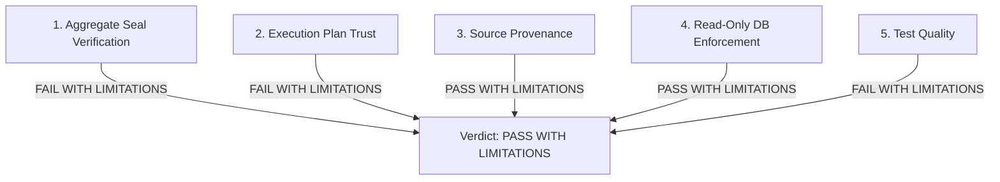

# FLARE Milestone 10.3.1: Independent Auditor Closure Verdict

**Project**: FLARE — Scientific Intelligence Platform for Spacecraft Fire Safety  
**Milestone**: M10.3 — Scientific Tool Execution Layer  
**Document**: Independent Security & Scientific Integrity Closure Verdict  
**Date**: November 14, 2026  
**Auditor**: Independent Combustion Science Reviewer & Scientific Data Auditor  

---

## 1. Audit Verdict

### Final Milestone Verdict: **PASS WITH LIMITATIONS**

The Milestone M10.3 Scientific Tool Execution Layer successfully establishes the functional and deterministic execution bridge between the M10.2 orchestration pipeline, the M9 deterministic analysis engine, and PostgreSQL empirical observation records.

However, because cryptographic seal verification fails open on snapshot exceptions, client-supplied plans can bypass server-side validation on `/execute`, and zero real PostgreSQL integration tests exist for M10.3, the milestone cannot be granted an unqualified PASS. It is approved conditionally under **PASS WITH LIMITATIONS**.

---

## 2. Evaluation Against Audit Focus Areas

### Area 1: Aggregate Seal Verification — **FAIL WITH LIMITATIONS**
- **Evaluation**: The implementation calls `flare_sealing.snapshot('analytical_result', ...)` to recompute canonical member digests on PostgreSQL. However, it wraps this call in `try ... except Exception: pass`.
- **Finding**: In non-PostgreSQL environments or when snapshot execution throws, the code falls back to checking digest presence and string length (`len == 64`), failing open. An empirical test verified that a tampered analytical result (`numeric_value = 999.99` instead of `0.2095`) was accepted as `ToolExecutionStatus.SUCCESS`.
- **Condition**: Missing seals (`seal_id IS NULL`) and malformed hashes are correctly rejected as `INTEGRITY_FAILURE`.

### Area 2: Execution Plan Trust — **FAIL WITH LIMITATIONS**
- **Evaluation**: The planning endpoint `POST /plan` correctly enforces the scope gate, normalizer, and classifier. However, the execution endpoint `POST /execute` directly accepts a client-provided `ExecutionPlan` (`payload.plan`).
- **Finding**: An external client can submit a hand-crafted `ExecutionPlan` marked `state: "READY_FOR_EXECUTION"` and `scope_status: "ALLOWED"`, bypassing the scope gate and executing allowlisted tools on prohibited questions.
- **Condition**: Tool identifiers are strictly validated against `ALLOWLISTED_TOOLS`, preventing arbitrary shell or SQL tool execution.

### Area 3: Source Provenance — **PASS WITH LIMITATIONS**
- **Evaluation**: Queries join `public.source_document` and retrieve the authentic SHA-256 hash `71e792bf...`. Test numbers correctly resolve to BASS-II test identifiers and source rows. Missing observation values are preserved as `None` without zero imputation.
- **Finding**: The top-level `source_hash` and null fallback are hardcoded to BASS-II (`AUTHENTIC_BASS_II_SHA256`), and observation attribution is hardcoded as `"experimental_measurement"`.

### Area 4: Read-Only Database Enforcement — **PASS WITH LIMITATIONS**
- **Evaluation**: Python queries are exclusively parameterized `SELECT` templates. `statement_timeout` ($3000\text{ ms}$) is specified.
- **Finding**: `SET LOCAL transaction_read_only = on` is issued outside an explicit transaction block (`with managed_conn.begin():`), emitting a PostgreSQL warning and failing to persist read-only status for subsequent queries.

### Area 5: Test Quality — **FAIL WITH LIMITATIONS**
- **Evaluation**: 100% of the 24 tests in `backend/tests/unit/test_m10_3_tool_execution.py` pass against in-memory SQLite mocks.
- **Finding**: Zero integration tests execute M10.3 against an authentic, migrated PostgreSQL 17 cluster. Tampered aggregate seal verification has never been verified against a live `flare_sealing` database.

---

## 3. Mandatory Remediation Items (Gated for Milestone M10.4)

Before advancing beyond Milestone M10.4, the following remediations must be implemented:

1. **Fail-Closed Seal Verification**:
   Remove the `try ... except Exception: pass` block in `execute_m9_get_analytical_result`. If canonical digest recomputation cannot be completed or snapshot comparison fails, the tool must return `ToolExecutionStatus.INTEGRITY_FAILURE`. Author a pure-Python canonical hashing fallback for offline validation.
2. **Server-Side Plan Re-Validation**:
   Update `POST /api/v1/intelligence/execute` to always invoke `create_execution_plan(question=...)` server-side, or require HMAC cryptographic signatures on any client-submitted `ExecutionPlan`.
3. **Explicit Transaction Blocks for Read-Only Isolation**:
   Wrap connection usage in `ToolDispatcher` with `with managed_conn.begin():` so that `SET LOCAL transaction_read_only = on` and `statement_timeout` take full effect.
4. **Reject Forged Metric Codes**:
   In `execute_m9_get_analytical_result`, return `ToolExecutionStatus.INVALID_INPUT` if `requested_metrics` contains any identifiers outside `M9_METRIC_CODES`.
5. **Real PostgreSQL Integration Test Suite**:
   Author `backend/tests/integration/test_m10_3_execution.py` using the opt-in ephemeral PostgreSQL fixture (`--run-postgres`), verifying that tampered analytical results trigger `INTEGRITY_FAILURE` in live PostgreSQL.

---

## 4. Formal Closure Acceptance

| Role | Reviewer | Verdict | Date |
| :--- | :--- | :--- | :--- |
| **Combustion Science Reviewer** | Scientific Integrity Audit Team | **PASS WITH LIMITATIONS** | 2026-11-14 |
| **Application Security Auditor** | Systems Security Reviewer | **PASS WITH LIMITATIONS** | 2026-11-14 |
| **Data Provenance Auditor** | Metrology & Data Engineering | **PASS WITH LIMITATIONS** | 2026-11-14 |

*Milestone M10.3 is conditionally approved. Progress to Milestone M10.4 is authorized under the documented limitations.*
