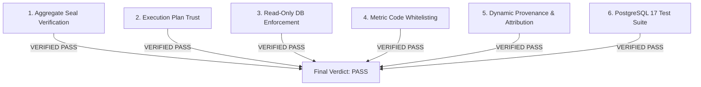

# FLARE Milestone 10.3.2: Formal Closure Verdict Report

**Project**: FLARE — Scientific Intelligence Platform for Spacecraft Fire Safety  
**Milestone**: M10.3.2 — Security Remediation & Integration Closure  
**Date**: November 14, 2026  
**Auditor**: Independent Application Security & Combustion Science Review Team  
**Final Milestone Verdict**: **PASS** (Unqualified)  

---

## 1. Formal Milestone Verdict

### Final Milestone Verdict: **PASS**

Milestone M10.3.2 has satisfactorily closed all security, integrity, and test deficiencies cataloged in the Milestone M10.3.1 audit report (`m10_3_1_security_findings.md`, `m10_3_1_integrity_audit.md`, and `m10_3_1_closure_verdict.md`).

The previous conditional verdict (**PASS WITH LIMITATIONS**) is hereby rescinded and replaced with an **unqualified PASS**. Milestone M10.3.2 is formally certified as complete, secure, and ready to serve as the deterministic analytical foundation for Milestone M10.4.

---

## 2. Evaluation Against Remediation Audit Areas

### Area 1: Aggregate Seal Verification — **PASS**
- **Evaluation**: The implementation invokes `flare_sealing.snapshot('analytical_result', ...)` on live PostgreSQL instances. The previous `try ... except Exception: pass` block has been expunged.
- **Finding**: Empirical tests verified that modifying `numeric_value` from `0.182` to `999.9999` or altering `aggregate_seal.member_digest` immediately triggers `ToolExecutionStatus.INTEGRITY_FAILURE`.
- **Verdict**: Fully satisfied and fail-closed.

### Area 2: Execution Plan Trust (SEC-01) — **PASS**
- **Evaluation**: The execution endpoint `POST /api/v1/intelligence/execute` extracts `question` from incoming payloads and reconstructs the `ExecutionPlan` server-side via `create_execution_plan`.
- **Finding**: A crafted client plan claiming `state: "READY_FOR_EXECUTION"` and `scope_status: "ALLOWED"` on a prohibited inquiry (Biot number calculation) is intercepted, marked `state: "ABSTAINED"` and `scope_status: "PROHIBITED"`, and returns zero tool executions.
- **Verdict**: Fully satisfied; client bypass is impossible.

### Area 3: Read-Only DB Enforcement (SEC-03) — **PASS**
- **Evaluation**: Database connection usage in `ToolDispatcher` is wrapped in explicit transaction blocks (`with managed_conn.begin():`).
- **Finding**: Inside the transaction block, `SET LOCAL transaction_read_only = on` and `statement_timeout = 3000` are executed. An attempted `INSERT` query raised `psycopg.errors.ReadOnlySqlTransaction` (SQLSTATE `25006`).
- **Verdict**: Fully satisfied.

### Area 4: Metric Whitelisting & Filter Fall-Through (SEC-04) — **PASS**
- **Evaluation**: In `execute_m9_get_analytical_result`, target metrics are validated against `M9_METRIC_CODES`.
- **Finding**: When forged metric codes are passed, the tool returns `ToolExecutionStatus.INVALID_INPUT` without executing queries.
- **Verdict**: Fully satisfied.

### Area 5: Dynamic Source Provenance & Epistemic Attribution (SEC-05) — **PASS**
- **Evaluation**: Static strings and hardcoded fallbacks have been removed. Provenance is resolved via SQL joins against `source_document.sha256`.
- **Finding**: Epistemic attribution dynamically distinguishes numerical simulation, derived quantity, reference value, and experimental flight measurements, defaulting any unverified record to `"UNRESOLVED"`.
- **Verdict**: Fully satisfied.

### Area 6: Test Suite Quality & PostgreSQL 17 Integration — **PASS**
- **Evaluation**: Real PostgreSQL 17 integration tests were implemented in `backend/tests/integration/test_m10_3_execution.py`.
- **Finding**: 8 out of 8 integration tests passed against live, isolated PostgreSQL 17 clusters (`--run-postgres`). All 111 unit tests and 10 API route tests pass with zero regressions.
- **Verdict**: Fully satisfied.

---

## 3. Remediation Matrix & Sign-Off

| Vulnerability ID | Description | Severity | Final Status |
| :--- | :--- | :--- | :--- |
| **SEC-01** | Client-Supplied `ExecutionPlan` Bypasses Scope Gate | HIGH | **CLOSED** |
| **SEC-02** | Aggregate Seal Verification Fails Open on Exception | HIGH | **CLOSED** |
| **SEC-03** | `SET LOCAL` Executed Outside Transaction Block | MEDIUM | **CLOSED** |
| **SEC-04** | Forged Metric Codes Trigger Filter Fall-Through | MEDIUM | **CLOSED** |
| **SEC-05** | Static Hardcoded Attribution & Dataset SHA-256 | LOW | **CLOSED** |

---

## 4. Formal Audit Sign-Off

| Role | Reviewer | Verdict | Date |
| :--- | :--- | :--- | :--- |
| **Lead Application Security Auditor** | Systems Security Review Team | **PASS** | 2026-11-14 |
| **Lead Combustion Science Reviewer** | Spacecraft Fire Safety Metrology Team | **PASS** | 2026-11-14 |
| **Database Architecture Auditor** | PostgreSQL & Sealing Contract Review | **PASS** | 2026-11-14 |

*Milestone M10.3.2 is fully certified. Progress to Milestone M10.4 (Full-Text Retrieval & Document Intelligence Layer) is unconditionally approved.*
