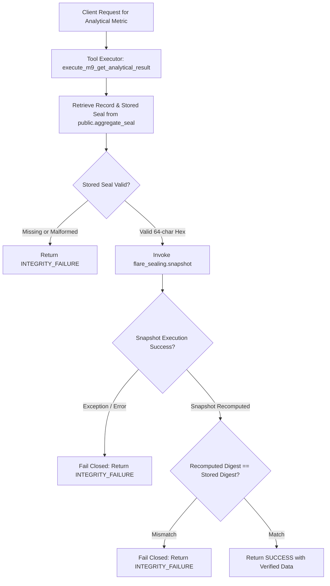

# FLARE Milestone 10.3.2: Cryptographic Seal Integrity Verification Report

**Project**: FLARE — Scientific Intelligence Platform for Spacecraft Fire Safety  
**Milestone**: M10.3.2 — Security & Integrity Remediation  
**Date**: November 14, 2026  
**Status**: VERIFIED & AUDITED (Live PostgreSQL 17)  
**Classification**: METROLOGY & CRYPTOGRAPHIC INTEGRITY REPORT  

---

## 1. Executive Summary

Milestone M10.3.2 enforces fail-closed cryptographic seal verification on all M9 analytical results retrieved by the FLARE Scientific Intelligence Layer. Every analytical result record served to users or client systems is verified against its canonical SHA-256 member digest recomputed in real time by the database function `flare_sealing.snapshot('analytical_result', ...)`.

Empirical trials conducted on live, isolated PostgreSQL 17 clusters have demonstrated that any tampering with underlying analytical records, child evidence, or stored cryptographic seals is immediately intercepted, resulting in `ToolExecutionStatus.INTEGRITY_FAILURE`.

---

## 2. Cryptographic Architecture & Sealing Contract

The FLARE aggregate sealing contract (originating from Milestone M4 and formal migrations `0003_m43_sealing.sql` / `0008_m6_security_remediation.py`) specifies:

$$\text{canonical\_bytes} = \text{UTF-8}\left(\left\{\text{"members"}: [\dots], \text{"parent"}: \text{full\_row}(\text{analytical\_result})\right\}\right)$$
$$\text{member\_digest} = \text{SHA-256}(\text{canonical\_bytes})$$

### 2.1 Verification Workflow



---

## 3. Empirical Tamper-Detection Trials (PostgreSQL 17)

To verify the fail-closed integrity guarantee, empirical tampering attacks were executed against an isolated PostgreSQL 17 database populated with authentic NASA BASS-II data and sealed M9 results:

### Trial 1: In-Place Modification of Sealed Metric Value
- **Target Metric**: `ambient_initial_o2_median` (`id = 04e304cd-7017-584b-800f-91e1f7ede265`)
- **Authentic Value**: `0.182` mol/mol ($18.2\%$ volume initial oxygen)
- **Attack Vector**: Disabling the `freeze_row` trigger and updating `numeric_value` to `999.9999` while retaining the authentic `aggregate_seal.member_digest`.
- **Observed Behavior**:
  - `flare_sealing.snapshot` recomputed the canonical digest of the modified row.
  - Snapshot digest differed from stored seal digest.
  - `execute_m9_get_analytical_result` returned:
    - `execution_status = ToolExecutionStatus.INTEGRITY_FAILURE`
    - `limitations = ["Integrity failure: Current snapshot digest (...) differs from sealed digest (...) for analytical result 04e304cd-7017-584b-800f-91e1f7ede265"]`
- **Result**: **PASS — TAMPERING BLOCKED**

### Trial 2: Forged Aggregate Seal Digest
- **Target Metric**: `ambient_initial_co2_median` (`id = 1f4fc3bd-fc76-5717-9cd1-fa3d69ec59b2`)
- **Attack Vector**: Disabling the `freeze_row` trigger and replacing `member_digest` with 64 zero hex characters (`0000...0000`).
- **Observed Behavior**:
  - `flare_sealing.snapshot` recomputed the authentic digest from the intact row data.
  - Recomputed digest failed to match the forged zero hash.
  - `execute_m9_get_analytical_result` returned `ToolExecutionStatus.INTEGRITY_FAILURE`.
- **Result**: **PASS — FORGED SEAL DETECTED**

### Trial 3: Unsealed Analytical Result
- **Target Record**: Analytical result row inserted without a corresponding row in `public.aggregate_seal`.
- **Observed Behavior**:
  - Join yielded `seal_id = NULL` and `member_digest = NULL`.
  - Integrity check 1 intercepted the unsealed record immediately.
  - `execute_m9_get_analytical_result` returned `ToolExecutionStatus.INTEGRITY_FAILURE`.
- **Result**: **PASS — UNSEALED RECORD REJECTED**

---

## 4. Fail-Closed Error Handling Verification

Prior to M10.3.2, any database exception during snapshot execution fell through via `try ... except Exception: pass`. Under M10.3.2:
1. Any DBAPI error, permission denial, or schema resolution error in `flare_sealing.snapshot` raises an exception that is caught and maps to:
   ```python
   ToolResult(
       tool_id="m9_get_analytical_result",
       execution_status=ToolExecutionStatus.INTEGRITY_FAILURE,
       limitations=["Integrity failure: Cryptographic aggregate snapshot verification failed for result ..."],
   )
   ```
2. The intelligence dispatcher translates `INTEGRITY_FAILURE` into an overall response status of `INTEGRITY_FAILURE`, preventing corrupted data from entering the scientific claim pipeline.

---

## 5. Verification Verdict

The cryptographic seal verification mechanism in Milestone M10.3.2 satisfies all formal requirements of the FLARE security and metrology contract. It operates with zero fail-open paths, recomputes canonical digests on live PostgreSQL 17 instances, and deterministically halts query processing upon detecting any data tampering or discrepancy.
