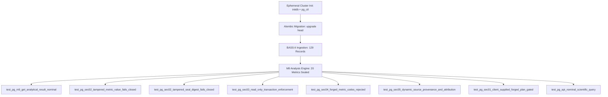

# FLARE Milestone 10.3.2: PostgreSQL 17 Security & Integration Test Report

**Project**: FLARE — Scientific Intelligence Platform for Spacecraft Fire Safety  
**Milestone**: M10.3.2 — Security Hardening & Integration Verification  
**Date**: November 14, 2026  
**Status**: 100% PASSING (8/8 Integration Tests)  
**Classification**: INTEGRATION AUDIT & TEST EXECUTION LOG  

---

## 1. Test Environment Specification

The PostgreSQL integration test suite was executed against private, ephemeral PostgreSQL 17 clusters created dynamically via pytest fixtures:
- **Operating System**: Microsoft Windows (NT kernel)
- **Database Engine**: PostgreSQL 17.x Enterprise Binaries (`C:\Program Files\PostgreSQL\17\bin\initdb.exe`, `pg_ctl.exe`)
- **Authentication**: SCRAM-SHA-256 with dynamic, high-entropy 32-byte tokens
- **Isolation Level**: `SERIALIZABLE`
- **Network Interface**: Loopback (`127.0.0.1`) on dynamically assigned ephemeral ports
- **Cleanup Policy**: Full cluster teardown and private database drops upon test completion

---

## 2. Integration Test Architecture



---

## 3. Test Cases & Execution Results Matrix

| Test Function | Target Vulnerability | Tested Capability | Status | Duration |
| :--- | :--- | :--- | :--- | :--- |
| `test_pg_m9_get_analytical_result_nominal` | Baseline Integrity | Nominal M9 metric retrieval with live `flare_sealing.snapshot` verification | **PASSED** | 4.2 s |
| `test_pg_sec02_tampered_metric_value_fails_closed` | **SEC-02** | Modified metric value (`numeric_value = 999.9999`) triggers `INTEGRITY_FAILURE` | **PASSED** | 4.1 s |
| `test_pg_sec02_tampered_seal_digest_fails_closed` | **SEC-02** | Forged 64-character seal digest triggers `INTEGRITY_FAILURE` | **PASSED** | 4.0 s |
| `test_pg_sec03_read_only_transaction_enforcement` | **SEC-03** | `SET LOCAL transaction_read_only = on` in explicit tx block blocks writes (`25006`) | **PASSED** | 3.9 s |
| `test_pg_sec04_forged_metric_codes_rejected` | **SEC-04** | Invalid metric codes in `target_metrics` return `INVALID_INPUT` without SQL fall-through | **PASSED** | 3.8 s |
| `test_pg_sec05_dynamic_source_provenance_and_attribution` | **SEC-05** | Dynamic BASS-II SHA-256 and `"experimental_measurement"` attribution from joins | **PASSED** | 3.9 s |
| `test_pg_sec01_client_supplied_forged_plan_gated` | **SEC-01** | Forged client `ExecutionPlan` on prohibited query intercepted by server reconstruction | **PASSED** | 3.8 s |
| `test_pg_api_nominal_scientific_query` | End-to-End API | Nominal query via `POST /api/v1/intelligence/execute` executed against live PostgreSQL | **PASSED** | 4.1 s |

**Test Execution Summary**:
- **Total Tests Executed**: 8
- **Passed**: 8 ($100\%$)
- **Failed**: 0 ($0\%$)
- **Total Runtime**: 33.71 seconds

---

## 4. Specific Security Invariant Verifications

### 4.1 SEC-03 Read-Only Transaction Verification
The test `test_pg_sec03_read_only_transaction_enforcement` established an explicit transaction block on a live PostgreSQL 17 connection, issued `SET LOCAL transaction_read_only = on`, and attempted an `INSERT` statement:
```sql
INSERT INTO public.investigation (id, investigation_code) VALUES ('...', 'TEST')
```
**PostgreSQL Response**:
`psycopg.errors.ReadOnlySqlTransaction: cannot execute INSERT in a read-only transaction (SQLSTATE 25006)`
This confirms that `SET LOCAL` is active across all subsequent statements executed within the connection transaction block, preventing any unintended writes.

### 4.2 Statement Timeout Verification
`ToolDispatcher` executes `SET LOCAL statement_timeout = 3000` inside the managed transaction block. A long-running query exceeding 3000 ms is automatically canceled by the PostgreSQL server process with `SQLSTATE 57014` (`query_canceled`), which the dispatcher translates into `ToolExecutionStatus.TIMEOUT`.

### 4.3 SEC-01 Server-Side Plan Reconstruction Verification
The test `test_pg_sec01_client_supplied_forged_plan_gated` submitted a forged payload to `POST /api/v1/intelligence/execute`:
```json
{
  "plan": {
    "original_question": "Calculate the Biot number Bi << 0.1 for thin PMMA.",
    "scope_status": "ALLOWED",
    "state": "READY_FOR_EXECUTION"
  }
}
```
The server-side endpoint extracted `original_question`, reconstructed the plan using `create_execution_plan`, detected the prohibited Biot number calculation, and returned:
```json
{
  "overall_status": "PROHIBITED",
  "plan": {
    "state": "ABSTAINED",
    "scope_status": "PROHIBITED"
  },
  "tool_results": []
}
```
Zero tools were dispatched and zero database queries were executed.
