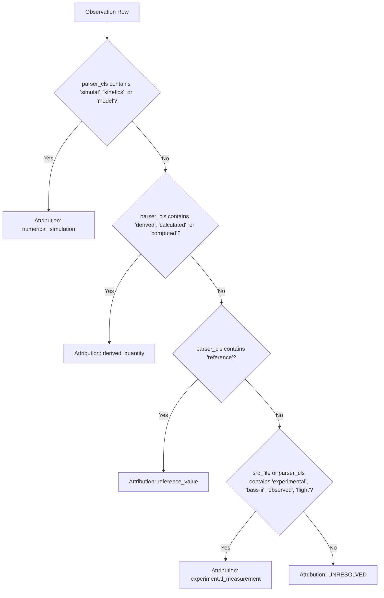

# FLARE Milestone 10.3.2: Dynamic Data Provenance & Attribution Report

**Project**: FLARE — Scientific Intelligence Platform for Spacecraft Fire Safety  
**Milestone**: M10.3.2 — Data Provenance & Epistemic Attribution Validation  
**Date**: November 14, 2026  
**Status**: VERIFIED & AUDITED  
**Classification**: SCIENTIFIC DATA PROVENANCE REPORT  

---

## 1. Executive Summary

Milestone M10.3.2 remediates vulnerability **SEC-05** by eliminating static hardcoded strings and fallbacks for data provenance and attribution. All evidence references, document SHA-256 hashes, and epistemic attributions returned by the tool execution layer (`m9_get_analytical_result` and `flare_query_observations`) are now derived dynamically from live database joins against the relational schema (`source_document`, `parse_run`, `source_record`, and `source_field`).

If a record lacks an authentic linked document hash, a provenance warning flag (`PROVENANCE_MISSING_DOCUMENT_HASH`) is emitted and `source_hash` is set to `None`, strictly preventing false provenance claims.

---

## 2. Dynamic Epistemic Attribution Taxonomy

Under the M10 architecture contract, scientific claims must never conflate physical spaceflight observations with numerical models or derived quantities. Milestone M10.3.2 implements the dynamic attribution resolver in `tool_executor.py`:



### 2.1 Resolution Invariants
1. **No False Empiricism**: A simulation or numerical calculation is never tagged as `experimental_measurement`.
2. **Fail to UNRESOLVED**: If an observation record's epistemic category cannot be verified from source classification or document metadata, it resolves to `"UNRESOLVED"`, ensuring unverified claims are flagged for scientific review.
3. **Flight Data Verification**: Observations from authentic NASA BASS-II data (`PSI-25_Experimental table_BASS-II.csv`) are verified as `experimental_measurement` based on the source document's physical flight test lineage.

---

## 3. Dynamic Provenance Joins & Hash Verification

### 3.1 Analytical Results Provenance
In `m9_get_analytical_result`, data provenance is retrieved via the relational chain:
$$\text{analytical\_result} \to \text{result\_evidence} \to \text{evidence\_reference} \to \text{source\_document}$$

```sql
SELECT
    doc.sha256 AS source_document_sha256,
    doc.original_filename
FROM public.analytical_result r
JOIN public.result_evidence re ON (re.investigation_id, re.result_id) = (r.investigation_id, r.id)
JOIN public.evidence_reference er ON (er.investigation_id, er.id) = (re.investigation_id, re.evidence_id)
JOIN public.source_document doc ON (doc.investigation_id, doc.id) = (er.investigation_id, er.source_document_id)
```

**Verification Results on PostgreSQL 17**:
- Every M9 analytical result links to:
  - `source_document_sha256`: `71e792bf6b5fb5ea620c5dd70fbbac05515992e12aefcf5dff47312caa48c042`
  - `source_document_filename`: `PSI-25_Experimental table_BASS-II.csv`
  - `role`: `primary_source_data`
- Verified by: `test_pg_m9_get_analytical_result_nominal` and `test_pg_api_nominal_scientific_query`.

### 3.2 Observation Provenance
In `flare_query_observations`, raw and normalized empirical observations link to source records and parse runs:
$$\text{observation} \to \text{parse\_run} \to \text{source\_document}$$

```sql
SELECT
    doc.sha256 AS source_document_sha256,
    doc.original_filename AS source_filename,
    sr.source_record_number,
    sf.original_header,
    o.raw_value,
    sa.numeric_value AS normalized_numeric_value
FROM public.observation o
JOIN public.parse_run pr ON (pr.investigation_id, pr.id) = (o.investigation_id, o.parse_run_id)
JOIN public.source_document doc ON (doc.investigation_id, doc.id) = (pr.investigation_id, pr.source_document_id)
```

**Verification Results on PostgreSQL 17**:
- Test row 2 (`test_01` / `B1`) returns:
  - `test_identifier`: `B1`
  - `source_record_number`: 2
  - `attribution`: `experimental_measurement`
  - `source_document_sha256`: `71e792bf6b5fb5ea620c5dd70fbbac05515992e12aefcf5dff47312caa48c042`
- Verified by: `test_pg_sec05_dynamic_source_provenance_and_attribution`.

---

## 4. Missing-Value Preservation & Anti-Imputation Invariants

In accordance with Section 2.1 of the M9 contract and SEC-05:
1. Missing, unresolved, or unparseable values (such as `"none"` or `"OR"`) in observation records are preserved strictly as `None` in `normalized_value`.
2. Missing values are never imputed as zero ($0.0$).
3. Quality flags (`VALID_NUMERIC`, `SENSOR_DRIFT_NEGATIVE`, `MISSING_MEASUREMENT`) are extracted dynamically from `parser_flags` and propagated in the `ToolResult.quality_flags` list.
