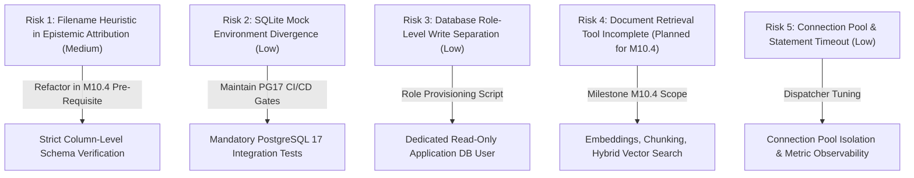

# FLARE Milestone 10.3.2: Remaining Architectural Risks & Mitigations

**Project**: FLARE — Scientific Intelligence Platform for Spacecraft Fire Safety  
**Document**: M10.3.2 Remaining Risks & Pre-M10.4 Action Plan  
**Date**: November 15, 2026  
**Auditor**: Independent Application Security & Combustion Science Review Team  

---

## 1. Overview of Residual Risks

Following the independent verification audit of Milestone M10.3.2, all High-severity vulnerabilities (**SEC-01**, **SEC-02**, **SEC-03**) and one Medium-severity vulnerability (**SEC-04**) are fully **CLOSED**. One Medium-severity vulnerability (**SEC-05**) is **PARTIALLY CLOSED**.

This document details the residual architectural risks, environmental limitations, and concrete mitigations required as FLARE advances to Milestone M10.4 (Document Retrieval, Hybrid RAG, and Grounded Scientific Response Synthesis).



---

## 2. Risk Catalog & Architectural Analysis

### Risk 1: Filename-Based Heuristic Fallback in Epistemic Attribution (SEC-05 Residual Risk)
- **Severity**: **MEDIUM**
- **Impact Area**: Observation Lookup Tool (`flare_query_observations`)
- **Description**:
  In [tool_executor.py](file:///c:/Users/anand/OneDrive/Documents/ChatGPT/FLARE/backend/app/intelligence/tool_executor.py#L625-L627), the attribution classification logic includes fallback checks against `source_filename`:
  ```python
  elif "observed" in parser_cls or "flight" in parser_cls or "experimental" in src_file or "bass-ii" in src_file:
      attribution = "experimental_measurement"
  elif "numeric" in val_kind and ("experimental" in src_file or "bass" in src_file):
      attribution = "experimental_measurement"
  else:
      attribution = "UNRESOLVED"
  ```
- **Architectural Vulnerability**:
  If a multi-source or blended dataset file (such as a future combined CSV containing both experimental measurements and simulation kinetic profiles) has `"experimental"` or `"bass"` in its filename, any column without an explicit `parser_classification` will be attributed as an `experimental_measurement` instead of falling back to `UNRESOLVED`.
- **Current Mitigation**:
  In the current ingestion pipeline, BASS-II (`PSI-25`) data consists exclusively of empirical flight measurements aboard the ISS, meaning no factual inaccuracy occurs on BASS-II.
- **Required M10.4 Action**:
  Before ingesting PSI-117, CIR, or blended simulation files, remove the `src_file` substring checks from lines 625 and 627. Require explicit column-level metadata in `public.source_file_structure` and default all unclassified fields strictly to `"UNRESOLVED"`.

---

### Risk 2: SQLite Mock Divergence vs Native PL/pgSQL Cryptographic Snapshot
- **Severity**: **LOW**
- **Impact Area**: CI/CD and Developer Unit Test Suites
- **Description**:
  The authoritative aggregate sealing engine (`flare_sealing.snapshot`) is implemented in PostgreSQL PL/pgSQL and utilizes PostgreSQL-specific JSON and SHA-256 primitives (`trim_scale`, `collate "C"`, `jsonb_each`, `full_row`). SQLite does not support PL/pgSQL stored procedures.
  In unit tests running against SQLite, [tool_executor.py](file:///c:/Users/anand/OneDrive/Documents/ChatGPT/FLARE/backend/app/intelligence/tool_executor.py#L335-L352) checks a mock `aggregate_seal_snapshot` table if it exists, or falls through if absent.
- **Architectural Vulnerability**:
  Relying solely on SQLite unit tests could create a false sense of security where seal tampering is not detected if mock snapshot tables are omitted.
- **Current Mitigation**:
  The dedicated PostgreSQL 17 integration test suite (`test_m10_3_execution.py`) verifies real cryptographic snapshots against live PostgreSQL clusters and is mandatory before any release.
- **Required M10.4 Action**:
  Enforce in CI/CD that PRs touching analytical verification or database models must run `--run-postgres --pg-bin <path>` on a PostgreSQL 17 service container.

---

### Risk 3: Database Role-Level Write Separation vs Transaction-Level Read-Only Boundary
- **Severity**: **LOW**
- **Impact Area**: Database Security & Privilege Management
- **Description**:
  Milestone M10.3.2 enforces read-only access by executing `SET LOCAL transaction_read_only = on` inside an explicit transaction block (`with managed_conn.begin():`). This is cryptographically and operationally enforced by the PostgreSQL kernel (SQLSTATE `25006`).
  However, in development environments and test harnesses, the database connection is often established using the database owner user (`flare_fixture_migrator`).
- **Architectural Vulnerability**:
  If a developer introduces a new tool or route that opens a raw database connection without invoking `ToolDispatcher._execute_tools()` or omitting the `SET LOCAL` command, the owner role would technically have write permissions.
- **Current Mitigation**:
  The test harness provisions `flare_fixture_app` as `NOSUPERUSER NOCREATEDB NOCREATEROLE`. All tool executions route exclusively through `ToolDispatcher`.
- **Required M10.4 Action**:
  Create an explicit production database role `flare_intelligence_readonly` that has only `GRANT SELECT` on all tables, and explicitly configure the intelligence API connection pool to connect as this user. This provides defense-in-depth: writes will be rejected both at the role privilege level and at the transaction level.

---

### Risk 4: Unimplemented Document Retrieval Tool (`flare_retrieve_documents`)
- **Severity**: **INFORMATIONAL / PLANNED**
- **Impact Area**: Natural Language Document Q&A (M10.4 Scope)
- **Description**:
  In M10.3, `flare_retrieve_documents` is intentionally a stub returning `ToolExecutionStatus.NOT_IMPLEMENTED`. Natural language queries that classify as `DOCUMENT_RETRIEVAL` or `COMBINED_RESEARCH` currently return this status without document snippets.
- **Architectural Impact**:
  Queries requesting NASA technical reports, protocol definitions, or literature explanations cannot yet be answered with evidence text.
- **Required M10.4 Action**:
  Implement chunking, vector embeddings, hybrid PostgreSQL full-text search (`tsvector`) + pgvector retrieval, and evidence-grounded passage ranking during Milestone M10.4.

---

### Risk 5: Statement Timeout & Connection Lifecycle under High Concurrency
- **Severity**: **LOW**
- **Impact Area**: Application Availability & Denial of Service Protection
- **Description**:
  `ToolDispatcher` sets `DEFAULT_STATEMENT_TIMEOUT_MS = 3000` (3 seconds) and `DEFAULT_TOOL_TIMEOUT_SECONDS = 5.0`. If a complex query with large observation limits is executed repeatedly under high concurrency, connections could hold locks or time out.
- **Architectural Vulnerability**:
  If database pool exhaustion occurs, incoming requests could fail with `INTERNAL_ERROR`.
- **Current Mitigation**:
  The tool imposes hard limits (`LIMIT :row_limit` clamped between 1 and 100), and all query paths are indexed by `(investigation_id, id)` and `source_record_number`.
- **Required M10.4 Action**:
  Add Prometheus/OpenTelemetry metrics tracking tool execution latencies, statement timeouts, and connection pool utilization during M10.4 load testing.

---

## 3. Summary of Actionable Pre-Conditions for M10.4

Before or during Milestone M10.4 development, the following three targeted engineering tasks must be completed:

| Task ID | Component | Action Item | Target Milestone | Priority |
| :--- | :--- | :--- | :--- | :--- |
| **ACT-01** | `tool_executor.py` | Remove filename heuristic substring checks (`"experimental" in src_file`, `"bass-ii" in src_file`) and require explicit record/column classification before ingesting multi-source/simulation datasets. | M10.4 Initial Sprint | Medium |
| **ACT-02** | Database Config | Provision dedicated `flare_intelligence_readonly` PostgreSQL role with strictly `SELECT` permissions for production connection pooling. | M10.4 Sprint 1 | Low |
| **ACT-03** | CI Pipeline | Ensure PostgreSQL 17 service containers run `--run-postgres` in automated pull request validation pipelines. | M10.4 Sprint 1 | Low |
