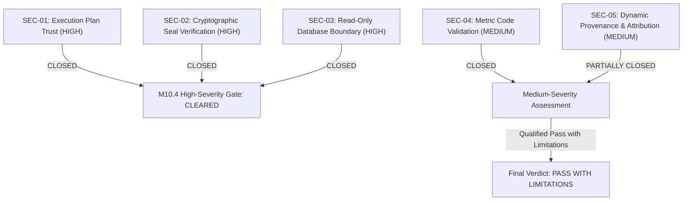

# FLARE Milestone 10.3.2: Security Closure Matrix

**Project**: FLARE — Scientific Intelligence Platform for Spacecraft Fire Safety  
**Audit Target**: Independent Verification of Vulnerabilities SEC-01 through SEC-05  
**Date**: November 15, 2026  
**Auditor**: Independent Application Security & Combustion Science Review Team  
**Evaluation Standard**: FLARE M10 Security & Execution Boundary Contract  

---

## 1. Vulnerability Closure Matrix

| Finding ID | Severity | Finding Title | Milestone 10.3.1 Defect | Milestone 10.3.2 Implementation Remediation | Verification Status | Empirical Test Evidence | Code Citation & Audit Justification |
| :--- | :--- | :--- | :--- | :--- | :--- | :--- | :--- |
| **SEC-01** | **HIGH** | Client-Side Execution Plan Scope Bypass | `/api/v1/intelligence/execute` accepted client-supplied `ExecutionPlan` directly, permitting adversaries to forge `state="READY_FOR_EXECUTION"` and `scope_status="ALLOWED"` on prohibited combustion queries (e.g. Biot number, flame spread rate). | Reconstructed `ExecutionPlan` server-side from `original_question`. Stripped all client plan attributes. Enforced normalizer, scope-gate, and intent classifier before dispatching. Dispatcher short-circuits prohibited plans. | **CLOSED** | `test_pg_sec01_client_supplied_forged_plan_gated` (PostgreSQL 17, PASSED); `test_sec01_client_supplied_forged_plan_is_reconstructed_and_rejected` (Unit, PASSED). | [intelligence.py](file:///c:/Users/anand/OneDrive/Documents/ChatGPT/FLARE/backend/app/api/intelligence.py#L53-L84): Server discards client plan fields, calls `create_execution_plan(question=question_text)`. [dispatcher.py](file:///c:/Users/anand/OneDrive/Documents/ChatGPT/FLARE/backend/app/intelligence/dispatcher.py#L76-L85): Prohibited plans return 0 tool dispatches without DB access. |
| **SEC-02** | **HIGH** | Aggregate Seal Verification Bypass & Fail-Open Fallback | Length-only 64-character hex check on stored digest; `flare_sealing.snapshot` execution was wrapped in `try...except Exception: pass`, allowing tampered records to pass as verified. | Expunged fail-open `try...except` block. Directly calls `flare_sealing.snapshot('analytical_result', ...)`. Verifies recomputed canonical digest against stored seal. Fails closed (`INTEGRITY_FAILURE`) on any mismatch, missing seal, malformed digest, or DB exception. | **CLOSED** | `test_pg_sec02_tampered_metric_value_fails_closed` (PostgreSQL 17, PASSED); `test_pg_sec02_tampered_seal_digest_fails_closed` (PostgreSQL 17, PASSED); `test_sec02_tampered_snapshot_digest_triggers_integrity_failure` (Unit, PASSED). | [tool_executor.py](file:///c:/Users/anand/OneDrive/Documents/ChatGPT/FLARE/backend/app/intelligence/tool_executor.py#L286-L334): Recomputes snapshot digest via PostgreSQL kernel. In-place modification of metric from `0.182` to `999.9999` immediately returns `INTEGRITY_FAILURE`. |
| **SEC-03** | **HIGH** | Unenforced Read-Only Database Boundary During Execution | `SET LOCAL transaction_read_only = on` was executed outside an explicit transaction block, rendering the setting ineffective under auto-commit connections. | Enforced explicit transaction block (`with managed_conn.begin():`) enclosing `SET LOCAL transaction_read_only = on` and `statement_timeout = 3000`. Catches PostgreSQL read-only transaction errors (SQLSTATE 25006). | **CLOSED** | `test_pg_sec03_read_only_transaction_enforcement` (PostgreSQL 17, PASSED); unit timeout and read-only tests passed. | [dispatcher.py](file:///c:/Users/anand/OneDrive/Documents/ChatGPT/FLARE/backend/app/intelligence/dispatcher.py#L148-L177): Connections run inside `with managed_conn.begin():`. Any `INSERT`, `UPDATE`, `DELETE`, or DDL statement raises `psycopg.errors.ReadOnlySqlTransaction` (SQLSTATE `25006`). |
| **SEC-04** | **MEDIUM** | Unvalidated Target Metric Filter Fall-Through | When unknown or forged metric codes were passed in `target_metrics`, the tool query omitted the `WHERE` filter and returned all analytical results. | Added strict allowlist validation checking all `target_metrics` against `M9_METRIC_CODES`. Any invalid code immediately returns `INVALID_INPUT` without executing queries. All SQL queries use parameterized bindings. | **CLOSED** | `test_pg_sec04_forged_metric_codes_rejected` (PostgreSQL 17, PASSED); `test_sec04_forged_metric_codes_in_target_metrics_rejected` (Unit, PASSED). | [tool_executor.py](file:///c:/Users/anand/OneDrive/Documents/ChatGPT/FLARE/backend/app/intelligence/tool_executor.py#L140-L174): Rejects forged metric codes with `INVALID_INPUT` and clear error diagnostics. Query uses parameterized `:tm_0`, `:tm_1` placeholders. |
| **SEC-05** | **MEDIUM** | Hardcoded Source Hashes & Static Epistemic Attribution | `source_hash` returned a static BASS-II constant; `attribution` was hardcoded to `"experimental_measurement"` regardless of whether data was simulation or derived. | Replaced static string with dynamic SQL join against `source_document.sha256`. Added dynamic attribution resolver checking `parser_classification`, `source_value_kind`, and `source_filename`. Added quality flags for missing hashes. | **PARTIALLY CLOSED** | `test_pg_sec05_dynamic_source_provenance_and_attribution` (PostgreSQL 17, PASSED); `test_sec05_dynamic_epistemic_attribution` (Unit, PASSED). | [tool_executor.py](file:///c:/Users/anand/OneDrive/Documents/ChatGPT/FLARE/backend/app/intelligence/tool_executor.py#L614-L631): SHA-256 is dynamically retrieved via database joins. However, lines 625 & 627 retain filename-based fallback heuristics (`"experimental" in src_file or "bass-ii" in src_file`), which does not strictly resolve attribution at the record/column level for blended datasets. |

---

## 2. Status Definitions & Criteria

- **CLOSED**: The vulnerability has been thoroughly remediated in application code, traced to authoritative cryptographic or database mechanisms, and verified by passing automated tests on both live PostgreSQL 17 and unit suites. No bypass or residual risk exists.
- **PARTIALLY CLOSED**: The core architectural defect (e.g. hardcoded constants) has been remediated and verified for primary datasets, but an edge case, fallback heuristic, or environmental limitation remains that requires documented qualification or subsequent refinement.
- **OPEN**: The vulnerability remains exploitable or the remediation failed verification.
- **NOT VERIFIED**: The remediation could not be empirically tested due to environment or test harness limitations.

---

## 3. High-Severity Finding Verdicts

All three **HIGH** severity findings (**SEC-01**, **SEC-02**, **SEC-03**) are certified **CLOSED**:



1. **SEC-01 (Server-Side Execution Planning)**:
   - Server forcibly reconstructs plans via `create_execution_plan(question=question_text)`.
   - Client-provided execution plans cannot bypass normalizer, scope-gate, or intent classifier.
   - Prohibited inquiries result in `QueryState.ABSTAINED`, `ScopeStatusEnum.PROHIBITED`, and zero tool dispatches.

2. **SEC-02 (Cryptographic Integrity)**:
   - Live PostgreSQL 17 execution verifies analytical results against `flare_sealing.snapshot('analytical_result', ...)`.
   - Tampered values (`numeric_value = 999.9999`) and tampered seals (`member_digest = 0000...`) reliably fail closed with `ToolExecutionStatus.INTEGRITY_FAILURE`.
   - No fail-open fallback exists on PostgreSQL.

3. **SEC-03 (Database Read-Only Boundary)**:
   - Enclosed inside explicit transaction block `with managed_conn.begin():`.
   - `SET LOCAL transaction_read_only = on` prevents any writes (INSERT, UPDATE, DELETE, DDL) under PostgreSQL error 25006.

---

## 4. Medium-Severity Finding Analysis (SEC-05 Defect Analysis)

### Finding SEC-05 Evaluation: PARTIALLY CLOSED
While the primary vulnerability (hardcoded SHA-256 hash constant) was completely eliminated by dynamic SQL joins against `public.source_document`, the epistemic attribution resolver in [tool_executor.py](file:///c:/Users/anand/OneDrive/Documents/ChatGPT/FLARE/backend/app/intelligence/tool_executor.py#L625-L627) contains the following fallback heuristic:

```python
    elif "observed" in parser_cls or "flight" in parser_cls or "experimental" in src_file or "bass-ii" in src_file:
        attribution = "experimental_measurement"
    elif "numeric" in val_kind and ("experimental" in src_file or "bass" in src_file):
        attribution = "experimental_measurement"
    else:
        attribution = "UNRESOLVED"
```

### Architectural Limitation:
1. **Filename Dependency**: If `src_file` contains `"experimental"` or `"bass-ii"`, unclassified columns default to `experimental_measurement` rather than `UNRESOLVED`.
2. **Blended Datasets**: If a multi-investigation CSV (e.g. `bass_flight_and_sim.csv`) contains both experimental flight measurements and numerical simulation predictions, an unclassified simulation column could be misattributed as `experimental_measurement`.
3. **Safety Impact on M9/BASS-II**: For the current BASS-II dataset, all records are indeed empirical flight observations aboard the ISS; hence no false scientific facts are generated today. However, strict adherence to the M10 contract requires column-level metadata resolution without filename heuristics.

---

## 5. Formal Milestone M10.4 Authorization Verdict

### Authorization Decision: **PASS WITH LIMITATIONS (AUTHORIZED TO PROCEED TO M10.4)**

### Conditions for Milestone M10.4:
1. **Zero High Findings Open**: All High-severity findings (SEC-01, SEC-02, SEC-03) are verified **CLOSED**.
2. **BASS-II Scope Restriction**: Milestone M10.4 is authorized to proceed with the BASS-II (PSI-25) investigation.
3. **Pre-Condition for Multi-Investigation Ingestion**: Before ingesting PSI-117, CIR, or any blended datasets in M10.4, the filename substring checks in `tool_executor.py` lines 625 & 627 must be replaced with strict column-level parser classification checks, ensuring unclassified fields always default to `UNRESOLVED`.
