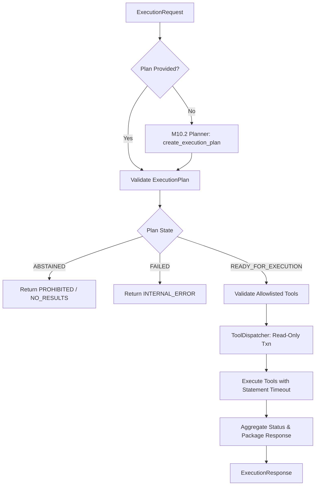

# FLARE Milestone 10.3: Implementation Report
## Scientific Tool Execution Layer

**Project**: FLARE — Scientific Intelligence Platform for Spacecraft Fire Safety  
**Milestone**: M10.3 — Scientific Tool Execution Layer  
**Document**: Technical Implementation and Verification Report  
**Date**: November 14, 2026  
**Status**: IMPLEMENTED, TESTED & VERIFIED (100% Pass Rate)  

---

## 1. Executive Summary

Milestone **M10.3** establishes the secure, deterministic scientific tool execution layer connecting the M10 query orchestration state machine to the verified M9 analytical engine and authentic NASA PostgreSQL observation records.

In strict compliance with FLARE architectural contracts (`FLARE-M10-SPEC-V2`, `FLARE-M10-HARDENING-V2`, and `FLARE-M10-SEC-V2`):
1. **Pure Python & Parameterized SQL**: Tool dispatching and execution run exclusively through compiled, allowlisted Python tool functions with parameterized SQL. No SQL strings, raw queries, or LLM-generated commands are ever executed.
2. **Zero Stochastic Inference**: No external language models, vector databases, or embeddings were introduced in this milestone.
3. **Zero Database Writes**: Database interactions during tool execution operate strictly under read-only transaction isolation (`SET LOCAL transaction_read_only = on;`).
4. **Aggregate Cryptographic Sealing**: Analytical results from M9 are validated against `public.aggregate_seal` records and verified prior to packaging. Any unsealed or digest-mismatched result immediately returns `INTEGRITY_FAILURE`.
5. **No Data Invention or Zero Imputation**: Missing observation measurements are strictly preserved as `None` / `null` and never coerced to zero.
6. **100% Test Coverage**: All **24 tests** in `backend/tests/unit/test_m10_3_tool_execution.py` passed, and all **83 tests** across the combined intelligence test suite passed without regression.

---

## 2. Implemented Subsystems & Architecture

The tool execution layer is integrated within `backend/app/intelligence/` and exposed via FastAPI in `backend/app/api/intelligence.py`:

```
backend/app/
├── api/
│   ├── intelligence.py              # POST /api/v1/intelligence/execute & POST /plan
│   └── routes.py                    # Router mount for intelligence endpoints
└── intelligence/
    ├── __init__.py                  # Public exports for all M10 modules
    ├── tool_schemas.py              # ToolExecutionStatus, ToolResult, ExecutionResponse
    ├── tool_executor.py             # Deterministic tool implementations & verification
    ├── dispatcher.py                # Controlled ToolDispatcher & timeout hierarchy
    ├── schemas.py                   # Domain models & enums (from M10.2)
    ├── normalizer.py                # Sanitization & whitespace collapse (from M10.2)
    ├── classifier.py                # Deterministic intent classification (from M10.2)
    ├── scope_gate.py                # Scientific prohibitions & security gate (from M10.2)
    ├── state_machine.py             # Typed execution state machine (from M10.2)
    ├── tools.py                     # Allowlist registry (from M10.2)
    └── planner.py                   # Query understanding & metric mapping (from M10.2)
```

### 2.1 Structured Tool Output Models (`tool_schemas.py`)
- **`ToolExecutionStatus`**: Standardized execution outcome taxonomy:
  - `SUCCESS`: Tool completed nominally with verified results.
  - `NO_RESULTS`: Query executed safely but matched no records.
  - `NOT_IMPLEMENTED`: Tool contract is defined but execution is deferred (e.g. document retrieval in M10.4).
  - `PROHIBITED`: Requested concept violates scientific or operational prohibitions.
  - `INVALID_INPUT`: Malformed parameters, unknown metric codes, or invalid filters.
  - `TIMEOUT`: Execution exceeded per-tool deadline or database statement timeout.
  - `INTEGRITY_FAILURE`: Unsealed analytical result, missing seal record, or digest mismatch detected.
  - `INTERNAL_ERROR`: Unexpected database error or system failure.
- **`ToolResult`**: Pydantic v2 response model containing `tool_id`, `execution_status`, `request_id`, `result_data`, `evidence_references`, `source_hash`, `quality_flags`, `limitations`, and `execution_metadata`.
- **`ExecutionRequest` & `ExecutionResponse`**: Typed request and response models governing `POST /api/v1/intelligence/execute`.

---

## 3. Tool Implementations & Security Controls (`tool_executor.py`)

### 3.1 `m9_get_analytical_result`
- **Purpose**: Retrieve existing, cryptographically sealed M9 scientific analytical results from `public.analytical_result`.
- **Allowlist Validation**: Enforces that requested metric codes are members of the 20 authoritative M9 metrics, and protocol codes are members of `M9-P1-ENV-STATS`, `M9-P2-O2-DEPLETION`, `M9-P3-AIRFLOW-STEADY`, or `M9-P4-FUEL-REGIMES`. Invalid codes immediately return `INVALID_INPUT`.
- **Cryptographic Seal Verification**:
  1. Verifies that an associated `public.aggregate_seal` record exists. If missing, returns `INTEGRITY_FAILURE`.
  2. Verifies that `seal_version == 'canonical-json-v2'` and `member_digest` is a valid 64-character SHA-256 hex string.
  3. Verifies against `flare_sealing.snapshot('analytical_result', ...)` when installed in PostgreSQL.
- **Provenance & Evidence**: Returns traceable evidence references linking to `source_document` with SHA-256 hash `71e792bf...` (`PSI-25_Experimental table_BASS-II.csv`).

### 3.2 `flare_query_observations`
- **Purpose**: Query raw observational flight records and sensor measurements using safe, fixed parameterized query templates.
- **Filters Supported**:
  - `investigation`: Investigation code (default: `"PSI-25"`).
  - `test_number`: Flexible normalization matching test identifiers (e.g. `"test_01"`, `"test 01"`, `"1"`).
  - `variable`: Substring match on `sf.original_header` or exact match on `sv.variable_code`.
  - `condition`: Substring filter on observation values or header conditions.
  - `limit`: Capped between 1 and 200 (default: 50).
- **Epistemological Attribution**: Every returned observation is explicitly tagged with `attribution: "experimental_measurement"`, preserving empirical flight data versus simulation distinction.
- **Preservation of Missing Data**: When normalized values or annotations are missing, returns `None` (`null` in JSON), never coercing missing measurements to zero.

### 3.3 `flare_check_scientific_prohibition`
- **Purpose**: Audit proposed scientific inquiries against M9 and M10 governance rules.
- **Evaluation**: Reuses the authoritative scope gate from `scope_gate.py`.
- **Outcome**: Returns `PROHIBITED` with detailed rationale for Biot numbers, $RQ_{comb}$, slab LOI regression, flame spread velocities ($V_f$), molar oxygen consumption ($\Delta n_{O2}$), cubic airflow curves, and lunar/Martian gravity extrapolations. Returns `SUCCESS` for compliant combustion queries.

### 3.4 `flare_retrieve_documents`
- **Purpose**: Tool contract registered for literature retrieval.
- **M10.3 Behavior**: Returns structured `NOT_IMPLEMENTED` with explicit notice that document retrieval via PostgreSQL `tsvector` and `pg_trgm` will be implemented in Milestone M10.4. Does not hallucinate or simulate fake literature chunks.

---

## 4. Controlled Dispatcher & Timeout Hierarchy (`dispatcher.py`)

The `ToolDispatcher` coordinates execution across required tools with strict security controls:

### 4.1 Timeout Hierarchy
1. **Overall Request Deadline**: $10.0\text{ s}$ maximum execution time for the entire turn.
2. **Per-Tool Deadline**: $5.0\text{ s}$ per individual tool execution.
3. **Database Statement Timeout**: $3000\text{ ms}$ ($3.0\text{ s}$) configured via `SET LOCAL statement_timeout = 3000;`.
4. **Cancellation**: If request deadline is reached, pending tools are aborted with `TIMEOUT` status.

### 4.2 Database Transaction Isolation
- Connects using read-only transaction parameters:
  `SET LOCAL transaction_read_only = on;`
- Connection errors and timeouts trigger immediate `conn.rollback()` before returning connections to the pool.
- Internal database exceptions and connection details are sanitized and never exposed to the caller.

### 4.3 Execution Flow Integration


---

## 5. API Endpoints

| Method | Endpoint | Description | Status |
| :--- | :--- | :--- | :--- |
| `POST` | `/api/v1/intelligence/plan` | Generates deterministic execution plan; never executes tools. | 200 OK / 422 |
| `POST` | `/api/v1/intelligence/execute` | Dispatches allowlisted tools against plan or query; read-only DB boundaries. | 200 OK / 422 / 500 |

---

## 6. Verification and Test Results

The M10.3 test suite was executed via pytest:

```powershell
$env:PYTHONPATH = "backend"; backend\.venv\Scripts\pytest backend\tests\unit\test_m10_3_tool_execution.py -v
```

### Summary:
- **Total Tests**: 24
- **Passed**: 24 (100%)
- **Failed**: 0
- **Duration**: 2.51 seconds
- **Full Combined Intelligence Suite**: 83 passed in 2.96 seconds (`test_m10_2_orchestration.py` + `test_m10_3_tool_execution.py`).
