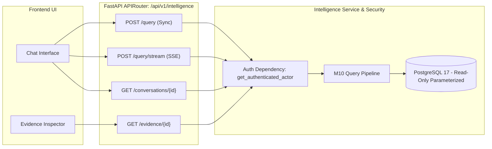

# FLARE Milestone 10: Scientific Intelligence API Design

**Project**: FLARE — Scientific Intelligence Platform for Spacecraft Fire Safety  
**Milestone**: M10 — Evidence-Grounded Scientific Intelligence Layer  
**Document**: FastAPI Endpoint Specifications, Request/Response Schemas, and Auth Architecture  
**Version**: 2.0.0 (Hardened Metrological Design)  
**Status**: DESIGN & SPECIFICATION ONLY  

---

## 1. API Architecture Overview

The Scientific Intelligence API is implemented as a dedicated FastAPI router mounted under `/api/v1/intelligence`. It bridges frontend scientific workspaces with the M10 Query Execution Pipeline, providing both synchronous and streaming (Server-Sent Events) interfaces.



---

## 2. Endpoint Specifications

### 2.1 `POST /api/v1/intelligence/query`
- **Description**: Executes a natural language scientific query synchronously and returns the complete grounded answer, verified citation links, deterministic metric cards, and scientific limitations.
- **Request Headers**:
  - `Content-Type: application/json`
  - `Authorization: Bearer <token>` (enforced when `AUTH_ENABLED=true`)
- **Status Codes**:
  - `200 OK`: Successful query execution or structured scientific abstention.
  - `400 Bad Request`: Malformed query payload.
  - `401 Unauthorized`: Missing or invalid credentials (in authenticated mode).
  - `403 Forbidden`: Insufficient role permissions.
  - `422 Unprocessable Entity`: Prohibited query syntax or schema violation.
  - `503 Service Unavailable`: Database or deterministic engine offline.

---

### 2.2 `POST /api/v1/intelligence/query/stream` (Buffered SSE Streaming)
- **Description**: Streams the execution lifecycle in real time via Server-Sent Events (SSE). 
- **CRITICAL SAFETY INVARIANT**: Unvalidated LLM text tokens are **never** streamed to the client. Real-time streaming is used exclusively for progress indicators. Narrative text is generated into an internal buffer, verified against M9 outputs via the Structured Scientific Claim Validation Gate, and streamed only after passing 100% verification.
- **Content-Type**: `text/event-stream`
- **Event Lifecycle Stream**:
  1. `event: status`: `{"phase": "PLANNING", "message": "Analyzing query intent..."}`
  2. `event: tool_call`: `{"tool": "m9_get_analytical_result", "metric": "ambient_initial_o2_median"}`
  3. `event: tool_result`: `{"tool": "m9_get_analytical_result", "status": "SEALED", "value": "0.182 mol/mol"}`
  4. `event: status`: `{"phase": "VALIDATING_CLAIMS", "message": "Validating scientific claims against M9 sealed outputs..."}`
  5. *(Internal Gate: All claims validated)*
  6. `event: delta`: `{"text": "Based on "}`
  7. `event: delta`: `{"text": "NASA BASS-II flight data..."}`
  8. `event: result_cards`: `[<ScientificResultCard JSON>]`
  9. `event: complete`: `{"query_id": "...", "duration_ms": 642}`
- **Fallback on Validation Failure**:
  If any claim fails validation, `event: delta` is **suppressed**. The stream emits:
  1. `event: warning`: `{"message": "Narrative suppressed due to unanchored numerical assertions."}`
  2. `event: result_cards`: Authenticated M9 result cards only.
  3. `event: complete`

---

### 2.3 `GET /api/v1/intelligence/conversations/{id}`
- **Description**: Retrieves prior turn history, evidence attachments, and result cards for an ongoing scientific research thread.

---

### 2.4 `GET /api/v1/intelligence/evidence/{id}`
- **Description**: Retrieves granular inspection details for a cited piece of evidence, including its parent `source_document`, original SHA-256 digest, raw tabular row/cell coordinates, and cryptographic aggregate seal verification status.

---

## 3. Pydantic v2 Request & Response Schemas

```python
from datetime import datetime
from decimal import Decimal
from enum import Enum
from typing import Any, Literal
from uuid import UUID
from pydantic import BaseModel, Field

from app.schemas.claims import EvidenceType, EpistemicStatus, ScientificClaim

class IntelligenceQueryRequest(BaseModel):
    query: str = Field(..., min_length=3, max_length=1000, description="Scientific question in natural language.")
    investigation_filter: str | None = Field(default="PSI-25", description="Target investigation code.")
    conversation_id: UUID | None = Field(default=None, description="Active session thread ID.")
    allow_simulation_data: bool = Field(default=False, description="Whether to include NS (numerical simulation) results.")

class CitationReference(BaseModel):
    uri: str  # e.g. "flare:result:M9-P1-ENV-STATS:ambient_initial_o2_median"
    evidence_type: EvidenceType
    epistemic_status: EpistemicStatus
    title: str
    source_filename: str
    source_sha256: str
    location: str  # e.g. "Row 2", "Page 14, Section 3"
    snippet: str
    cryptographic_seal: str | None = None

class ScientificResultCard(BaseModel):
    card_id: UUID
    metric_code: str
    canonical_name: str
    numeric_value: str | None  # Decimal string representation
    canonical_unit: str | None
    source_value: str | None
    source_unit: str | None
    sample_size: int
    confidence_interval_95: dict[str, Any] | None = None
    quality_flags: list[str] = Field(default_factory=list)
    limitations: list[str] = Field(default_factory=list)
    chart_hint: Literal["none", "boxplot", "histogram", "range_bar"] = "none"

class LimitationNotice(BaseModel):
    category: str  # e.g. "UNVENTED_CHAMBER_ACCUMULATION", "HOT_WIRE_SENSOR_LAG"
    severity: Literal["blocking", "warning", "informational"]
    statement: str
    physical_rationale: str

class IntelligenceQueryResponse(BaseModel):
    query_id: UUID
    conversation_id: UUID
    status: Literal["completed", "abstained", "failed"]
    answer_markdown: str
    validated_claims: list[ScientificClaim]
    citations: list[CitationReference]
    result_cards: list[ScientificResultCard]
    limitations: list[LimitationNotice]
    prohibitions_enforced: list[str]
    execution_duration_ms: int
    created_at: datetime
```

---

## 4. Security, Parameterized Access & Execution Safeguards

### 4.1 Actual Audit Findings & Missing Controls
The audit verified that the current repository has **no authentication, password hashing, or role models**. M10 establishes the following security controls:

1. **Authentication Dependency (`get_authenticated_actor`)**:
   - In development: `AUTH_ENABLED=false` defaults actor to `"development_researcher"`.
   - In production: `AUTH_ENABLED=true` validates Bearer JWT tokens with signed claims.
2. **Strict Read-Only Parameterized SQL**:
   - All database queries execute with `SET TRANSACTION READ ONLY`.
   - Prepared statements with typed parameters only (`text("...").bindparams(...)`).
   - Arbitrary SQL generation by the LLM is **strictly prohibited**.
3. **Execution Resource Limits**:
   - Hard statement timeout: `SET statement_timeout = 5000` (5,000 ms).
   - Maximum tabular row limit: `MAX_ROWS = 50`.
   - Per-tool timeout: 3,000 ms; maximum 5 tool calls per turn.
4. **Structured Audit Logging**:
   Every query execution records `query_id`, `actor_ref`, `tools_invoked`, `claims_validated`, `execution_latency_ms`, and `cryptographic_seals_verified`.
