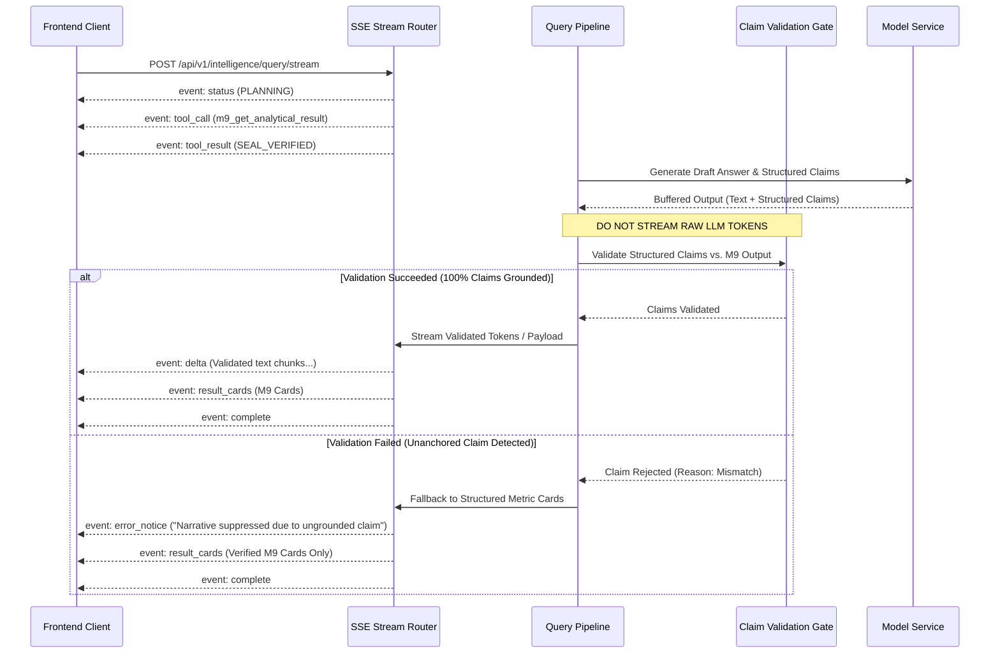

# FLARE Milestone 10: Architecture Hardening & Metrological Audit Review

**Project**: FLARE — Scientific Intelligence Platform for Spacecraft Fire Safety  
**Investigation**: NASA PSI-25 / BASS-II and Microgravity Combustion Research  
**Document**: M10 Architecture Hardening Review & Metrological Remediation  
**Author**: Independent Senior Scientific Data Architect & PostgreSQL Database Engineer  
**Date**: November 14, 2026  
**Status**: APPROVED HARDENING SPECIFICATION  

---

## 1. Executive Summary & Review Scope

Following an in-depth architectural and environmental audit of the initial Milestone 10 design deliverables, seven critical technical, metrological, and operational deficiencies were identified. 

This review establishes the hardened specifications and design corrections required to transition Milestone 10 into an **airtight, verifiable, and safety-compliant scientific intelligence layer**.

### 1.1 Summary of Remediated Findings

| Area | Initial Design Deficiency | Hardened Architectural Resolution |
| :--- | :--- | :--- |
| **1. Numerical Claim Validation** | Relied on post-generation regular expressions to verify numbers in generated narrative text. | **Replaced with Structured Scientific Claim Objects**. Claims are typed, structured payloads extracted and validated against deterministic M9 outputs before narrative rendering. |
| **2. Evidence Taxonomy** | Conflated `UNRESOLVED` as an evidence type alongside `EM`, `NS`, `DQ`, `RT`. | **Separated Evidence Type from Epistemic Status**. Retained `EM`, `NS`, `DQ`, `RT` as evidence types; introduced `SUPPORTED`, `DISPUTED`, `UNRESOLVED`, `HYPOTHESIS` as orthogonal epistemic statuses. |
| **3. PostgreSQL Retrieval** | Assumed `pgvector` was installed and conflated full-text search with vector search. | **Verified Environment: `pgvector` is NOT installed**. Vector search is made strictly conditional/optional. Native `tsvector` BM25 full-text search and `pg_trgm` are established as primary. |
| **4. Security & Permissions** | Assumed existing RBAC and user authorization infrastructure. | **Audited Actual Codebase: Auth does not exist**. Documented exact missing controls; specified allowlisted tool calling, read-only parameterized SQL, statement timeouts, and audit logging. Arbitrary SQL generation is strictly prohibited. |
| **5. Real-Time Streaming Safety** | Proposed streaming unvalidated LLM answer tokens over Server-Sent Events (SSE). | **Buffered Answer Validation Gate**. SSE streams progress events only; narrative answer tokens are buffered until all claims and citations pass validation. |
| **6. Operational Boundaries** | Did not explicitly differentiate ground research from spacecraft flight software. | **Formal Deployment Boundary Definition**. M10 is defined as a ground-based research/planning platform, explicitly not certified for autonomous onboard spacecraft safety control. |
| **7. Scientific Prohibitions** | Risk of LLM overriding M9 sample eligibility and scientific exclusions. | **Strict Invariant Inheritance**. M10 cannot alter M9 partitions, recalculate Biot numbers, or extrapolate microgravity data to Lunar/Martian environments. |

---

## 2. Remediation 1: Structured Scientific Claim Validation

### 2.1 The Inadequacy of Regex-Based Post-Verification
The initial architecture proposed using regex token extraction to match numbers in generated text against tool execution payloads. In combustion metrology, this approach fails under common scientific scenarios:
1. **Semantic Misattribution**: A model might output *"Initial O2 was 0.4% and final O2 depletion was 18.2%"*. Both numbers ($0.4\%$ and $18.2\%$) exist in M9 results, so regex matching would falsely pass, despite the quantities being completely inverted!
2. **Unit & Scale Blindness**: A regex matching `0.182` cannot detect whether the model reported `0.182 mol/mol`, `0.182 %`, or `0.182 ppm`.
3. **Range & Bound Confusion**: A model citing $[0.175, 0.188]$ could misrepresent this 95% order-statistic confidence interval as a min-max experimental range or instrumental sensor error.

### 2.2 The Structured Claim Architecture
The pipeline now enforces a two-stage **Extract-Validate-Synthesize** workflow:
1. **Structured Claim Extraction**: The LLM emits or returns a typed array of `ScientificClaim` objects specifying:
   - `subject_variable`: e.g. `ambient_initial_o2_median`
   - `claimed_value`: Exact `Decimal` value
   - `claimed_unit`: e.g. `mol/mol`
   - `metric_identifier`: Standardized M9 protocol metric code
   - `evidence_references`: List of stable URI pointers
   - `uncertainty_claimed`: CI or bounds
2. **Deterministic Claim Validation**: A pure-Python validation engine verifies each claim against the cryptographically sealed M9 database record.
3. **Synthesis from Validated Claims**: The final narrative text is synthesized **exclusively** from claims that passed validation. Unsupported or disputed claims are explicitly rejected or converted into structured limitation notices.

---

## 3. Remediation 2: Disentangling Evidence Type from Epistemic Status

### 3.1 Orthogonal Epistemic Model
In scientific epistemology, **how data was collected** (its physical origin) is orthogonal to **how well-verified the claim is** (its truth/verification status):
- An Experimental Measurement (`EM`) can be `DISPUTED` if sensor calibration failed or operator notes conflict with recorded data.
- A Derived Quantity (`DQ`) can be `UNRESOLVED` if boundary conditions are missing.
- A proposed flame extinction mechanism is an `EM`-grounded `HYPOTHESIS`.

### 3.2 Standardized Definitions
- **Evidence Types** (Physical Origin):
  - `EM`: Direct transducer or optical measurement.
  - `NS`: Numerical simulation of differential governing equations.
  - `DQ`: Deterministic reduction from measurements.
  - `RT`: Reference standard, certified gas bottle, or nominal dimension.
- **Epistemic Status** (Verification Quality):
  - `SUPPORTED`: Validated by cryptographically sealed M9 results or verified flight telemetry.
  - `DISPUTED`: Conflicting data exists (e.g. sensor drift vs. operator log).
  - `UNRESOLVED`: Documentation is insufficient to determine accuracy or mounting geometry.
  - `HYPOTHESIS`: Theoretical conjecture or extrapolated physical mechanism.

---

## 4. Remediation 3: PostgreSQL Environment Reality & Retrieval Architecture

### 4.1 Environmental Verification
An inspection of `C:\Program Files\PostgreSQL\17\share\extension\` confirmed:
```text
Available Extensions:
amcheck, btree_gin, btree_gist, citext, cube, dblink, dict_int, dict_xsyn,
earthdistance, file_fdw, fuzzystrmatch, hstore, intarray, isn, ltree,
pageinspect, pgcrypto, pg_stat_statements, pg_trgm, unaccent, uuid-ossp, xml2
```
**`vector.control` / `pgvector` IS NOT PRESENT.**

### 4.2 Retrieval Strategy Separation
1. **Full-Text Literature Search (Standard & Unconditional)**:
   - Uses native PostgreSQL `tsvector` with English dictionary stemming and GIN indexing on document chunks.
   - Uses `pg_trgm` (which **is** installed) for fuzzy keyword matching, acronym resolution, and typo tolerance.
2. **Vector Similarity Search (Conditional / Optional Feature Flag)**:
   - Encapsulated behind `enable_vector_search: bool = False` in application configuration.
   - If `pgvector` is absent, the system operates in **Full-Text BM25 + Structured Relational Mode** with zero performance degradation for structured scientific queries.
3. **Structured Parameterized SQL Access**:
   - Every observation query uses prepared statements with typed parameters.
   - Strict resource limits: `SET statement_timeout = 5000` (5s), `MAX_ROWS = 50`.

---

## 5. Remediation 4: Security Posture & Prohibiting Arbitrary SQL

### 5.1 Audit of Existing Codebase
- **Authentication**: `backend/app` currently has **NO user authentication, password hashing, or JWT infrastructure**. All existing endpoints are open development routes.
- **Authorization**: There are **NO RBAC roles** in the existing schema or services.
- **Existing Strengths**: Identity code validation in `services/identity.py`, origin CORS validation in `config.py`, and cryptographic aggregate sealing triggers in PostgreSQL.

### 5.2 Hardened Security Controls for M10
1. **Total Prohibition of LLM-Generated SQL**: The model is NEVER permitted to write or execute arbitrary SQL. All database operations are strictly encapsulated within hardcoded, allowlisted Python tool functions.
2. **Read-Only Database Connections**: All connections allocated to the intelligence service execute with `SET TRANSACTION READ ONLY`.
3. **Allowlisted Tool Execution**: The orchestrator only dispatches tool calls that match pre-registered Pydantic schemas.
4. **Execution Timeouts & Rate Limiting**: Per-tool execution timeout is capped at 3,000 ms. Maximum 5 tool calls per query.
5. **Structured Audit Logging**: Every query, tool execution, parameter payload, execution latency, and seal verification digest is logged to an immutable audit ledger.

---

## 6. Remediation 5: Real-Time Streaming Safety via Buffered Answer Validation



---

## 7. Remediation 6: Spacecraft Flight Software vs. Ground Research Boundary

```text
+-------------------------------------------------------------------------------+
|                       OPERATIONAL DEPLOYMENT BOUNDARY                         |
+-------------------------------------------------------------------------------+
|                                                                               |
|   FLARE Milestone 10 is strictly a GROUND-BASED SCIENTIFIC RESEARCH           |
|   AND MISSION PLANNING PLATFORM.                                              |
|                                                                               |
|   It is NOT flight-certified software (DO-178C / NASA-STD-8739.8).           |
|   It is NOT qualified for autonomous spacecraft fire detection, suppression   |
|   triggering, life-support atmospheric venting, or emergency response.        |
|                                                                               |
|   Any flight operations application requires independent ground-truth         |
|   validation by certified human safety officers and flight control teams.     |
+-------------------------------------------------------------------------------+
```

---

## 8. Remediation 7: Preserving M9 Scientific Invariants

The M10 layer is explicitly forbidden from modifying or bypassing M9 eligibility criteria:
1. **P1 Gas Statistics**: 13 negative CO sensor drift records ($-1, -2, -3\text{ ppm}$) must remain signed and unclamped.
2. **P2 Oxygen Depletion**: The 5 quarantined gross anomalies ($|\Delta X| > 19\%$) and 2 missing tests cannot be included in depletion statistics.
3. **P3 Calibrated Airflow**: Only the 24 steady scalar runs ($Air \in [2.0, 15.0]\text{ cm/s}$) can be mapped to linear duct velocities. The 100 dynamic potentiometer sequences remain excluded due to sensor lag.
4. **P4 Morphology**: Specimens cannot be classified into Biot regimes ($Bi \ll 0.1$ or $Bi \gg 1.0$). 107 virgin burns and 22 re-burns must be tracked separately.
5. **Explicit Prohibitions**: $RQ_{comb}$, slab LOI logistic regression, flame spread velocities ($V_f$), absolute molar consumption ($\Delta n_{O2}$), and partial-gravity extrapolations remain strictly non-computable.
