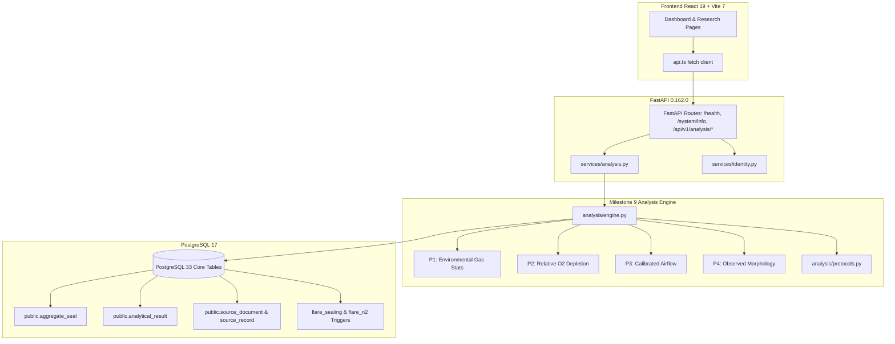

# FLARE Milestone 10: Evidence-Grounded Scientific Intelligence Layer Architecture Specification

**Project**: FLARE — Scientific Intelligence Platform for Spacecraft Fire Safety  
**Investigation Context**: NASA PSI-25 / BASS-II, CIR, MSG, and Cygnus Saffire Flight Campaigns  
**Document**: M10 System Architecture Specification  
**Version**: 2.0.0 (Hardened Metrological Design)  
**Status**: DESIGN & SPECIFICATION ONLY (Read-Only Repository Posture)  

---

## 1. Executive Overview & Core Philosophy

The primary objective of Milestone 10 (M10) is to construct an **Evidence-Grounded Scientific Intelligence Layer** that enables combustion scientists, spacecraft safety engineers, and mission operators to interrogate microgravity fire safety datasets, NASA experimental findings, and deterministic analyses using natural language.

### 1.1 The Cardinal Axiom of FLARE Intelligence
```text
+-------------------------------------------------------------------------------+
|                             THE CARDINAL AXIOM                                |
|                                                                               |
|   Large Language Models (LLMs) synthesize, explain, and contextualize.        |
|   Deterministic Engines (M9) calculate, partition, and quantify.              |
|                                                                               |
|   The LLM must NEVER independently perform arithmetic, interpolate, or invent  |
|   scientific quantities. Every number, statistical bound, and material       |
|   classification MUST originate from deterministic, traceable tools.           |
+-------------------------------------------------------------------------------+
```

Unlike generic conversational RAG systems, FLARE operates in a safety-critical domain where hallucinated flammability limits, misidentified microgravity convective velocities, or conflated simulation runs could lead to catastrophic spacecraft design vulnerabilities. M10 establishes an epistemologically segregated architecture where **all numerical assertions must be validated as structured claim objects backed by cryptographically sealed M9 analytical results or direct NASA flight observations**.

---

## 2. Baseline Repository & Architecture Inspection Findings



### 2.1 Backend Architecture
- **Framework**: FastAPI `0.162.0`, Starlette `1.10.0`, Pydantic `2.14.2`, SQLAlchemy `2.0.57`, psycopg `3.3.8`, Python `3.12.8`.
- **Modularity**: Clean separation between [backend/app/api/](file:///c:/Users/anand/OneDrive/Documents/ChatGPT/FLARE/backend/app/api/), [backend/app/services/](file:///c:/Users/anand/OneDrive/Documents/ChatGPT/FLARE/backend/app/services/), [backend/app/analysis/](file:///c:/Users/anand/OneDrive/Documents/ChatGPT/FLARE/backend/app/analysis/), and [backend/app/db/](file:///c:/Users/anand/OneDrive/Documents/ChatGPT/FLARE/backend/app/db/).
- **Actual Security Audit**: The codebase currently has **no user authentication, password hashing, or role models**. Existing routes are unauthenticated development endpoints. All database interactions in M10 must use strict read-only parameterized SQL with prepared statements.

### 2.2 Frontend Architecture
- **Framework**: React `19.0.0`, Vite `7.0.0`, Tailwind CSS `4.0.0`, Lucide React `0.468.0`, React Router `7.0.0`.
- **Existing Workspaces**: [App.tsx](file:///c:/Users/anand/OneDrive/Documents/ChatGPT/FLARE/frontend/src/App.tsx) defines `/`, `/experiments`, `/compare`, `/evidence`, `/research-gaps`, and `/settings`. Currently, these views display `EmptyState` cards awaiting evidence indexing and query capabilities.

### 2.3 Deterministic M9 Analysis Modules & APIs
- **Modules**:
  - `M9-P1-ENV-STATS`: Ambient $O_2$ median ($0.182\text{ mol/mol}$), $CO_2$ ($0.0041\text{ mol/mol}$), $CO$ ($5.5\ \mu\text{mol/mol}$); negative sensor drift preserved signed.
  - `M9-P2-O2-DEPLETION`: Relative oxygen depletion partitioned into non-negative ($N=117$, median $0.0040\text{ mol/mol}$, $\Pi_{O2} = 0.01935$), positive ($N=93$), signed drift ($N=5$), quarantined ($N=5$), and missing ($N=2$).
  - `M9-P3-AIRFLOW-STEADY`: NASA SPICE linear calibration ($U = 1.0066 \times \text{Air}$); 24 steady scalar runs ($0.020132$ to $0.150990\text{ m/s}$); 100 dynamic potentiometer sequences excluded.
  - `M9-P4-FUEL-REGIMES`: 10 morphological regimes across 129 runs; 107 unique specimens (87 single burn, 20 repeated burns); 107 first burns, 22 re-burns; Biot numbers completely expunged.
- **Persistence & Sealing**: Outputs persisted in `analytical_result` and sealed with `flare_sealing.seal()` (`canonical-json-v2` SHA-256 digests) with database immutability triggers.

### 2.4 NASA Source Document Registry & PostgreSQL Reality
- **33 Core Tables** in [backend/app/models/scientific.py](file:///c:/Users/anand/OneDrive/Documents/ChatGPT/FLARE/backend/app/models/scientific.py), including `source_document`, `evidence_reference`, `source_record`, `experimental_test`, `experimental_condition`, `observation`, `scientific_variable`, and `analytical_result`.
- **PostgreSQL Extension Audit**: Environmental inspection confirmed that **`pgvector` is NOT installed** in PostgreSQL 17. Literature search relies unconditionally on native `tsvector` with English dictionary stemming, GIN indexing, and `pg_trgm` for fuzzy keyword matching. Vector similarity search is treated as a strictly conditional, optional feature flag.

### 2.5 M9 Unresolved Scientific Limitations
The M10 layer must strictly inherit and respect all unresolved limitations documented in [m9_unresolved_limitations.md](file:///c:/Users/anand/OneDrive/Documents/ChatGPT/FLARE/m9_unresolved_limitations.md) and [m9_final_closure_verdict.md](file:///c:/Users/anand/OneDrive/Documents/ChatGPT/FLARE/m9_final_closure_verdict.md):
1. $RQ_{comb}$ is deferred (division-by-zero on 24 zero-depletion runs).
2. Dynamic airflow sequences are excluded from static flow regressions (60s sensor lag).
3. Biot numbers are expunged (heat transfer coefficients unmeasured in flight).
4. Slabs LOI logistic regression is prohibited (20:0 class balance).
5. Pseudoreplication: Virgin specimens ($N=107$) share unvented chamber gas buildup ($CO \le 950\text{ ppm}$, $CO_2 \le 1.9\%$).
6. Flame spread rate ($V_f$) and absolute molar consumption ($\Delta n_{O2}$) are prohibited.
7. ISS microgravity evidence cannot be extrapolated to Lunar/Martian gravity or universal fire risk.

---

## 3. High-Level Layered Architecture

The Evidence-Grounded Scientific Intelligence Layer is structured into four distinct, strictly decoupled tiers:

```mermaid
flowchart TD
    subgraph PresentationTier [1. Presentation Tier (React 19 Frontend)]
        NLQ[Natural Language Scientific Query Bar]
        AnswerView[Evidence-Grounded Answer Canvas]
        CardsView[Deterministic Metric Cards & Charts]
        CitationDrawer[Slide-Over Evidence Inspector]
    end

    subgraph OrchestrationTier [2. Intelligence Orchestration Tier (FastAPI Service)]
        QU[Query Understanding & Intent Classifier]
        Plan[Execution Planner & Tool Dispatcher]
        ClaimGate[Structured Scientific Claim Validation Gate]
        Synth[Validated Narrative Synthesizer]
    end

    subgraph ToolTier [3. Deterministic Tool & Retrieval Tier]
        M9Bridge[M9 Deterministic Tool Bridge]
        SQLRetriever[PostgreSQL Parameterized SQL Engine]
        DocRetriever[PostgreSQL tsvector / GIN Literature Search]
        LimitationFilter[Scientific Guardrail & Eligibility Filter]
    end

    subgraph StorageTier [4. Cryptographic Storage & Engine Tier]
        M9Core[M9 Pure Python Engine (P1, P2, P3, P4)]
        PG[(PostgreSQL 17 Database)]
        RawFiles[Authenticated NASA Source Documents]
        Seals[flare_sealing Cryptographic Ledger]
    end

    NLQ --> QU
    QU --> Plan
    Plan --> M9Bridge
    Plan --> SQLRetriever
    Plan --> DocRetriever
    M9Bridge --> LimitationFilter
    SQLRetriever --> LimitationFilter
    DocRetriever --> LimitationFilter
    LimitationFilter --> ClaimGate
    ClaimGate --> Synth
    Synth --> AnswerView
    Synth --> CardsView
    Synth --> CitationDrawer

    M9Bridge --> M9Core
    M9Bridge --> PG
    SQLRetriever --> PG
    DocRetriever --> PG
    DocRetriever --> RawFiles
    M9Core --> Seals
```

---

## 4. The Four Core Intelligence Components

### 4.1 Component A: Query Understanding & Intent Classification
The Query Understanding module inspects incoming user queries and decomposes them into structured, machine-verifiable analytical intents.

- **Key Responsibilities**:
  1. **Intent Classification**: Categorize the query into one or more operational modes:
     - `NUMERICAL_ANALYSIS`: Requires deterministic statistical calculation (e.g. "What was the median oxygen depletion in BASS-II?").
     - `EXPERIMENTAL_EXPLORATION`: Requires querying raw observation records (e.g. "Which tests burned Nomex III fabric?").
     - `DOCUMENT_RETRIEVAL`: Requires extracting technical explanations from NASA papers or FAQs (e.g. "Why does the BASS-II hot-wire anemometer have a 60-second lag?").
     - `HYBRID_SYNTHESIS`: Combines document explanation with verified numerical data.
     - `UNSUPPORTED_OR_AMBIGUOUS`: Identifies queries violating scientific scope (e.g. "Predict fire risk on Mars" or "What is the Biot number of B1?").
  2. **Entity & Variable Extraction**:
     - Standardized Variables: `initial_o2`, `final_o2`, `airflow_velocity`, `initial_co`, etc.
     - Investigation Names: `PSI-25`, `BASS-II`, `Saffire`, `PSI-117`.
     - Materials: `PMMA rods`, `Thin PMMA films`, `Nomex III`, `SIBAL fabric`, `Candle wax`.
     - Primary Investigators: `Olson`, `Fernandez-Pello`, `Bhattacharjee`, `Tien`, `Miller`, `Ferkul`.
  3. **Scope Guardrail Check**: Pre-screen for prohibited concepts (Biot numbers, $RQ_{comb}$, Martian gravity, probabilistic fire risk) and immediately route to structured abstention / limitation explanation.

### 4.2 Component B: Scientific Tool Orchestrator
The Scientific Tool Orchestrator serves as the execution coordinator. It interacts with the deterministic M9 engine and database queries, ensuring the LLM is never invoked to execute mathematical algorithms.

- **Allowlisted Tool Interfaces**:
  1. `m9_get_analytical_result(metric_code, protocol_code)`: Retrieves cryptographically sealed analytical metrics from `public.analytical_result`.
  2. `flare_query_observations(investigation_code, test_ids, pi_filter, fuel_material_pattern, limit)`: Queries raw observations from `public.source_record` with preserved signed values.
  3. `flare_retrieve_documents(query, investigation_code, epistemological_filter, top_k)`: Executes full-text search across NASA technical papers and metadata via native `tsvector` and `pg_trgm`.
  4. `flare_check_scientific_prohibition(concept)`: Verifies concept validity against FLARE's prohibition registry.
- **Execution Constraints**: Arbitrary SQL generation is strictly prohibited. Per-tool timeout is 3,000 ms.

### 4.3 Component C: Evidence Retrieval Engine
The Evidence Retrieval Engine retrieves supporting facts from PostgreSQL and authentic NASA document repositories using an orthogonal evidence taxonomy:

- **Evidence Types (Physical Origin)**:
  - `EM`: Experimental Measurement (e.g. sensor telemetry).
  - `NS`: Numerical Simulation (e.g. CFD/CHEMKIN kinetic models; requires `[SIMULATION]` tag).
  - `DQ`: Derived Quantity (e.g. burning rate $K$).
  - `RT`: Reference / Theoretical Value (e.g. bottle calibration gas).
- **Epistemic Status (Verification Quality)**:
  - `SUPPORTED`: Validated by sealed M9 results or verified telemetry.
  - `DISPUTED`: Conflicting observations exist.
  - `UNRESOLVED`: Incomplete or ambiguous documentation.
  - `HYPOTHESIS`: Theoretical conjecture.
- **Stable Resolvable Identifiers**:
  - `flare:result:<protocol_code>:<metric_code>`
  - `flare:row:<source_sha256>:<csv_record_number>`
  - `flare:doc:<source_sha256>[:page=<p>][:sec=<s>]`
  - `flare:test:<investigation_code>:<test_id>`

### 4.4 Component D: Answer Generation & Structured Claim Validation Gate
The Answer Generation component enforces deterministic claim verification:

- **Core Synthesis Rules**:
  1. **Structured Claims Representation**: The model emits typed `ScientificClaim` objects detailing numerical values, units, metric identifiers, uncertainty bounds, and evidence links.
  2. **Deterministic Claim Validation**: A pure-Python validator verifies every claim against sealed M9 results before rendering narrative text.
  3. **Narrative Generation Invariant**: Final user-facing markdown narrative is assembled **exclusively** from claims with `validation_status == 'VALIDATED'`.
  4. **Buffered Streaming Safety**: Real-time SSE streaming delivers progress events only. Narrative text is buffered internally until claim validation passes, completely preventing ungrounded tokens from reaching the user.

---

## 5. Security & Operational Boundaries

1. **Terrestrial Research Scope**: FLARE M10 is designed exclusively as an Evidence-Grounded Decision-Support Platform for ground-based combustion research and mission safety planning.
2. **Non-Flight-Certified Disclaimer**: FLARE M10 is NOT flight-certified software (DO-178C / NASA-STD-8739.8). It must NEVER be integrated into closed-loop fire suppression triggers or autonomous spacecraft life-support safety interlocks.
3. **Read-Only Database Enforcement**: All database connections execute with `SET TRANSACTION READ ONLY` and prepared statements. Statement timeout is capped at 5,000 ms.

---

## 6. Component Interface Contracts Summary

The detailed specifications for each sub-system are expanded in the accompanying milestone deliverables:
- **Hardening Audit Review**: [m10_architecture_hardening_review.md](file:///c:/Users/anand/OneDrive/Documents/ChatGPT/FLARE/m10_architecture_hardening_review.md)
- **Structured Claim Contract**: [m10_structured_claim_validation_contract.md](file:///c:/Users/anand/OneDrive/Documents/ChatGPT/FLARE/m10_structured_claim_validation_contract.md)
- **Security & Execution Boundaries**: [m10_security_and_execution_boundary.md](file:///c:/Users/anand/OneDrive/Documents/ChatGPT/FLARE/m10_security_and_execution_boundary.md)
- **Query Flow & Orchestration**: [m10_query_execution_flow.md](file:///c:/Users/anand/OneDrive/Documents/ChatGPT/FLARE/m10_query_execution_flow.md)
- **Evidence & Citation Schema**: [m10_evidence_and_citation_contract.md](file:///c:/Users/anand/OneDrive/Documents/ChatGPT/FLARE/m10_evidence_and_citation_contract.md)
- **LLM Tool Interface**: [m10_llm_tool_contract.md](file:///c:/Users/anand/OneDrive/Documents/ChatGPT/FLARE/m10_llm_tool_contract.md)
- **Technology Evaluation**: [m10_technology_decision_record.md](file:///c:/Users/anand/OneDrive/Documents/ChatGPT/FLARE/m10_technology_decision_record.md)
- **API Endpoints**: [m10_api_design.md](file:///c:/Users/anand/OneDrive/Documents/ChatGPT/FLARE/m10_api_design.md)
- **Frontend Architecture**: [m10_frontend_design.md](file:///c:/Users/anand/OneDrive/Documents/ChatGPT/FLARE/m10_frontend_design.md)
- **Validation Harness**: [m10_validation_and_testing_plan.md](file:///c:/Users/anand/OneDrive/Documents/ChatGPT/FLARE/m10_validation_and_testing_plan.md)
- **Implementation Roadmap**: [m10_implementation_roadmap.md](file:///c:/Users/anand/OneDrive/Documents/ChatGPT/FLARE/m10_implementation_roadmap.md)
