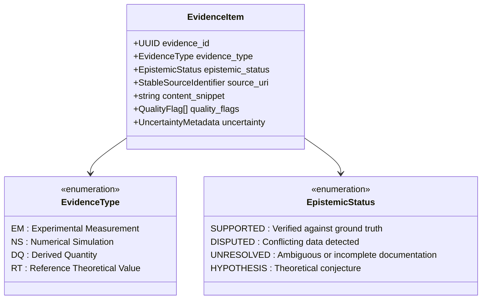

# FLARE Milestone 10: Evidence & Citation Contract Specification

**Project**: FLARE — Scientific Intelligence Platform for Spacecraft Fire Safety  
**Milestone**: M10 — Evidence-Grounded Scientific Intelligence Layer  
**Document**: Epistemological Evidence Classification, Granular Provenance, and Citation Syntax  
**Version**: 2.0.0 (Hardened Metrological Design)  
**Status**: DESIGN & SPECIFICATION ONLY  

---

## 1. Epistemological Classification Framework

To protect scientific integrity and prevent catastrophic model bias in spacecraft safety evaluations, FLARE enforces an orthogonal two-dimensional evidence classification model separating **Physical Origin (Evidence Type)** from **Verification Quality (Epistemic Status)**:



### 1.1 The Four Evidence Types (Physical Origin)
1. **`EM` — Experimental Measurement**:
   - Direct physical transducer readouts or optical recordings obtained during microgravity flight or drop-tower experiments (e.g. photodiode voltages, oxygen sensor galvanic cells, hot-wire anemometers, thermocouple outputs).
   - *Example*: `Calibrated  initial O2 % by vol  = 18.2` in `PSI-25_Experimental table_BASS-II.csv`.
2. **`NS` — Numerical Simulation**:
   - Data points generated by integrating differential governing equations (e.g. 1D transient droplet combustion models, CHEMKIN kinetics simulations, CFD Navier-Stokes solutions).
   - *Epistemological Rule*: Must NEVER be presented as empirical proof of fire behavior. Must always carry the mandatory label `[SIMULATION]`.
3. **`DQ` — Derived Quantity**:
   - Metrics computed from experimental measurements via deterministic reduction algorithms (e.g. median oxygen mole fraction depletion $\Delta \chi_{O2}$, relative depletion ratio $\Pi_{O2}$, calibrated airflow velocity $U_\infty$).
   - *Epistemological Rule*: Must identify the underlying reduction algorithm and its exact input parameters.
4. **`RT` — Reference / Theoretical Value**:
   - Certified calibration standards, pre-flight ambient baselines, nominal manufacturer dimensions, or chemical stoichiometry (e.g. certified gas bottle concentrations, PMMA nominal rod diameter $\frac{1}{4}\text{ in}$, stoichiometric fuel/oxygen ratios).

### 1.2 The Four Epistemic Statuses (Verification Quality)
1. **`SUPPORTED`**:
   - Grounded directly in authentic flight telemetry or cryptographically sealed M9 analytical results. Fully reproducible and audited.
2. **`DISPUTED`**:
   - Conflicting evidence detected in source records (e.g. sensor zero-drift readings conflicting with operator logbook notes, or contradictory dual-channel radiometer readings).
3. **`UNRESOLVED`**:
   - Source documentation is incomplete, ambiguous, or lacks boundary conditions (e.g. mounting geometry in Miller slab tests $M4, M6-M13, M16-M20$, or unrecorded chamber temperature/pressure).
4. **`HYPOTHESIS`**:
   - Theoretical explanations, proposed reaction pathways, or extrapolated physical mechanisms not directly verified by sensor telemetry.

---

## 2. Stable, Resolvable Source Identifiers (URIs)

To ensure citations can be resolved deterministically across database sessions, evidence references must use standardized FLARE Uniform Resource Names (URNs):

### 2.1 Standardized URI Schemes
1. **Cryptographically Sealed M9 Analytical Result**:
   ```text
   flare:result:<protocol_code>:<metric_code>
   ```
   - *Example*: `flare:result:M9-P1-ENV-STATS:ambient_initial_o2_median`
   - *Resolution*: Resolves directly to `public.analytical_result` via `(protocol_code, metric_code)` and verifies against `public.aggregate_seal`.
2. **Tabular Flight Observation Record**:
   ```text
   flare:row:<source_sha256>:<csv_record_number>
   ```
   - *Example*: `flare:row:71e792bf6b5fb5ea620c5dd70fbbac05515992e12aefcf5dff47312caa48c042:45`
   - *Resolution*: Resolves to line 45 in `PSI-25_Experimental table_BASS-II.csv` and its parsed entity in `public.source_record`.
3. **NASA Publication or Technical Report**:
   ```text
   flare:doc:<source_sha256>[:page=<p>][:sec=<s>]
   ```
   - *Example*: `flare:doc:71e792bf...:page=14:sec=apparatus`
   - *Resolution*: Resolves to authentic NASA publications indexed in `public.source_document`.
4. **Experimental Test Execution**:
   ```text
   flare:test:<investigation_code>:<test_id>
   ```
   - *Example*: `flare:test:PSI-25:O2`
   - *Resolution*: Resolves to `public.experimental_test` and related observations.

---

## 3. Multiple Evidence References per Scientific Claim

In scientific discourse, a single claim often synthesizes multiple evidence items. For example, a statement regarding BASS-II airflow velocity is supported by:
1. `flare:result:M9-P3-AIRFLOW-STEADY:calibrated_airflow_velocity_median` (The sealed median velocity $0.050330\text{ m/s}$).
2. `flare:row:71e792bf...:49` (Test O2 raw air display $0.0\text{ cm/s}$ demonstrating the stall deadband).
3. `flare:doc:fan_calibration_data:row=33` (The NASA SPICE calibration equation $U = 1.0066 \times \text{Air}$).

The M10 contract explicitly requires that every `ScientificClaim` object maintains a list of one or more `StableEvidenceReference` items (`evidence_references: list[StableEvidenceReference]`).

---

## 4. Strict Citation Contract Rules

| Rule ID | Contract Rule | Enforcement Mechanism | Failure Action |
| :--- | :--- | :--- | :--- |
| **CIT-01** | **Structured Claim Invariant**: Every numerical assertion in user narrative must be derived from a validated `ScientificClaim` object. | Claims validation gate prior to narrative rendering. | Narrative suppressed; render verified M9 metric card only. |
| **CIT-02** | **No Orphan Citations**: Every citation key in narrative text must resolve to a valid `flare:*` URI in the verified claims bundle. | URI lookup table verification. | Drop invalid citation token; flag for audit review. |
| **CIT-03** | **Simulation Warning Mandatory**: Any claim grounded in `NS` (Numerical Simulation) evidence must carry the prominent badge `[SIMULATION]` and explicit disclaimer text. | Epistemic tag checker. | Auto-inject `[SIMULATED DATA - NOT FLIGHT MEASUREMENT]` callout. |
| **CIT-04** | **Uncertainty Mandatory Inclusion**: Citing an M9 median requires citing the 95% confidence interval (or IQR) and sample size $N$ alongside it. | Token presence validator. | Auto-append `(Median: X, 95% CI: [Y, Z], N=...)`. |
| **CIT-05** | **Epistemic Transparency**: If a claim's status is `DISPUTED` or `UNRESOLVED`, the limitation must be highlighted in a dedicated warning card. | Status filter in synthesizer. | Auto-inject `LimitationNotice` component. |
| **CIT-06** | **Microgravity Domain Boundary**: Citations of BASS-II data must explicitly specify the environment as ISS microgravity ($\sim 10^{-6}\text{ g}$). | Prompt & post-audit constraint. | Prohibit extrapolation to lunar ($0.16\text{ g}$) or Martian ($0.38\text{ g}$) gravity. |

---

## 5. Pydantic v2 Schemas

```python
from datetime import datetime
from decimal import Decimal
from enum import Enum
from typing import Any, Literal
from uuid import UUID, uuid4
from pydantic import BaseModel, Field

class EvidenceType(str, Enum):
    EXPERIMENTAL_MEASUREMENT = "EM"
    NUMERICAL_SIMULATION = "NS"
    DERIVED_QUANTITY = "DQ"
    REFERENCE_THEORETICAL = "RT"

class EpistemicStatus(str, Enum):
    SUPPORTED = "SUPPORTED"
    DISPUTED = "DISPUTED"
    UNRESOLVED = "UNRESOLVED"
    HYPOTHESIS = "HYPOTHESIS"

class StableEvidenceReference(BaseModel):
    uri: str = Field(..., description="Stable URN e.g. flare:result:M9-P1-ENV-STATS:ambient_initial_o2_median")
    evidence_type: EvidenceType
    epistemic_status: EpistemicStatus
    source_sha256: str
    location_label: str  # e.g. "Table 1, Row 45" or "Result Seal #4fa8"
    summary_snippet: str

class ScientificClaim(BaseModel):
    claim_id: UUID = Field(default_factory=uuid4)
    subject_entity: str
    claimed_numeric_value: Decimal | None = None
    claimed_unit: str | None = None
    metric_identifier: str | None = None
    claimed_ci_lower: Decimal | None = None
    claimed_ci_upper: Decimal | None = None
    claimed_sample_size: int | None = None
    claimed_statement: str
    evidence_references: list[StableEvidenceReference] = Field(..., min_length=1)
    validation_status: Literal["PENDING", "VALIDATED", "REJECTED", "QUALIFIED"] = "PENDING"
    validation_error: str | None = None
    epistemic_verdict: EpistemicStatus = EpistemicStatus.SUPPORTED

class ValidatedClaimBundle(BaseModel):
    query_id: UUID
    claims: list[ScientificClaim]
    all_validated: bool
    rejection_reasons: list[str] = Field(default_factory=list)
```
