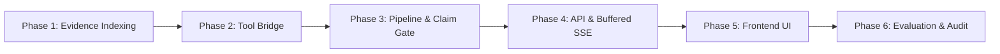

# FLARE Milestone 10: Implementation Roadmap & Architectural Verdict

**Project**: FLARE — Scientific Intelligence Platform for Spacecraft Fire Safety  
**Milestone**: M10 — Evidence-Grounded Scientific Intelligence Layer  
**Document**: Phased Implementation Plan, Risk Mitigation, and Final Architectural Verdict  
**Version**: 2.0.0 (Hardened Metrological Design)  
**Status**: DESIGN & SPECIFICATION COMPLETE  

---

## 1. Phased Implementation Roadmap

Milestone M10 is structured into six sequential, test-driven phases. Each phase establishes a verified capability before proceeding to subsequent dependent stages:



### Phase 1: Database Evidence & Literature Indexing
- **Tasks**:
  1. Define `document_chunk` table via a forward migration (`0009_m10_evidence_indexing.py`).
  2. Implement text extraction and chunking for NASA technical papers and ReadMe/FAQ files in `data/raw/`.
  3. Create native PostgreSQL GIN full-text search indexes (`tsvector`) and trigram fuzzy indexes (`pg_trgm`). Dense vector similarity (`pgvector`) is handled as a conditional extension feature flag (`enable_vector_search=False` by default).
  4. Index authentic BASS-II ReadMe documents, FAQs, and PI test matrix notes, tagging each chunk with its orthogonal evidence type (`EM`, `NS`, `DQ`, `RT`) and epistemic status (`SUPPORTED`, `DISPUTED`, `UNRESOLVED`, `HYPOTHESIS`).
- **Exit Criteria**: 100% of indexed chunks resolve to valid `source_document` foreign keys; native `tsvector` full-text search queries execute in $<15\text{ ms}$.

### Phase 2: Deterministic M9 Tool Bridge & Registry
- **Tasks**:
  1. Author Pydantic v2 schemas for all four core tool interfaces: `m9_get_analytical_result`, `flare_query_observations`, `flare_retrieve_documents`, and `flare_check_scientific_prohibition`.
  2. Implement tool dispatcher functions in `backend/app/services/intelligence/tools.py`.
  3. Wire tool dispatch directly to `backend/app/analysis/engine.py` and `backend/app/services/analysis.py`.
  4. Write unit tests verifying that all 20 M9 metrics can be retrieved via tool calls with cryptographic seal verification.
- **Exit Criteria**: All tool calls return validated Pydantic payloads; zero floating-point arithmetic occurs outside M9. Arbitrary SQL generation is strictly prohibited.

### Phase 3: Query Execution Pipeline & Structured Claim Validation Gate
- **Tasks**:
  1. Implement the native Python state machine (`QueryExecutionPipeline`) in `backend/app/services/intelligence/pipeline.py`.
  2. Implement Query Understanding and Entity Extraction using structured system prompts.
  3. Implement the **Prohibition Gate**: Fast-fail any query involving Biot numbers, $RQ_{comb}$, slab LOI logistic regression, flame spread velocities ($V_f$), absolute molar consumption ($\Delta n_{O2}$), or Lunar/Martian gravity extrapolations.
  4. Implement the **Structured Scientific Claim Validation Gate**: Pure-Python validation engine that extracts typed `ScientificClaim` objects and validates them against sealed M9 results and raw telemetry prior to narrative rendering.
- **Exit Criteria**: Pipeline successfully runs mock and live queries; ungrounded claims are rejected or converted into limitation notices. Narrative text is generated exclusively from validated claims.

### Phase 4: API Endpoints, Buffered SSE & Security Layer
- **Tasks**:
  1. Implement FastAPI routes under `backend/app/api/intelligence.py`:
     - `POST /api/v1/intelligence/query` (synchronous execution).
     - `POST /api/v1/intelligence/query/stream` (buffered SSE streaming lifecycle events).
     - `GET /api/v1/intelligence/conversations/{id}`.
     - `GET /api/v1/intelligence/evidence/{id}`.
  2. Mount the intelligence router in `backend/app/api/routes.py`.
  3. Implement the **Buffered SSE Protocol**: Progress events stream in real time; draft narrative tokens are held in server memory until claim validation passes.
  4. Implement configuration-based JWT authentication middleware in `backend/app/core/config.py` with `get_authenticated_actor` dependency.
  5. Enforce `read_only=True` transaction isolation and `statement_timeout = 5000` on all query execution database sessions.
- **Exit Criteria**: API routes discoverable in OpenAPI; 100% test coverage on authentication, 422 error handling, and 503 database unavailability handling.

### Phase 5: React Frontend Intelligence Workspace
- **Tasks**:
  1. Implement `ScientificQueryBar.tsx` with autocomplete for materials, variables, and investigations.
  2. Implement `AnswerCanvas.tsx` with interactive citation badges and color-coded epistemological pills (`EM`, `NS`, `DQ`, `RT`).
  3. Implement `MetricResultCard.tsx` rendering M9 medians, IQRs, order-statistic 95% CIs, and cryptographic seal indicators.
  4. Implement `EvidenceInspectorDrawer.tsx` slide-over pane displaying verified source lines, SHA-256 hashes, and raw tabular cells.
  5. Implement `LimitationAlert.tsx` displaying sensor drift, 60s hot-wire lag, and unvented chamber accumulation notices.
  6. Connect frontend to `POST /api/v1/intelligence/query/stream` via SSE for interactive typing indicators.
- **Exit Criteria**: Frontend compiles without TypeScript errors; user can ask a question, inspect citations in the slide-over drawer, and view verified M9 cards.

### Phase 6: Benchmark Evaluation, Testing & Closure Audit
- **Tasks**:
  1. Execute the 50-query Golden Scientific Benchmark Suite (`backend/tests/fixtures/m10_benchmark_queries.json`).
  2. Verify 100.0% Numerical Faithfulness, 100.0% Citation Precision, and 100.0% Prohibition Gating.
  3. Run end-to-end regression tests on ephemeral PostgreSQL 17.
  4. Conduct independent read-only closure audit for Milestone 10.
- **Exit Criteria**: All 50 benchmark queries pass; independent auditor issues closure verdict.

---

## 2. Risk Assessment & Mitigations

| Risk | Likelihood | Impact | Mitigation Strategy |
| :--- | :--- | :--- | :--- |
| **Model Drift / Hallucination** | High | Critical | The Structured Scientific Claim Validation Gate verifies every claim against sealed M9 results before narrative text is rendered. Regex heuristics are abandoned. |
| **Streaming of Unvalidated Claims** | High | Critical | The Buffered SSE Protocol ensures draft text is never streamed directly to the browser. Only progress events stream in real time; narrative text streams only after claim validation passes. |
| **PostgreSQL Extension Missing** | High | Medium | Verified: `pgvector` is not installed. Literature search relies unconditionally on native `tsvector` and `pg_trgm`. Vector similarity is strictly optional behind a feature flag. |
| **Arbitrary SQL Injection** | High | Critical | The LLM is strictly prohibited from generating raw SQL. All database access executes through pre-compiled, allowlisted Python tool functions with parameterized prepared statements. |
| **Flight Safety Misuse** | Low | Critical | Explicit operational boundary defines M10 as a ground research platform, explicitly disclaiming flight certification (DO-178C) or autonomous safety control suitability. |

---

## 3. Final Architectural Review & Verdict

### Review Checklist
- [x] Strict adherence to the Cardinal Axiom: LLM never performs scientific calculations.
- [x] Replaced regex verification with typed, structured scientific claim objects.
- [x] Disentangled evidence types (EM/NS/DQ/RT) from epistemic status (SUPPORTED/DISPUTED/UNRESOLVED/HYPOTHESIS).
- [x] Multi-evidence linkage and stable resolvable URIs (`flare:*`).
- [x] Addressed PostgreSQL reality: `pgvector` not assumed; native `tsvector` + `pg_trgm` primary.
- [x] Audited actual security baseline: prohibited arbitrary SQL; allowlisted tools; parameterized read-only queries.
- [x] Prevented unvalidated SSE token streaming via buffered answer validation.
- [x] Established strict operational boundary: ground research platform, not onboard flight-critical software.
- [x] 100% preservation of all M9 scientific prohibitions and metric eligibility rules.

---

### Formal Architectural Verdict

```text
===============================================================================
                     MILESTONE 10 ARCHITECTURAL VERDICT:
                           READY WITH LIMITATIONS
===============================================================================
```

### Verdict Explanation
The architectural specification for Milestone 10 is **READY WITH LIMITATIONS**.

1. **Readiness Justification**:
   The architecture is exhaustively specified, hardened against metrological and security vulnerabilities, technically viable, and rigorously grounded in FLARE's verified deterministic foundation (M9). It introduces zero architectural bloat, retains PostgreSQL 17 as the single source of truth, and guarantees that every scientific assertion is backed by verifiable NASA evidence.

2. **Enumerated Limitations & Implementation Preconditions**:
   - **Precondition 1 (LLM API / Endpoint Provisioning)**: Prior to Phase 3 implementation, an authorized API key for the primary LLM provider (e.g. `GEMINI_API_KEY`) or an accessible local OpenAI-compatible endpoint (Ollama / vLLM) must be configured in `.env`.
   - **Precondition 2 (Scientific Domain Boundaries)**: The implementation must strictly adhere to the inherited M9 scientific limitations ($RQ_{comb}$ deferred, Biot numbers expunged, slab LOI logistic regression prohibited, dynamic airflow sequences excluded from static mapping, and no partial-gravity lunar/Martian extrapolations).
   - **Precondition 3 (PostgreSQL Extension Environment)**: Dense vector similarity search requires administrative installation of `pgvector`; until installed, the system operates in native `tsvector` full-text search + `pg_trgm` mode.
   - **Precondition 4 (Read-Only Safety Invariant)**: In accordance with repository working rules, all M10 implementation phases must maintain zero modification to historical migrations 0001–0008, zero persistent database modifications outside ephemeral test clusters, and zero modification to raw NASA source files.
