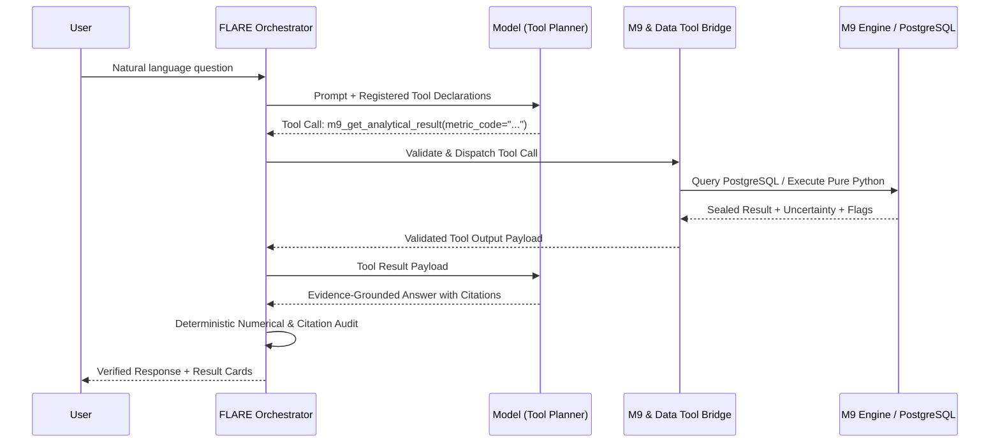

# FLARE Milestone 10: LLM Tool Interface & Orchestration Contract

**Project**: FLARE — Scientific Intelligence Platform for Spacecraft Fire Safety  
**Milestone**: M10 — Evidence-Grounded Scientific Intelligence Layer  
**Document**: LLM Tool Specifications, JSON Schemas, and Architectural Prohibitions  
**Version**: 1.0.0 (Authoritative Design)  
**Status**: DESIGN & SPECIFICATION ONLY  

---

## 1. Principles of Tool-Governed Intelligence

The LLM in Milestone 10 does NOT compute; it queries, orchestrates, and explains. To enforce this boundary, all scientific operations are encapsulated behind deterministic tools. The LLM interacts with these tools via standard structured function calling (JSON schema tool declarations).



---

## 2. Tool Definitions & JSON Schemas

### Tool 1: `m9_get_analytical_result`
- **Purpose**: Retrieve a cryptographically sealed statistical metric calculated by M9 from `public.analytical_result`.
- **JSON Schema Declaration**:
```json
{
  "name": "m9_get_analytical_result",
  "description": "Retrieve an authoritative, cryptographically sealed M9 scientific metric (median, IQR, confidence intervals, sample counts) from the FLARE PostgreSQL database. NEVER attempt to recalculate these values yourself.",
  "parameters": {
    "type": "object",
    "properties": {
      "metric_code": {
        "type": "string",
        "description": "Standardized M9 metric code.",
        "enum": [
          "ambient_initial_o2_median",
          "ambient_initial_o2_iqr",
          "ambient_initial_co2_median",
          "ambient_initial_co2_iqr",
          "ambient_initial_co_median",
          "ambient_initial_co_iqr",
          "non_negative_o2_depletion_median",
          "non_negative_o2_depletion_iqr",
          "relative_o2_depletion_ratio_median",
          "positive_o2_depletion_median",
          "positive_o2_depletion_iqr",
          "signed_distribution_o2_depletion_median",
          "calibrated_airflow_velocity_median",
          "calibrated_airflow_velocity_iqr",
          "calibrated_airflow_velocity_range",
          "total_flight_runs_count",
          "unique_physical_specimens_count",
          "first_burn_subset_runs_count",
          "subsequent_reburn_subset_runs_count",
          "observed_morphology_regimes_summary"
        ]
      },
      "protocol_code": {
        "type": "string",
        "description": "Protocol code governing this metric.",
        "enum": [
          "M9-P1-ENV-STATS",
          "M9-P2-O2-DEPLETION",
          "M9-P3-AIRFLOW-STEADY",
          "M9-P4-FUEL-REGIMES"
        ]
      }
    },
    "required": ["metric_code"]
  }
}
```
- **Returns**:
```json
{
  "metric_code": "ambient_initial_o2_median",
  "protocol_code": "M9-P1-ENV-STATS",
  "canonical_name": "Baseline Pre-Ignition Oxygen Mole Fraction Median",
  "numeric_value": "0.182",
  "unit": "mol/mol",
  "source_unit": "% by vol",
  "raw_value_source_unit": "18.2",
  "sample_size": 129,
  "confidence_interval_95": {
    "lower": "0.175",
    "upper": "0.188",
    "lower_rank": 53,
    "upper_rank": 76
  },
  "quality_flags": ["VALID_NUMERIC", "FULL_SAMPLE_100_PCT"],
  "cryptographic_seal": {
    "seal_version": "canonical-json-v2",
    "member_digest": "4fa871...d0a"
  }
}
```

---

### Tool 2: `flare_query_observations`
- **Purpose**: Query raw flight experimental records from `public.source_record` / `public.observation` across specific test runs or materials.
- **JSON Schema Declaration**:
```json
{
  "name": "flare_query_observations",
  "description": "Query specific experimental run observations (e.g. test numbers, materials, raw sensor readings) from the BASS-II flight database. Preserves signed sensor values and original strings.",
  "parameters": {
    "type": "object",
    "properties": {
      "investigation_code": {
        "type": "string",
        "description": "NASA investigation code (default: 'PSI-25')",
        "default": "PSI-25"
      },
      "test_ids": {
        "type": "array",
        "items": {"type": "string"},
        "description": "Optional list of specific test IDs (e.g. ['B1', 'O2', 'F4'])."
      },
      "pi_filter": {
        "type": "string",
        "description": "Filter by Primary Investigator (e.g. 'Olson', 'Tien', 'Miller', 'Ferkul', 'Bhattacharjee', 'Fernandez-Pello')."
      },
      "fuel_material_pattern": {
        "type": "string",
        "description": "Case-insensitive substring match on Fuel Sample Material (e.g. 'PMMA', 'Nomex', 'SIBAL', 'Candle')."
      },
      "limit": {
        "type": "integer",
        "description": "Maximum number of rows to return (max: 50)",
        "default": 10
      }
    }
  }
}
```

---

### Tool 3: `flare_retrieve_documents`
- **Purpose**: Retrieve textual snippets and context from authentic NASA papers, metadata sheets, readmes, and FAQs.
- **JSON Schema Declaration**:
```json
{
  "name": "flare_retrieve_documents",
  "description": "Search authentic NASA technical reports, flight guides, ReadMe documents, and FAQ sheets for physical apparatus explanations and investigator notes.",
  "parameters": {
    "type": "object",
    "properties": {
      "query": {
        "type": "string",
        "description": "Natural-language search query focusing on physical hardware, operational protocols, or apparatus limitations."
      },
      "investigation_code": {
        "type": "string",
        "description": "Target investigation code (e.g. 'PSI-25', 'Saffire', 'PSI-117')."
      },
      "epistemological_filter": {
        "type": "string",
        "enum": ["ALL", "EM_ONLY", "EXCLUDE_SIMULATION"],
        "description": "Filter by epistemological category. Set to EXCLUDE_SIMULATION to eliminate numerical simulation text.",
        "default": "EXCLUDE_SIMULATION"
      },
      "top_k": {
        "type": "integer",
        "description": "Number of snippets to retrieve (max: 5)",
        "default": 3
      }
    },
    "required": ["query"]
  }
}
```

---

### Tool 4: `flare_check_scientific_prohibition`
- **Purpose**: Deterministically check whether a proposed topic or parameter is prohibited under FLARE scientific contracts.
- **JSON Schema Declaration**:
```json
{
  "name": "flare_check_scientific_prohibition",
  "description": "Consult FLARE's authoritative scientific prohibition registry to verify whether an analysis request is physically valid or explicitly prohibited.",
  "parameters": {
    "type": "object",
    "properties": {
      "concept": {
        "type": "string",
        "description": "Scientific concept or variable name to check.",
        "enum": [
          "biot_number",
          "rq_comb",
          "slab_loi_regression",
          "flame_spread_rate",
          "absolute_molar_consumption",
          "cubic_flow_polynomial",
          "lunar_gravity_extrapolation",
          "martian_gravity_extrapolation",
          "fire_risk_odds_ratio"
        ]
      }
    },
    "required": ["concept"]
  }
}
```

---

## 3. Strict Model Prohibitions Contract

The LLM must agree to the following operational prohibitions. Any violation detected by the post-generation deterministic audit triggers immediate response invalidation:

| Prohibition Code | Description | Forbidden Action | Mandated Behavior |
| :--- | :--- | :--- | :--- |
| **PROHIB-01** | **No In-Context Arithmetic** | Calculating medians, averages, differences, or quotients from raw observation arrays inside prompt text. | Must call `m9_get_analytical_result` or state that calculation is not available. |
| **PROHIB-02** | **No Numerical Rounding Drift** | Truncating or rounding a reported value (e.g. turning $0.182\text{ mol/mol}$ into "about 18%"). | Must report the exact canonical number and original source unit verbatim. |
| **PROHIB-03** | **No Extrapolation to Partial Gravity** | Concluding that microgravity observations on ISS ($\sim 10^{-6}\text{ g}$) apply directly to the Moon ($0.16\text{ g}$) or Mars ($0.38\text{ g}$). | Must state that microgravity suppresses buoyant convection, whereas lunar/Martian gravity induces distinct partial buoyancy. |
| **PROHIB-04** | **No Fabricated Uncertainty** | Guessing standard deviations or $\pm$ margins when the database reports order-statistic CIs. | Must cite the exact `confidence_interval_95` bounds reported by the tool. |
| **PROHIB-05** | **No Conflation of Re-burns with Virgin Tests** | Stating that 129 tests represent 129 distinct physical fuel samples. | Must distinguish the 107 virgin burns (`FIRST_BURN_SUBSET`) from the 22 re-burns (`SUBSEQUENT_REBURN_SUBSET`). |
| **PROHIB-06** | **No Inferred Biot Regimes** | Labeling materials as "thermally thin ($Bi < 0.1$)" or "thermally thick ($Bi > 1$)". | Must describe materials purely by observed nominal geometry (Thin Films, Rods, Slabs, Fabric, Wax). |
| **PROHIB-07** | **No Probabilistic Risk Claims** | Stating fire risk odds ratios or flammability probability scores. | Must state that empirical flight data provides baseline physical observations, not universal risk probabilities. |

---

## 4. Tool Execution Security & Validation

1. **Read-Only Transaction Isolation**: All database operations executed by tools run with `SET TRANSACTION READ ONLY`.
2. **Deterministic Argument Parsing**: Pydantic strictly validates all parameters before dispatch. Unknown arguments or out-of-range limits are rejected at the service boundary.
3. **Audit Logging**: Every tool invocation records:
   - `query_id`: UUID of the parent query.
   - `tool_name`: Name of invoked tool.
   - `input_arguments`: Exact JSON payload.
   - `execution_duration_ms`: Latency.
   - `result_digest`: SHA-256 digest of output payload.
