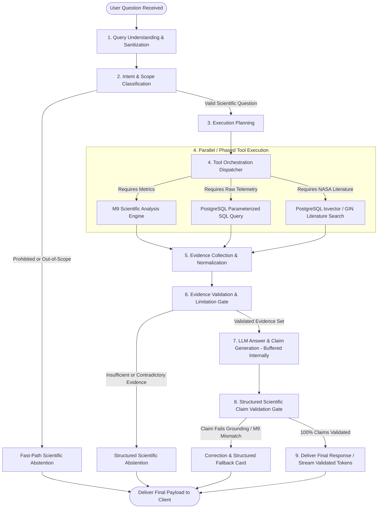

# FLARE Milestone 10: Query Execution Flow & State Machine Specification

**Project**: FLARE — Scientific Intelligence Platform for Spacecraft Fire Safety  
**Milestone**: M10 — Evidence-Grounded Scientific Intelligence Layer  
**Document**: Query Execution Flow, State Transitions, and Failure Handling  
**Version**: 2.0.0 (Hardened Metrological Design)  
**Status**: DESIGN & SPECIFICATION ONLY  

---

## 1. End-to-End Query Execution Pipeline

The FLARE M10 execution flow is a strictly controlled, deterministic pipeline that transitions incoming scientific questions through intent parsing, tool orchestration, structured claim extraction, and claim validation. Unvalidated model text is **never** streamed directly to the user.



---

## 2. Detailed Stage-by-Stage Operational Analysis

### Stage 1: Query Understanding & Input Sanitization
- **Purpose**: Ingest natural language query, strip control characters, detect potential prompt injection attacks, and extract key entities.
- **Inputs**:
  - `user_query`: Raw UTF-8 string.
  - `conversation_context`: Optional history of prior verified scientific turns.
- **Operations**:
  1. Normalize whitespace and sanitize Unicode homoglyphs.
  2. Extract candidate entities:
     - Materials (e.g. "PMMA", "Nomex", "SIBAL", "paraffin candle").
     - Environmental variables (e.g. "oxygen depletion", "initial O2", "duct airflow", "CO background").
     - NASA investigations (e.g. "BASS-II", "PSI-25", "Saffire", "ACME").
     - Experimental runs / specimen IDs (e.g. "Test O2", "Sample #4").
- **Failure Conditions**:
  - Empty string or non-textual input $\rightarrow$ HTTP 422 Unprocessable Entity.
  - Prompt injection attempt detected $\rightarrow$ Fast reject with generic safety message.

### Stage 2: Intent & Scope Classification
- **Purpose**: Determine what kind of scientific information is needed and verify that the query does NOT ask for prohibited calculations.
- **Classifications**:
  1. `NUMERICAL_STATISTICAL`: Inquiries regarding pre-ignition gas concentrations, relative oxygen depletion, or calibrated airflow velocities.
  2. `OBSERVATION_LOOKUP`: Queries regarding specific test records, run counts, or fuel geometries.
  3. `LITERATURE_EXPLANATION`: Queries regarding experimental apparatus design, sensor limitations, or NASA investigator notes.
  4. `PROHIBITED_OR_UNSUPPORTED`: Questions regarding Biot numbers, $RQ_{comb}$, slab LOI logistic regression, flame spread velocities ($V_f$), absolute molar consumption ($\Delta n_{O2}$), or Lunar/Martian fire risk extrapolations.
- **Failure Conditions**:
  - If classified as `PROHIBITED_OR_UNSUPPORTED`, execution immediately diverts to the **Fast-Path Scientific Abstention** stage, outputting the exact physical or metrological reason why the calculation is scientifically invalid.

### Stage 3: Execution Planning
- **Purpose**: Formulate a deterministic execution plan consisting of specific tool invocations, parameter filters, and required evidence types.
- **Outputs**:
  - `plan_steps`: Ordered list of allowlisted tools to invoke (e.g. `m9_get_analytical_result`, `flare_query_observations`).
- **Failure Conditions**:
  - Ambiguous query where multiple distinct variables match with equal probability $\rightarrow$ Trigger interactive clarification prompt.

### Stage 4: Tool Orchestration & Dispatching
- **Purpose**: Execute external deterministic tools without LLM hallucination.
- **Execution Branches**:
  - **Branch A: M9 Scientific Analysis Engine**:
    - Queries `public.analytical_result` for pre-computed, cryptographically sealed metrics.
    - If uncached, dynamically invokes `app.analysis.engine.run_m9_analysis_engine()` within a read-only transaction.
  - **Branch B: PostgreSQL Parameterized SQL Query**:
    - Queries `public.source_record` or `public.observation` with prepared, parameterized SQL filters on `investigation_id`, `variable_id`, and `test_id`.
    - Preserves exact source strings and signed negative readings.
  - **Branch C: NASA Literature Search Engine**:
    - Queries indexed NASA technical papers, ISA-Tab metadata, and ReadMe files using native PostgreSQL full-text search (`tsvector` / GIN) and fuzzy keyword matching (`pg_trgm`). Dense vector matching is invoked only if `pgvector` is available.
- **Failure Conditions**:
  - Database connectivity failure $\rightarrow$ Return HTTP 503 with graceful degradation.
  - Tool execution timeout (>3,000 ms) $\rightarrow$ Log error, return structured error card.

### Stage 5: Evidence Collection & Normalization
- **Purpose**: Aggregate all tool responses into a structured, unified evidence bundle.
- **Operations**:
  1. Verify cryptographic seals on all analytical results via `aggregate_seal.member_digest`.
  2. Normalize all quantitative measurements to canonical SI units alongside original source units.
  3. Tag every evidence item with its unique, stable URN (e.g. `flare:result:M9-P1-ENV-STATS:ambient_initial_o2_median`).
  4. Collect all associated quality flags (e.g. `SENSOR_ZERO_DRIFT_PRESERVED`, `STEADY_SCALAR_SUBSET`).

### Stage 6: Evidence Validation & Limitation Gate
- **Purpose**: Enforce scientific gating criteria before generating narrative text.
- **Validation Rules**:
  1. Minimum evidence threshold: At least one verified evidence item must be present.
  2. Conflict detection: If two retrieved documents present conflicting definitions, both must be flagged as `DISPUTED`.
  3. Sample size sufficiency check: If sample size $N < 4$, order-statistic CIs cannot be cited.
- **Failure Conditions**:
  - Zero supporting evidence found in verified repository $\rightarrow$ Transfer control to **Structured Scientific Abstention**.

### Stage 7: LLM Answer & Structured Claim Generation (Buffered Internally)
- **Purpose**: Generate a draft natural-language scientific explanation alongside structured `ScientificClaim` objects.
- **Critical Safety Rule**: **DO NOT STREAM TO THE USER**.
  - All generated tokens and claims are buffered in server memory.
  - The model outputs:
    1. `draft_narrative`: The drafted markdown explanation with inline citation URNs.
    2. `extracted_claims`: A list of typed `ScientificClaim` objects declaring the exact numbers, units, metric codes, and evidence links used in the text.

### Stage 8: Structured Scientific Claim Validation Gate
- **Purpose**: Verify that every claim emitted by the model matches deterministic ground truth.
- **Verification Invariants**:
  1. **Exact Numeric Equality**: For every claim with `claim_type == STATISTICAL_METRIC`, `claimed_numeric_value` must equal `m9_result.numeric_value` exactly as a `Decimal`.
  2. **Unit Consistency**: The claimed unit must match the canonical SI unit (or verified source unit).
  3. **Sample Size Matching**: The sample size $N$ must equal the M9 sample count.
  4. **Evidence Linkage**: Every evidence reference must resolve to a valid `flare:*` URN present in the retrieved bundle.
- **Failure Handling**:
  - If any claim is `REJECTED`, the buffered narrative is **discarded**.
  - The engine falls back to rendering an authenticated M9 summary card accompanied by an explicit limitation notice: *"Narrative explanation suppressed due to an ungrounded numerical assertion."*

### Stage 9: Final Response Delivery & Validated Streaming
- **Purpose**: Once and ONLY once all claims have passed validation, deliver the verified narrative, result cards, citation references, and limitation notices to the client.

---

## 3. Failure Conditions & Abstention Matrix

| Failure Mode | Detection Point | Handling Strategy | User-Facing Output |
| :--- | :--- | :--- | :--- |
| **Prohibited Scientific Query** (e.g. "Calculate Biot number for B1") | Stage 2 (Intent Classification) | Fast-path short-circuit; bypass LLM generation | Structured limitation card explaining that Biot numbers are physically ungrounded in flight data. |
| **Missing Evidence** (e.g. "What was chamber pressure during test F1?") | Stage 6 (Evidence Gate) | Immediate abstention | "FLARE lacks verified chamber pressure data for test F1 (unrecorded in BASS-II telemetry)." |
| **Sensor Zero-Drift Confusion** (e.g. "Why is initial CO negative?") | Stage 4 / 7 | Limitation annotation injection | Explicit explanation that $-1, -2, -3\text{ ppm}$ reflects sensor zero-drift in microgravity, preserved signed without clamping. |
| **Dynamic Flow Extrapolation** (e.g. "What was flow during test M14 step 3?") | Stage 2 / 4 | Gated exclusion enforcement | Explains that Test M14 is a dynamic sequence excluded from static mapping due to 60-second hot-wire lag. |
| **Ungrounded Scientific Claim** (e.g. Model invents a flame speed) | Stage 8 (Claim Validation Gate) | Buffer discarded; fallback to cards | "Narrative suppressed due to unanchored claim. Verified M9 metrics rendered below." |
| **Database Unavailable** | Stage 4 (Tool Dispatcher) | Fail-safe 503 response | "FLARE database connection unavailable. Scientific queries cannot be verified." |

---

## 4. State Machine Definition (Pydantic / Python Representation)

```python
from dataclasses import dataclass, field
from enum import Enum
from typing import Any
from uuid import UUID

from app.schemas.claims import ScientificClaim, ValidatedClaimBundle

class QueryState(str, Enum):
    RECEIVED = "RECEIVED"
    PARSED = "PARSED"
    PLANNING = "PLANNING"
    EXECUTING_TOOLS = "EXECUTING_TOOLS"
    EVALUATING_EVIDENCE = "EVALUATING_EVIDENCE"
    GENERATING_BUFFERED = "GENERATING_BUFFERED"
    VALIDATING_CLAIMS = "VALIDATING_CLAIMS"
    STREAMING_VALIDATED = "STREAMING_VALIDATED"
    COMPLETED = "COMPLETED"
    ABSTAINED = "ABSTAINED"
    FAILED = "FAILED"

@dataclass
class QueryExecutionContext:
    session_id: UUID
    query_id: UUID
    raw_query: str
    current_state: QueryState = QueryState.RECEIVED
    intent_category: str | None = None
    extracted_entities: dict[str, list[str]] = field(default_factory=dict)
    tool_calls_planned: list[dict[str, Any]] = field(default_factory=list)
    tool_results: list[dict[str, Any]] = field(default_factory=list)
    evidence_bundle: list[dict[str, Any]] = field(default_factory=list)
    quality_flags: list[str] = field(default_factory=list)
    unresolved_limitations: list[str] = field(default_factory=list)
    
    # Buffered draft and validated claims
    buffered_draft_narrative: str | None = None
    extracted_claims: list[ScientificClaim] = field(default_factory=list)
    claim_bundle: ValidatedClaimBundle | None = None
    
    # Verified user-facing output
    verified_response: str | None = None
    citations: list[dict[str, Any]] = field(default_factory=list)
    failure_reason: str | None = None
```
