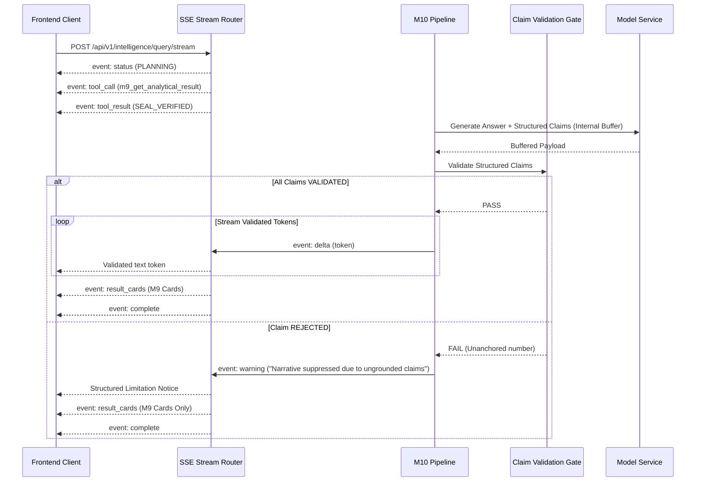

# FLARE Milestone 10: Security, Execution Boundaries & Operational Scope

**Project**: FLARE — Scientific Intelligence Platform for Spacecraft Fire Safety  
**Milestone**: M10 — Evidence-Grounded Scientific Intelligence Layer  
**Document**: Security Architecture, Tool Allowlisting, SSE Safety, and Operational Boundaries  
**Version**: 1.0.0 (Authoritative Design)  
**Status**: DESIGN & SPECIFICATION ONLY  

---

## 1. Actual Repository Security Audit & Gap Analysis

An inspection of the codebase ([backend/app/](file:///c:/Users/anand/OneDrive/Documents/ChatGPT/FLARE/backend/app/)) establishes the factual security baseline:

### 1.1 Existing Verified Capabilities
1. **Identity Integrity**: [backend/app/services/identity.py](file:///c:/Users/anand/OneDrive/Documents/ChatGPT/FLARE/backend/app/services/identity.py) strictly enforces version-qualified codes (`_v2`, `_v3`) for scientific condition roles and instruments, preventing silent overwrites.
2. **Cryptographic Sealing**: PostgreSQL schema migration `0003` / `0008` provides `flare_sealing.seal()` and trigger immutability (`guard_child`, `freeze_row`) on sealed analytical results.
3. **Network Boundary Checks**: [backend/app/core/config.py](file:///c:/Users/anand/OneDrive/Documents/ChatGPT/FLARE/backend/app/core/config.py) validates CORS origins and prevents wildcards (`*`) or credential leaks in origin URLs.
4. **Log Sanitization**: [backend/app/db/backup.py](file:///c:/Users/anand/OneDrive/Documents/ChatGPT/FLARE/backend/app/db/backup.py) and test fixtures explicitly redact database credentials in logs.

### 1.2 Missing Controls & Identified Gaps
1. **No User Authentication**: There is currently **zero authentication infrastructure** (no user model, no password hashing like bcrypt/argon2, no token generation like JWT, and no session management).
2. **No Role-Based Access Control (RBAC)**: All API routes (`/api/v1/health`, `/api/v1/system/info`, `/api/v1/analysis/*`) are publicly accessible without credential requirements.
3. **No Rate Limiting**: There is currently no per-IP or per-client throttling middleware.

### 1.3 Target Security Architecture for M10
```text
+-------------------------------------------------------------------------------+
|                       M10 SECURITY HARDENING ARCHITECTURE                     |
+-------------------------------------------------------------------------------+
|                                                                               |
|   1. Authentication Gate:                                                     |
|      - Bearer token / API-key dependency: get_authenticated_actor()           |
|      - Development override flag: AUTH_ENABLED=false (for local offline dev)   |
|      - Production mode: AUTH_ENABLED=true (rejects unauthenticated queries)   |
|                                                                               |
|   2. Database Access Gate:                                                    |
|      - SET TRANSACTION READ ONLY on all intelligence sessions                 |
|      - Parameterized SQL only; zero dynamic query construction                 |
|      - Query timeout: statement_timeout = '5000' (5s maximum)                 |
|                                                                               |
|   3. Tool Execution Gate:                                                     |
|      - Strict allowlist of 4 registered tools; no arbitrary SQL execution    |
|      - Per-tool timeout: 3,000 ms                                             |
|      - Maximum tool invocations per query: 5                                  |
|                                                                               |
|   4. Streaming Output Gate:                                                   |
|      - Buffered generation; no streaming of unvalidated text                  |
|      - Pre-delivery structured claim validation pass                          |
+-------------------------------------------------------------------------------+
```

---

## 2. Prohibition of Arbitrary LLM-Generated SQL

```text
+-------------------------------------------------------------------------------+
|                     PROHIBITION: ARBITRARY SQL GENERATION                     |
+-------------------------------------------------------------------------------+
|                                                                               |
|   Under NO circumstances is the LLM granted direct database connection       |
|   handles, text-to-SQL capabilities, or raw query generation privileges.     |
|                                                                               |
|   All database interactions MUST execute through pre-compiled, tested, and   |
|   allowlisted Python service functions with strict Pydantic parameter typing. |
+-------------------------------------------------------------------------------+
```

### 2.1 Rationale for Strict Tool Allowlisting
1. **Bypassing Audited Metrology**: An LLM writing raw SQL might execute `SELECT AVG(calibrated_initial_o2)` instead of using M9's audited sample median with R Type 7 quantiles.
2. **Data Tampering & Injection**: An arbitrary SQL generator could be exploited via prompt injection to alter `source_record` rows or attempt mutations on unsealed tables.
3. **Denial of Service**: Unindexed joins or unbounded cross-table queries across 261 challenge files could lock PostgreSQL connection pools.

### 2.2 Allowlisted Tool Set
Only the following four tools may be executed by the M10 orchestrator:
1. `m9_get_analytical_result(metric_code, protocol_code)`
2. `flare_query_observations(investigation_code, test_ids, pi_filter, fuel_material_pattern, limit)`
3. `flare_retrieve_documents(query, investigation_code, epistemological_filter, top_k)`
4. `flare_check_scientific_prohibition(concept)`

---

## 3. Real-Time Streaming Safety: Buffered Response Architecture

### 3.1 The Streaming Safety Dilemma
In standard LLM streaming, generated tokens are streamed directly to the browser via Server-Sent Events (SSE). If a model generates an ungrounded hallucination (e.g. *"Peak flame temperature reached 1,840 K"*), the user reads the false information before any post-generation validator can flag it.

### 3.2 The Buffered SSE Protocol
M10 resolves this dilemma by separating **Progress Streaming** from **Answer Delivery**:



---

## 4. Operational Boundaries: Ground Research vs. Spacecraft Flight Software

```text
+-------------------------------------------------------------------------------+
|                       FLIGHT SAFETY & DEPLOYMENT BOUNDARY                     |
+-------------------------------------------------------------------------------+
|                                                                               |
|   1. Terrestrial Research Scope:                                              |
|      FLARE Milestone 10 is designed exclusively as an Evidence-Grounded       |
|      Decision-Support Platform for terrestrial combustion scientists,         |
|      materials engineers, and mission safety planning teams.                  |
|                                                                               |
|   2. Non-Flight-Certified Disclaimer:                                         |
|      FLARE M10 is NOT flight-certified software.                              |
|      - It does NOT comply with DO-178C (Software Considerations in Airborne   |
|        Systems and Equipment Certification).                                  |
|      - It does NOT comply with NASA-STD-8739.8 (Software Assurance Standard).|
|      - It is NOT qualified for real-time onboard spacecraft flight computers. |
|                                                                               |
|   3. Prohibition on Autonomous Control:                                       |
|      FLARE M10 must NEVER be integrated into closed-loop fire suppression     |
|      triggers, life-support atmospheric venting valves, or autonomous safety  |
|      interlocks on crewed or uncrewed spacecraft.                             |
|                                                                               |
|   4. Human-in-the-Loop Mandate:                                               |
|      All M10 analytical outputs and synthesis narratives must be verified by  |
|      qualified human combustion research officers before inclusion in         |
|      spacecraft materials certification or operational flight rules.          |
+-------------------------------------------------------------------------------+
```

---

## 5. Deployment Trade-Offs: Frontier Cloud API vs. Local Air-Gapped Models

| Architectural Factor | Frontier Cloud API (e.g. Gemini 2.5 Pro) | Local Self-Hosted Model (e.g. Llama 3.3 70B via vLLM) |
| :--- | :--- | :--- |
| **Operational Setting** | Ground mission planning, terrestrial research laboratories. | Air-gapped ground facilities, isolated mission control networks. |
| **Telemetry & Privacy** | Queries transit external API; requires data processing agreements. | 100% on-premises; zero telemetry egress; complete air-gap compliance. |
| **Hardware Overhead** | Zero GPU requirement; runs on standard CPU workstation/server. | High: Minimum 2x NVIDIA A100 (80GB) or 4x RTX 4090 for 70B inference. |
| **Tool Calling Reliability** | High ($\ge 99\%$ JSON schema compliance; complex multi-tool planning). | Moderate ($88–95\%$ schema compliance; requires strict constrained decoding). |
| **Reasoning Latency** | Rapid ($<1.5\text{s}$ per turn). | Moderate ($3–8\text{s}$ depending on GPU batching and quantization). |
| **Architectural Resolution** | **Adopt Model-Agnostic Interface**: Gemini API default; local OpenAI-compatible fallback for air-gapped deployments. |
