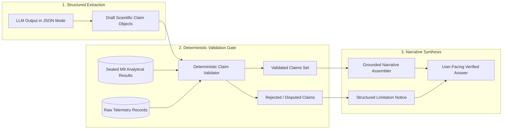

# FLARE Milestone 10: Structured Scientific Claim Validation Contract

**Project**: FLARE — Scientific Intelligence Platform for Spacecraft Fire Safety  
**Milestone**: M10 — Evidence-Grounded Scientific Intelligence Layer  
**Document**: Structured Claim Schemas, Validation Invariants, and Synthesis Contract  
**Version**: 1.0.0 (Authoritative Design)  
**Status**: DESIGN & SPECIFICATION ONLY  

---

## 1. Principles of Claim-Based Verification

To eliminate model hallucination and mathematical drift, FLARE abandons heuristic regular-expression checking in favor of **Typed Scientific Claim Objects**. 

Every quantitative assertion, statistical boundary, material attribution, or physical interpretation formulated during query execution must be represented as a formal claim object before it can appear in user-facing narrative text.



---

## 2. Orthogonal Evidence & Epistemic Taxonomy

Every claim links to evidence items categorized by both **Physical Origin (Evidence Type)** and **Verification Quality (Epistemic Status)**:

### 2.1 Evidence Types (Physical Origin)
- `EM` — **Experimental Measurement**: Physical transducer readouts recorded during microgravity flight or drop-tower experiments (e.g. photodiode voltages, oxygen sensor galvanic cells, hot-wire anemometers).
- `NS` — **Numerical Simulation**: Differential governing equation integrations (e.g. 1D transient droplet combustion models, CHEMKIN kinetics simulations, Navier-Stokes CFD). *Mandatory visual badge: [SIMULATION].*
- `DQ` — **Derived Quantity**: Deterministic mathematical reduction from experimental measurements (e.g. median oxygen mole fraction depletion $\Delta \chi_{O2}$, calibrated velocity $U_\infty$).
- `RT` — **Reference / Theoretical Value**: Certified bottle calibration gases, thermodynamic equilibrium limits, nominal manufacturer dimensions.

### 2.2 Epistemic Status (Verification Quality)
- `SUPPORTED`: Direct evidence exists, conforms to instrumentation standards, and matches cryptographically sealed M9 results.
- `DISPUTED`: Conflicting observations exist (e.g. sensor drift vs. operator log, contradictory radiometer channels).
- `UNRESOLVED`: Incomplete or ambiguous documentation prevents verification (e.g. unspecified mounting geometry in Miller slab tests).
- `HYPOTHESIS`: Theoretical conjecture, proposed reaction mechanism, or unverified physical model.

---

## 3. Stable, Resolvable Source Identifiers (URIs)

To ensure citations can be resolved deterministically across database sessions, evidence references must use standardized FLARE Uniform Resource Names (URNs):

1. **Cryptographically Sealed M9 Analytical Result**:
   ```text
   flare:result:<protocol_code>:<metric_code>
   ```
   *Example*: `flare:result:M9-P1-ENV-STATS:ambient_initial_o2_median`  
   *Resolves to*: `public.analytical_result` row via `(protocol_code, metric_code)`.

2. **Tabular Flight Observation Record**:
   ```text
   flare:row:<source_sha256>:<csv_record_number>
   ```
   *Example*: `flare:row:71e792bf6b5fb5ea620c5dd70fbbac05515992e12aefcf5dff47312caa48c042:45`  
   *Resolves to*: Line 45 in `PSI-25_Experimental table_BASS-II.csv`.

3. **NASA Publication or Technical Report**:
   ```text
   flare:doc:<source_sha256>[:page=<p>][:sec=<s>]
   ```
   *Example*: `flare:doc:71e792bf...:page=14:sec=apparatus`  
   *Resolves to*: `public.source_document` via SHA-256 hash.

4. **Experimental Test Execution**:
   ```text
   flare:test:<investigation_code>:<test_id>
   ```
   *Example*: `flare:test:PSI-25:O2`  
   *Resolves to*: `public.experimental_test` row.

---

## 4. Structured Scientific Claim Schema (Pydantic v2)

```python
from datetime import datetime
from decimal import Decimal
from enum import Enum
from typing import Any, Literal
from uuid import UUID, uuid4
from pydantic import BaseModel, Field

class EvidenceType(str, Enum):
    EXPERIMENTAL_MEASUREMENT = "EM"
    NUMERICAL_SIMULATION = "NS"
    DERIVED_QUANTITY = "DQ"
    REFERENCE_THEORETICAL = "RT"

class EpistemicStatus(str, Enum):
    SUPPORTED = "SUPPORTED"
    DISPUTED = "DISPUTED"
    UNRESOLVED = "UNRESOLVED"
    HYPOTHESIS = "HYPOTHESIS"

class ClaimType(str, Enum):
    NUMERICAL_MEASUREMENT = "NUMERICAL_MEASUREMENT"
    STATISTICAL_METRIC = "STATISTICAL_METRIC"
    MATERIAL_CLASSIFICATION = "MATERIAL_CLASSIFICATION"
    EXPERIMENTAL_REGIME = "EXPERIMENTAL_REGIME"
    METHODOLOGICAL_LIMITATION = "METHODOLOGICAL_LIMITATION"

class StableEvidenceReference(BaseModel):
    uri: str = Field(..., description="Stable URN e.g. flare:result:M9-P1-ENV-STATS:ambient_initial_o2_median")
    evidence_type: EvidenceType
    epistemic_status: EpistemicStatus
    source_sha256: str
    location_label: str  # e.g. "Table 1, Row 45" or "Result Seal #4fa8"
    summary_snippet: str

class ScientificClaim(BaseModel):
    claim_id: UUID = Field(default_factory=uuid4)
    claim_type: ClaimType
    subject_entity: str = Field(..., description="e.g. calibrated_initial_o2, Test O2, Thin PMMA films")
    
    # Exact numeric specification
    claimed_numeric_value: Decimal | None = None
    claimed_unit: str | None = None
    metric_identifier: str | None = None  # e.g. ambient_initial_o2_median
    
    # Uncertainty bounds
    claimed_ci_lower: Decimal | None = None
    claimed_ci_upper: Decimal | None = None
    claimed_sample_size: int | None = None
    
    # Textual claim formulation
    claimed_statement: str
    
    # Multi-evidence linkage
    evidence_references: list[StableEvidenceReference] = Field(..., min_length=1)
    
    # Validation state
    validation_status: Literal["PENDING", "VALIDATED", "REJECTED", "QUALIFIED"] = "PENDING"
    validation_error: str | None = None
    epistemic_verdict: EpistemicStatus = EpistemicStatus.SUPPORTED

class ValidatedClaimBundle(BaseModel):
    query_id: UUID
    claims: list[ScientificClaim]
    all_validated: bool
    rejection_reasons: list[str] = Field(default_factory=list)
```

---

## 5. Deterministic Claim Validation Algorithm

The claim validation engine executes the following verification checks for every claim prior to narrative generation:

```python
def validate_scientific_claim(
    claim: ScientificClaim,
    sealed_m9_results: dict[str, Any],
    source_records: dict[str, Any],
) -> ScientificClaim:
    """Validate a single scientific claim against deterministic ground truth."""
    
    # 1. Statistical Metric Validation
    if claim.claim_type == ClaimType.STATISTICAL_METRIC:
        if not claim.metric_identifier or claim.metric_identifier not in sealed_m9_results:
            claim.validation_status = "REJECTED"
            claim.validation_error = f"Metric identifier '{claim.metric_identifier}' not found in sealed M9 results."
            claim.epistemic_verdict = EpistemicStatus.UNRESOLVED
            return claim
        
        m9_res = sealed_m9_results[claim.metric_identifier]
        
        # Verify exact numeric value
        if claim.claimed_numeric_value is not None:
            expected_val = Decimal(str(m9_res["numeric_value"]))
            if claim.claimed_numeric_value != expected_val:
                claim.validation_status = "REJECTED"
                claim.validation_error = (
                    f"Numeric value mismatch for {claim.metric_identifier}: "
                    f"claimed {claim.claimed_numeric_value}, expected {expected_val}"
                )
                claim.epistemic_verdict = EpistemicStatus.DISPUTED
                return claim
        
        # Verify unit matching
        if claim.claimed_unit and claim.claimed_unit != m9_res.get("unit"):
            claim.validation_status = "REJECTED"
            claim.validation_error = (
                f"Unit mismatch for {claim.metric_identifier}: "
                f"claimed {claim.claimed_unit}, expected {m9_res.get('unit')}"
            )
            return claim
        
        # Verify sample size
        if claim.claimed_sample_size and claim.claimed_sample_size != m9_res.get("sample_size"):
            claim.validation_status = "REJECTED"
            claim.validation_error = (
                f"Sample size mismatch: claimed N={claim.claimed_sample_size}, "
                f"expected N={m9_res.get('sample_size')}"
            )
            return claim

    # 2. Evidence Resolvability Verification
    for ev in claim.evidence_references:
        if not ev.uri.startswith("flare:"):
            claim.validation_status = "REJECTED"
            claim.validation_error = f"Invalid evidence URI format: {ev.uri}"
            return claim

    # Passed all invariant checks
    claim.validation_status = "VALIDATED"
    claim.validation_error = None
    return claim
```

---

## 6. Narrative Generation Constraint Invariant

```text
+-------------------------------------------------------------------------------+
|                       THE NARRATIVE GENERATION INVARIANT                      |
+-------------------------------------------------------------------------------+
|                                                                               |
|   The user-facing narrative response must be synthesized ONLY from claims     |
|   with validation_status == 'VALIDATED'.                                      |
|                                                                               |
|   If any numerical claim is 'REJECTED', it must NEVER appear in narrative     |
|   text. The system must substitute the rejected claim with an explicit        |
|   scientific limitation notice and render the authentic M9 card directly.    |
+-------------------------------------------------------------------------------+
```
