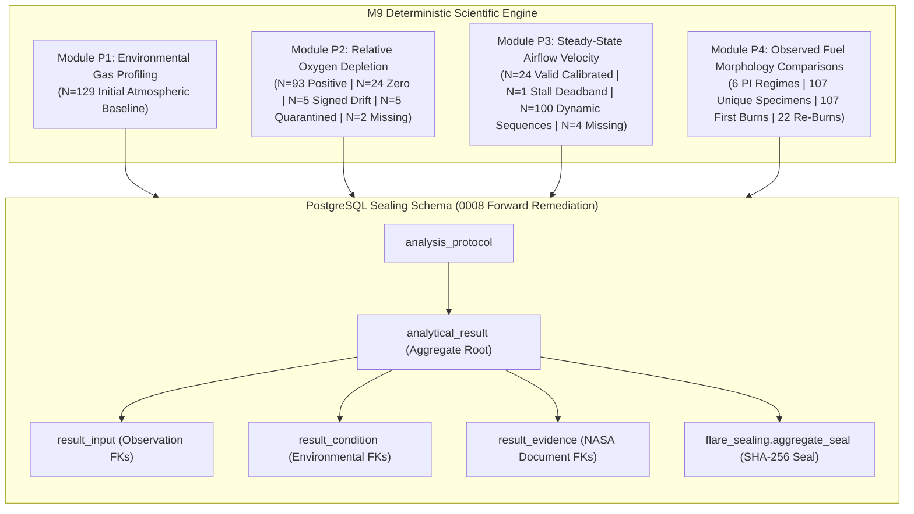

# FLARE Milestone 9: Final Scientific Analysis Engine Contract

**Document Identifier:** `FLARE-CONTRACT-FINAL-M9-V2`  
**Classification:** Definitive Scientific Interface & Analysis Contract (Read-Only Specification)  
**Authors:** Senior Combustion Scientist, Scientific Data Engineer, Python Architect  
**Project:** FLARE (Scientific Intelligence Platform for Spacecraft Fire Safety)  
**Target Investigation:** NASA PSI-25 / BASS-II Primary Experimental Flight Data  
**Verified Source SHA-256:** `71e792bf6b5fb5ea620c5dd70fbbac05515992e12aefcf5dff47312caa48c042`  
**Target Schema:** Ephemeral PostgreSQL Schema under Migrations `0003_m43_sealing` / `0008_m6_security_remediation`  
**Date:** November 2026  
**Status:** APPROVED FOR IMPLEMENTATION GATING (V2 FINAL CORRECTION)  

---

## 1. Executive Summary & Purpose

This contract establishes the formal, binding specification governing the execution of the **FLARE Milestone 9 (M9) Deterministic Scientific Analysis Engine**.

Following rigorous, multi-stage independent audits and cross-source reconciliation against primary NASA Physical Sciences Informatics (PSI-25 / BASS-II) archives, this contract defines the exact mathematical formulations, canonical SI units, input eligibility partitions, quality flag behaviors, and cryptographic sealing invariants governing all M9 analytical modules.

Every metric specified herein is **100% deterministic, reproducible, and verifiable** down to raw source observations in `PSI-25_Experimental table_BASS-II.csv` and persisted database entities, with zero fabricated physical parameters and zero speculative extrapolations.

---

## 2. Definitive Module Specifications



---

### 2.1 Module P1: Environmental Gas Descriptive Statistics

#### Protocol Identification
- **Protocol Code:** `M9-P1-ENV-STATS`
- **Protocol Version:** `1.0.0`
- **Governing Table:** `analysis_protocol` (`protocol_code = 'M9-P1-ENV-STATS'`)

#### Mathematical Formulations
1. **Sample Median ($\tilde{X}$):**
   $$\tilde{X} = \begin{cases}
     x_{\left(\frac{N+1}{2}\right)} & \text{if } N \text{ is odd} \\
     \frac{1}{2} \left( x_{\left(\frac{N}{2}\right)} + x_{\left(\frac{N}{2} + 1\right)} \right) & \text{if } N \text{ is even}
   \end{cases}$$
2. **Interquartile Range ($\text{IQR}$):**
   $$\text{IQR} = Q_3 - Q_1 = F_N^{-1}(0.75) - F_N^{-1}(0.25)$$
   Computed using NIST/SciPy default method (linear interpolation of empirical CDF, R Type 7).
3. **Non-Parametric Order-Statistic 95% Confidence Intervals for Median:**
   $$\text{CI}_{0.95} = \left[ x_{(j)}, x_{(k)} \right], \quad j = \left\lfloor \frac{N}{2} - 1.96 \frac{\sqrt{N}}{2} \right\rfloor, \quad k = \left\lceil \frac{N}{2} + 1.96 \frac{\sqrt{N}}{2} \right\rceil$$

#### Metric Payload Contracts

| Metric Identifier | Target Physical Property | Eligible Inputs & Counts | Source Unit | Canonical SI Unit | Quality Flags Applied |
| :--- | :--- | :--- | :---: | :---: | :--- |
| `ambient_initial_o2_median` | Baseline pre-ignition oxygen concentration | `Calibrated  initial O2 % by vol ` ($N = 129$, 100% complete) | `% by vol` | `mol/mol` ($X_{O2} = \frac{\%}{100}$) | `VALID_NUMERIC` |
| `ambient_initial_o2_iqr` | Dispersion of pre-ignition oxygen setpoints | `Calibrated  initial O2 % by vol ` ($N = 129$) | `% by vol` | `mol/mol` | `VALID_NUMERIC` |
| `ambient_initial_co2_median` | Background carbon dioxide in glovebox | `Initial CO2 % by vol` ($N = 127$ numeric; 2 `'none'` mapped to NULL) | `% by vol` | `mol/mol` ($X_{CO2} = \frac{\%}{100}$) | `VALID_NUMERIC` |
| `ambient_initial_co2_iqr` | Dispersion of background carbon dioxide | `Initial CO2 % by vol` ($N = 127$) | `% by vol` | `mol/mol` | `VALID_NUMERIC` |
| `ambient_initial_co_median` | Background carbon monoxide trace gas | `Initial CO (ppm)` ($N = 126$ numeric; 2 `'none'`; 1 `'OR'`) | `ppm` | $\mu\text{mol/mol}$ ($X_{CO} = \text{ppm} \times 1.0$) | `VALID_NUMERIC`, `SENSOR_ZERO_DRIFT_PRESERVED` |
| `ambient_initial_co_iqr` | Dispersion of background carbon monoxide | `Initial CO (ppm)` ($N = 126$) | `ppm` | $\mu\text{mol/mol}$ | `VALID_NUMERIC`, `SENSOR_ZERO_DRIFT_PRESERVED` |

#### Specific Quality & Drift Invariant
Negative initial $CO$ values ($-1, -2, -3\text{ ppm}$, $N=13$) represent zero-point electrochemical baseline sensor drift. They are preserved signed as `Decimal('-3.0')` and included in order-statistic median/IQR rankings to prevent positive statistical distortion. They are **never clamped to zero**.

---

### 2.2 Module P2: Relative Oxygen Depletion Analysis

#### Protocol Identification
- **Protocol Code:** `M9-P2-O2-DEPLETION`
- **Protocol Version:** `1.0.0`

#### Mathematical Formulations (Strictly Relative Metrics)
1. **Volumetric Oxygen Depletion:**
   $$\Delta X_{O2} = X_{O2,init} - X_{O2,final} \quad [\% \text{ by vol}]$$
2. **Canonical SI Mole Fraction Depletion:**
   $$\Delta \chi_{O2} = \frac{\Delta X_{O2}}{100.0} = \frac{X_{O2,init} - X_{O2,final}}{100.0} \quad [\text{mol/mol}]$$
3. **Relative Oxygen Depletion Ratio ($\Pi_{O2}$):**
   $$\Pi_{O2} = \frac{X_{O2,init} - X_{O2,final}}{X_{O2,init}} \quad [\text{dimensionless}]$$

#### Exact Record Set Eligibility Partition (Audited in `m9_p2_record_eligibility.csv`)
The 129 flight records are partitioned into four disjoint categories, with explicit distinction between positive depletion, zero depletion, and negative sensor drift:

```
+--------------------------------------------------------------------------------------------------------------------------+
| CATEGORY / REGIME            | RECORD COUNT | DELTA O2 RANGE      | STANDARD AGGREGATIONS | SIGNED CDF / ORDER STATS     |
+--------------------------------------------------------------------------------------------------------------------------+
| POSITIVE_DEPLETION           | N = 93       | +0.1% to +3.2%      | ELIGIBLE              | ELIGIBLE                     |
| ZERO_DEPLETION               | N = 24       | exactly 0.0%        | ELIGIBLE              | ELIGIBLE                     |
| NEGATIVE_SENSOR_DRIFT        | N = 5        | exactly -0.1%       | EXCLUDED (Non-Phys)   | ELIGIBLE (Signed Unclamped)  |
| QUARANTINED_GROSS_ANOMALY    | N = 5        | -19.7% to +20.6%    | EXCLUDED (Quarantine) | EXCLUDED (Quarantine)        |
| MISSING_FINAL_O2             | N = 2        | NULL ('none')       | EXCLUDED (Missing)    | EXCLUDED (Missing)           |
+--------------------------------------------------------------------------------------------------------------------------+
| TOTAL INGESTED FLIGHT ROWS   | N = 129      |                     |                       |                              |
+--------------------------------------------------------------------------------------------------------------------------+
```

1. **Partition 1A: Measurable Positive Depletion ($N = 93$, $\Delta X_{O2} > 0$):**
   - **Range:** $+0.1\%$ to $+3.2\%$ ($0.0010$ to $0.0320\text{ mol/mol}$).
   - **Physical State:** Verified fuel oxidation occurred, depleting chamber oxygen.
   - **Eligibility:** Eligible for all P2 metrics (mean, median, IQR, relative ratio $\Pi_{O2}$).
   - **Quality Flag:** `POSITIVE_DEPLETION`.
2. **Partition 1B: Zero Depletion ($N = 24$, $\Delta X_{O2} == 0.0\%$):**
   - **Value:** $X_{O2,final} == X_{O2,init}$ (delta exactly $0.0000$).
   - **Physical State:** No net change detected by the sensor (brief ignition attempts, immediate quench, or consumption below the $0.1\%$ resolution threshold).
   - **Eligibility:** Eligible for median, IQR, and cumulative distribution metrics. When computing relative ratio $\Pi_{O2} = 0 / X_{init}$, yields valid scalar $0.0$.
   - **Quality Flag:** `ZERO_DEPLETION`.
   - *Subtotal Non-Negative Depletion ($1A + 1B$):* Exactly **$N = 117$ records**.
3. **Partition 2: Resolution-Limited Negative Drift ($N = 5$, Tests `T5, T10, T12, T13, T23`):**
   - **Observed Value:** $\Delta X_{O2} = -0.1\%$ ($X_{O2,final} = X_{O2,init} + 0.1\%$).
   - **Preservation Rule:** Stored signed as `Decimal('-0.0010') mol/mol`. **Never clamped to zero; never imputed to an artificial positive interval.**
   - **Eligibility:** Excluded from standard positive mass balances where negative consumption is non-physical. Eligible **only** for complete signed distribution reporting (empirical CDF) and non-parametric order statistics.
   - **Quality Flag:** `SENSOR_RESOLUTION_LIMIT_NEGATIVE_DRIFT`.
   - *Subtotal Reconciled Valid Records ($117 + 5$):* Exactly **$N = 122$ paired records**.
4. **Partition 3: Quarantined Gross Recording Anomalies ($N = 5$, Tests `B2, P22a, P22b, T28a, T28b`):**
   - **Observed Values:** $|\Delta X_{O2}| > 19\%$ (e.g. Test `B2`: $22.2 \to 1.6\%$, Test `P22b`: $20.0 \to 39.1\%$).
   - **Eligibility:** **STRICTLY EXCLUDED** from all P2 quantitative metrics.
   - **Quality Flag:** `QUARANTINED_GROSS_RECORDING_ANOMALY`.
5. **Partition 4: Missing Final Telemetry ($N = 2$, Tests `B14, F3`):**
   - **Observed Values:** Final $O_2$ recorded as literal `'none'`. Mapped to typed SQL `NULL`.
   - **Eligibility:** **STRICTLY EXCLUDED** from all paired depletion calculations.
   - **Quality Flag:** `EXCLUDED_MISSING_FINAL_MEASUREMENT`.

---

### 2.3 Explicit Deferral of Apparent Respiratory Quotient ($RQ_{comb}$)

#### Mathematical Definition & Sign Convention
The combustion respiratory quotient is defined as:
$$RQ_{comb} = \frac{\Delta X_{CO2}}{\Delta X_{O2}} = \frac{X_{CO2,final} - X_{CO2,init}}{X_{O2,init} - X_{O2,final}}$$
where positive signs denote $CO_2$ generation and $O_2$ consumption. For complete PMMA combustion, $RQ_{theoretical} = 5/6 \approx 0.833$.

#### Audit Findings on Incomparability
1. **Mathematical Degeneracy (Division by Zero):** In **24 flight runs**, $\Delta X_{O2} = 0.0\%$, making $RQ_{comb}$ undefined ($\Delta X_{CO2} / 0$).
2. **Extreme Noise Magnification:** In over 60% of runs, $\Delta X_{O2} \le 0.2\%$. Because the electrochemical $O_2$ sensor has a discretization uncertainty of $\pm 0.1\%$, the relative error in the denominator is $100\%$, causing computed quotients to fluctuate erratically between $0.00$ and $1.40$, including negative quotients (e.g. Test `O12`: $-0.10$, Test `T5`: $-0.50$).
3. **Sensor Spatial & Temporal Asynchrony:** The $O_2$ sensor and the CDM NDIR $CO_2$ sensor are located at different positions in the MSG duct recirculation loop and have differing pneumatic response constants. Without a dynamic mixing model, instantaneous post-burn readings are not physically comparable.

#### Decision
**$RQ_{comb}$ is EXPLICITLY DEFERRED from Milestone 9 implementation.** It will not be calculated or stored in `analytical_result`.

---

### 2.4 Module P3: Steady-State Calibrated Airflow Mapping

#### Protocol Identification
- **Protocol Code:** `M9-P3-AIRFLOW-STEADY`
- **Protocol Version:** `1.0.0`

#### Authentic Calibration Equation
From NASA Glenn SPICE calibration workbook (`Fan calibration data.xlsx`, Row 33):
$$U_\infty = 1.0066 \times (\text{Air Display}) \quad [\text{cm/s}]$$
Canonical SI conversion:
$$U_\infty = (1.0066 \times \text{Air Display}) \times 10^{-2} \quad [\text{m/s}]$$

#### Distinguishing Calibration Domain from Restrictor Limits
- **Restrictor Operational Limits (Hardware Flow Limits):**  
  The maximum aerodynamic flow rate achievable by the fan through a specific duct baffle plate:
  - `Flow restrictor = 0` (No restrictor plate): Operational limit up to $59.0\text{ cm/s}$ ($0.590\text{ m/s}$).
  - `Flow restrictor = 1` (1 restrictor plate): Operational limit up to $40.0\text{ cm/s}$ ($0.400\text{ m/s}$).
  - `Flow restrictor = 2` (2 restrictor plates): Operational limit up to $40.0\text{ cm/s}$ ($0.400\text{ m/s}$).
- **Empirical Calibration Domain (Primary Evidence):**  
  The discrete setpoints where hot-wire anemometer readings were empirically cross-calibrated against SPICE laser Doppler traverses in `Fan calibration data.xlsx`. Across the 27 GMT test blocks, calibration points span $2.0\text{ to }40.0\text{ cm/s}$.
- **Eligible Scalar Subset ($N = 24$):**  
  All 24 positive scalar runs (`Air display` $\in [2.0, 15.0]\text{ cm/s}$) fall strictly within the empirical calibration domain. Eligible for static velocity mapping ($U_\infty = 0.02013\text{ to }0.15099\text{ m/s}$).
- **Motor Shut-Off / Stall Deadband ($N = 1$, Test `O2`):**  
  `Air display = 0.0`. `Fan calibration data.xlsx` Row 1 explicitly notes the fan turns off above 3.8 V (`Fan display` $\le 38$). Reading sits at zero flow / motor cutoff and is flagged `MOTOR_STALL_DEADBAND`. Excluded from convective flow velocity regressions.
- **Dynamic Sequence Exclusion ($N = 100$):**  
  The 100 records containing multi-step potentiometer adjustments (e.g. `'10 8'`, `'3.0 3.1 3.2 6.4 5.5 5.4'`) or operator notes (e.g. `'5 2 slow decr to ext'`) are classified as `DYNAMIC_FLOW_SEQUENCE` and **strictly excluded** from steady-state scalar velocity mapping due to the $\sim 1\text{-minute}$ hot-wire response lag.
- **Missing Telemetry ($N = 4$, Tests `O7, O8a, O8b, O9`):** Excluded with flag `MISSING_AIRFLOW`.

---

### 2.5 Module P4: Observed Fuel Morphology & Specimen Grouping

#### Protocol Identification
- **Protocol Code:** `M9-P4-FUEL-REGIMES`
- **Protocol Version:** `1.0.0`

#### Complete Elimination of Biot Number Inferences
- **Rule:** All previous claims that thin films exhibit $Bi \ll 0.1$ or thick slabs exhibit $Bi \gg 1.0$ are **strictly expunged**.
- **Justification:** Solid thermal conductivity ($k_s$), solid density, flame standoff distance, and local convective heat transfer coefficients ($h_c$) were not measured in BASS-II.
- **Enforced Metrology:** Fuel specimens are classified **strictly by observed categorical morphology and nominal dimensions** as recorded by NASA Principal Investigators.

#### Observed Morphological Regimes (Audited in `m9_p4_test_regime_mapping.csv`)

| Regime Code | Observed Morphology Description | Flow Geometry | Flight Runs ($N$) | Unique Specimens |
| :--- | :--- | :--- | :---: | :---: |
| `THIN_PMMA_FILMS` | Cast PMMA thin films ($100 - 400\ \mu\text{m}$ nominal thickness) | Opposed flow | **22** | **19** |
| `THICK_PMMA_SLABS_1SIDED` | Cast PMMA slabs ($1 - 5\text{ mm}$) with 1-sided phenolic mount | Opposed flow | **5** | **5** |
| `THICK_PMMA_SLABS_2SIDED` | Cast PMMA slab ($3\text{ mm}$) with 2-sided unbacked free burn | Opposed flow | **1** | **1** |
| `THICK_PMMA_SLABS_UNSPECIFIED` | Cast PMMA slabs ($1 - 5\text{ mm}$) mounting unspecified in CSV | Opposed flow | **14** | **14** |
| `CLEAR_PMMA_RODS_STAGNATION` | Clear cast PMMA cylindrical rods (1/4", 3/8", 1/2" diameter) | Stagnation / concurrent | **27** | **20** |
| `BLACK_PMMA_RODS_OPPOSED` | Black carbon-doped PMMA rods (1/4", 3/8", 1/2" diameter) | Opposed flow | **27** | **20** |
| `SIBAL_FABRIC_OPPOSED` | SIBAL fabric (75% cotton / 25% fiberglass woven blend) | Opposed flow | **27** | **21** |
| `PMMA_SPHERE_SEGMENT` | Cast PMMA 4 cm spherical section | Forced flow over sphere | **2** | **1** |
| `NOMEX_III_FABRIC` | Nomex III natural aramid woven fabric | Opposed flow | **3** | **3** |
| `CANDLE_WAX_WICK` | Japan Wax paraffin candle with cotton wick | Coflow diffusion | **1** | **1** |
| **Total Ingested Dataset** | **All Experimental Runs** | | **129** | **107** |

#### Pseudoreplication Management & Reporting
- **Run Count vs. Specimen Count:** Exactly **129 flight runs** conducted on **107 unique physical specimens**.
- **Repeated Burn Breakdown:** Exactly **20 specimens were burned multiple times** (accounting for 42 runs: 20 first burns + 22 re-burns). Exactly **87 specimens were burned exactly once** (87 runs).
- **Subsets Defined:**
  1. **`FIRST_BURN_SUBSET` ($N = 107$ runs):** Each unique specimen's initial ignition test.
  2. **`SUBSEQUENT_REBURN_SUBSET` ($N = 22$ runs):** Tests conducted on previously ignited specimens.
- **Statistical Independence Caveat:** The engine contract **does not claim that $N=107$ establishes statistical independence**. Even for first burns, observations conducted on the same GMT day shared unvented glovebox air (where background $CO$ accumulated up to $950\text{ ppm}$ and $CO_2$ rose up to $1.9\%$). All formal statistical models must treat `GMT` day and sequence index as potential clustering covariates.

---

## 3. Explicit Scientific Prohibitions

The following operations are **strictly prohibited** in Milestone 9 implementation:

1. **NO Biot Number Calculations or Regimes:** No $Bi$ values may be computed or inferred.
2. **NO LOI Prediction via Logistic Regression:** Miller's thick slabs were tested only at $\ge 17.9\% O_2$. Zero extinction events exist in the slab records ($20:0$ class balance).
3. **NO Flame Spread Rate Calculations ($V_f$):** Spatial tracking coordinates ($x_f(t)$) do not exist in the tabular CSV.
4. **NO Absolute Molar Oxygen Consumption:** Static pressure ($P$), temperature ($T$), and net displaced volume are unrecorded. Only relative differences ($\Delta X_{O2}, \Pi_{O2}$) are permitted.
5. **NO Cubic Flow Polynomials:** The authentic NASA calibration is strictly linear in `Air display`.
6. **NO Extrapolation of Calibration Curves:** No velocity conversion outside verified empirical calibration points ($2.0 - 15.0\text{ cm/s}$ for scalar subset); zero flow deadband is flagged and excluded.
7. **NO Gravitational Extrapolations or Fire Risk Odds:** Zero extrapolations to Lunar/Martian gravity or Loss-of-Crew odds.

---

## 4. PostgreSQL Database Alignment & Sealing Invariants

Every analytical output generated by M9 binds directly to the forward-remediated M6 database schema (`0008_m6_security_remediation`) without requiring schema modifications:

- **`analysis_protocol`:** Governs protocol code (`M9-P1-ENV-STATS`, `M9-P2-O2-DEPLETION`, `M9-P3-AIRFLOW-STEADY`, `M9-P4-FUEL-REGIMES`), version, and JSONB parameter schemas.
- **`analytical_result`:** Aggregate root storing method identifier, numeric scalar values, canonical SI units, and quality flags.
- **`result_input`:** Binds results directly to underlying raw `observation` UUIDs and source CSV row numbers (2–130).
- **`result_condition`:** Binds results to verified environmental conditions (`experimental_condition`).
- **`result_evidence`:** Binds results to NASA PSI-25 reference documents.
- **`flare_sealing.aggregate_seal`:** Invokes `flare_sealing.seal_analytical_result()` to compute and lock immutable SHA-256 cryptographic seals over the aggregate tree.

All participating source observations reference the verified authentic source hash:
`71e792bf6b5fb5ea620c5dd70fbbac05515992e12aefcf5dff47312caa48c042`.
