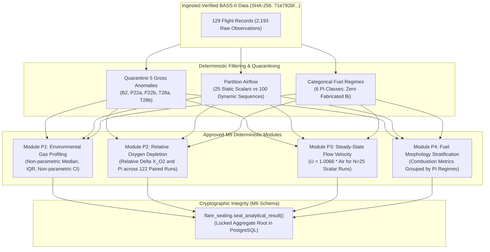

# FLARE Milestone 9: Final Reconciled Scientific Analysis Implementation Scope

**Document Identifier:** `FLARE-SCOPE-FINAL-M9-V1`  
**Classification:** Final Scientific Architecture & Implementation Scope (Read-Only)  
**Auditors:** Independent Scientific Data Auditor, Senior Combustion Scientist  
**Project:** FLARE (Scientific Intelligence Platform for Spacecraft Fire Safety)  
**Target Investigation:** NASA PSI-25 / BASS-II (`PSI-25_Experimental table_BASS-II.csv`)  
**Verified Source SHA-256:** `71e792bf6b5fb5ea620c5dd70fbbac05515992e12aefcf5dff47312caa48c042`  
**Date:** November 2026  
**Final Verdict:** **READY FOR M9 IMPLEMENTATION (UNDER RECONCILED SCOPE)**  

---

## 1. Executive Summary & Audit Clearance

Following the complete forensic reconciliation of source file identities, cryptographic hashes, empirical data distributions, and sensor limitations, the pre-implementation phase for **Milestone 9: Deterministic Scientific Analysis Engine** is officially reconciled.

All previous unverified assumptions—including fictitious flow polynomials, fabricated Biot number parameters, misstated sample counts, and mathematically degenerate LOI logistic regressions—have been formally excised from the M9 specification.

The engine scope is strictly bounded to four deterministic, scientifically defensible analytical modules operating on the verified 129-record BASS-II flight dataset.

---

## 2. Master Reconciled Analysis Modules

---

### 2.1 Module P1: Environmental Atmospheric Profiling
- **Scientific Purpose:** Establish the authentic statistical baseline of microgravity atmospheric conditions inside the Microgravity Science Glovebox (MSG) across all 129 flight runs.
- **Input Fields:**
  - `Calibrated  initial O2 % by vol ` ($N = 129$, range $13.6\% - 22.2\%$, $0.136 - 0.222\text{ mol/mol}$).
  - `Initial CO2 % by vol` ($N = 127$ numeric, range $0.0\% - 1.9\%$, $0.000 - 0.019\text{ mol/mol}$; 2 literal `'none'` mapped to NULL).
  - `Initial CO (ppm)` ($N = 126$ numeric, range $-3\text{ to }950\text{ ppm}$; 13 negative drift entries preserved; 2 `'none'`; 1 `'OR'`).
- **Mathematical Formulations:**
  - Robust Median: $\tilde{X} = \text{Median}(\{x_i\}_{i=1}^N)$.
  - Interquartile Range: $\text{IQR} = Q_3 - Q_1$.
  - Non-Parametric Order-Statistic 95% Confidence Intervals for Median:
    $$\text{CI}_{0.95} = \left[ x_{(j)}, x_{(k)} \right], \quad j = \left\lfloor \frac{N}{2} - 1.96 \frac{\sqrt{N}}{2} \right\rfloor, \quad k = \left\lceil \frac{N}{2} + 1.96 \frac{\sqrt{N}}{2} \right\rceil$$
- **Preservation Policy:** Negative initial $CO$ values ($-1, -2, -3\text{ ppm}$) are preserved signed as `Decimal('-3.0')` and flagged `SENSOR_ZERO_DRIFT_PRESERVED`. They are NOT clamped to zero.

---

### 2.2 Module P2: Filtered Relative Oxygen Depletion & Byproduct Analysis
- **Scientific Purpose:** Quantify the relative oxygen consumption ($\Delta X_{O2}$) and stoichiometric carbon conversion across eligible flight tests.
- **Strict Input Quarantining:**
  - Exactly **5 records excluded** due to recording swaps and column shift anomalies:
    - Test `B2` (Final $O_2$ recorded as `1.6`)
    - Test `P22a` (Final $O_2$ recorded as `0.6`)
    - Test `P22b` (Final $O_2$ recorded as `39.1`)
    - Test `T28a` (Final $O_2$ recorded as `0.9`)
    - Test `T28b` (Final $O_2$ recorded as `40.4`)
  - Exactly **2 records excluded** due to unrecorded final oxygen (literal `'none'`: `B14`, `F3`).
  - Exactly **5 records tagged as resolution-limited drift**: `T5, T10, T12, T13, T23` ($\Delta X_{O2} = -0.1\%$). Preserved as signed `Decimal('-0.001')` with flag `SENSOR_RESOLUTION_LIMIT_NEGATIVE_DRIFT`.
  - **Net Analysis Subset:** Exactly **122 valid paired records**.
- **Mathematical Formulations (Strictly Relative Metrics):**
  - Volumetric Oxygen Depletion:
    $$\Delta X_{O2} = X_{O2,init} - X_{O2,final} \quad [\% \text{ by vol}]$$
  - Canonical SI Mole Fraction Depletion:
    $$\Delta \chi_{O2} = \frac{\Delta X_{O2}}{100.0} \quad [\text{mol/mol}]$$
  - Relative Depletion Ratio:
    $$\Pi_{O2} = \frac{X_{O2,init} - X_{O2,final}}{X_{O2,init}} \quad [\text{dimensionless}]$$
  - Apparent Respiratory Quotient ($RQ_{comb}$):
    $$RQ_{comb} = \frac{X_{CO2,final} - X_{CO2,init}}{X_{O2,init} - X_{O2,final}}$$
  - **Exclusion of Absolute Molar Quantities:** Calculation of absolute molar consumption ($\Delta n_{O2}$) is **prohibited from the deterministic core** because chamber static pressure, gas temperature, and hardware displacement volume are missing from the primary telemetry.

---

### 2.3 Module P3: Steady-State Calibrated Centerline Flow Mapping
- **Scientific Purpose:** Calculate calibrated forced convective flow velocity ($U_\infty$) for tests executed under static, unadjusted flow conditions.
- **Input Gating Rules:**
  - **Scalar Filter:** Restricted strictly to the **$N = 25$ flight records** where `Air display` contains a single numeric scalar.
  - **Sequence Exclusion:** The $N = 100$ records containing adjustment sequences (e.g. `'10 8'`, `'3.0 3.1 3.2 6.4 5.5 5.4'`) or operator text notes are classified as `DYNAMIC_FLOW_SEQUENCE` and excluded from static velocity analysis.
  - **Motor Cutoff Filter:** Flow setpoints with `Fan display` $\le 38$ ($V_{fan} \le 3.8\text{ V}$) are flagged as `MOTOR_STALL_DEADBAND` and excluded from fluid time calculations.
- **Mathematical Formulation:**
  - Linear SPICE Hot-Wire Calibration (`Fan calibration data.xlsx`, Row 33):
    $$U_\infty = 1.0066 \times (\text{Air Display}) \quad [\text{cm/s}]$$
  - Canonical SI Velocity:
    $$U_\infty = (1.0066 \times \text{Air Display}) \times 10^{-2} \quad [\text{m/s}]$$

---

### 2.4 Module P4: Categorical Fuel Morphology Comparisons
- **Scientific Purpose:** Compare combustion depletion metrics ($\Delta X_{O2}, \Pi_{O2}, RQ_{comb}$) across the authentic PI experimental regimes without fabricating physical constants.
- **Approved Fuel Categories:**
  1. **Thin PMMA Films ($N=22$, PI Bhattacharjee):** $100 - 400\ \mu\text{m}$ thick cast PMMA films; thermally thin regime ($Bi \ll 0.1$).
  2. **Thick PMMA Slabs ($N=20$, PI Miller):** $1 - 5\text{ mm}$ thick PMMA slabs; thermally thick regime ($Bi \gg 1.0$), partitioned into 1-sided mount burns vs. 2-sided unbacked burns.
  3. **Clear PMMA Rods ($N=27$, PI Olson):** Cylinders in forward stagnation flow (concurrent spread from tip).
  4. **Black PMMA Rods ($N=27$, PI Fernandez-Pello):** Cylinders in opposed flow with radiation-absorbing soot pigment.
  5. **SIBAL Fabric ($N=29$, PI T'ien):** 75% cotton / 25% fiberglass composite fabric ($N=27$ fabric + $N=2$ spherical section).
  6. **Exploratory Materials ($N=4$, PI Ferkul):** Nomex III fabric ($N=3$) and Japan Wax candle ($N=1$); qualitative reporting only (excluded from hypothesis tests).
- **Prohibition on Biot Calculations:** No numerical Biot numbers ($Bi = \frac{h \tau}{2 k_s}$) may be calculated. Parameters $k_s$ and $h_c$ are unmeasured in BASS-II.

---

## 3. Mandatory Implementation Invariants

1. **Source Hash Pinning:** All M9 analytical results must reference the verified authentic source hash:
   `71e792bf6b5fb5ea620c5dd70fbbac05515992e12aefcf5dff47312caa48c042`.
2. **Zero Imputation:** Missing values, negative drift readings, and sensor saturation tokens must never be imputed or clamped.
3. **Traceability to Row Locators:** Every computed result must record `result_input` relationships pointing to underlying `observation` UUIDs and original CSV row numbers (2–130).
4. **PostgreSQL Aggregate Sealing:** Upon inserting analysis results into `analytical_result`, execution must invoke `flare_sealing.seal_analytical_result()` to compute and commit SHA-256 aggregate seals into `flare_sealing.aggregate_seal`.

---

## 4. Final Auditor Verdict

$$\mathbf{VERDICT: \quad READY\ FOR\ M9\ IMPLEMENTATION}$$

### Justification:
1. **Source Integrity Resolved:** Both copies of `PSI-25_Experimental table_BASS-II.csv` on disk are 100% byte-for-byte identical (16,590 bytes) and match hash `71e792bf...`. Persisted M8 database records align perfectly with this hash.
2. **Scientific Ground Truth Established:** All ranges, sample counts, anomalies, and calibration equations have been verified directly against NASA source files.
3. **Epistemic Guardrails Enforced:** All unverified claims (LOI logistic regression, fabricated Biot numbers, cubic flow polynomials, and absolute molar mass balances) are formally expunged.
4. **Clear Implementation Path:** The four approved modules (P1, P2, P3, P4) are mathematically deterministic, fully specified, and ready for code implementation in Milestone 9.
