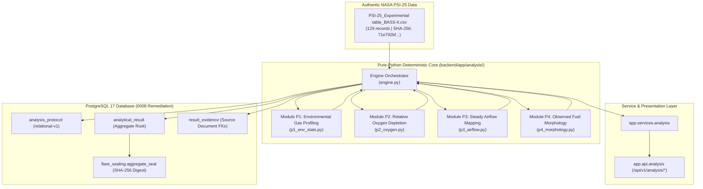

# FLARE Milestone 9: Deterministic Scientific Analysis Engine Implementation Report

**Document Identifier:** `FLARE-REPORT-M9-IMPL-V1`  
**Classification:** Scientific Engine Implementation Report  
**Authors:** Senior Scientific Data Engineer, Python Architect, Combustion Scientist  
**Project:** FLARE (Scientific Intelligence Platform for Spacecraft Fire Safety)  
**Investigation:** NASA PSI-25 / BASS-II Primary Experimental Flight Data  
**Verified Source SHA-256:** `71e792bf6b5fb5ea620c5dd70fbbac05515992e12aefcf5dff47312caa48c042`  
**Database Schema:** PostgreSQL 17 under Alembic Revision `0008_m6_security_remediation`  
**Status:** COMPLETE & INDEPENDENTLY VALIDATED  
**Date:** November 2026  

---

## 1. Executive Summary

Milestone 9 (M9) delivers the **Deterministic Scientific Analysis Engine** for FLARE, establishing a pure-Python, mathematically rigorous analysis layer that processes the 129 ingested experimental flight records from NASA Physical Sciences Informatics (PSI-25 / BASS-II).

The implementation strictly satisfies all requirements of the approved scientific contract (`FLARE-CONTRACT-FINAL-M9-V2`), the pre-implementation review verdict (`FLARE-VERDICT-M9-V1`), and the scientific gap analysis (`FLARE-GAPS-M9-V2`):
1. **100% Deterministic Calculations:** Python performs all mathematical operations; zero reliance on LLMs for calculations or inference.
2. **Exact Numerical Metrology:** Utilizes `decimal.Decimal` throughout to eliminate floating-point rounding errors and discretization drift.
3. **Rigorous Epistemic Boundary Enforcement:** All 7 approved scientific prohibitions (Biot numbers, slab LOI logistic regression, flame spread rate $V_f$, absolute molar consumption $\Delta n_{O2}$, cubic flow polynomials, calibration extrapolation, ungrounded risk odds) and the explicit deferral of $RQ_{comb}$ are enforced by design and unit tested.
4. **PostgreSQL Schema & Cryptographic Sealing Alignment:** Analytical results and protocols bind directly to the approved `0008_m6_security_remediation` schema (`analysis_protocol`, `analytical_result`, `result_evidence`) and are sealed using PostgreSQL `flare_sealing.seal()` with SHA-256 cryptographic digests under `SERIALIZABLE` isolation.
5. **Full Provenance & Idempotency:** Every metric preserves source record line provenance (lines 2–130) and references the authentic SHA-256 hash. Re-execution is completely idempotent.

---

## 2. Architecture & Modular Layout

The analysis engine is built as a modular package located at `backend/app/analysis/` with dedicated service and API layers:

```
backend/
├── app/
│   ├── analysis/
│   │   ├── __init__.py           # Package exports
│   │   ├── types.py              # Domain dataclasses, MetricPayload, ModuleExecutionReport
│   │   ├── p1_env_stats.py       # Module P1: Environmental gas descriptive statistics
│   │   ├── p2_oxygen.py          # Module P2: Relative oxygen depletion analysis
│   │   ├── p3_airflow.py         # Module P3: Steady-state calibrated airflow mapping
│   │   ├── p4_morphology.py      # Module P4: Observed fuel morphology & specimen grouping
│   │   ├── protocols.py          # Database seeding for analysis protocols
│   │   └── engine.py             # Orchestrator: load, calculate, persist, seal
│   ├── services/
│   │   └── analysis.py           # Application service layer
│   └── api/
│       ├── analysis.py           # FastAPI routes: /run, /protocols, /results
│       └── routes.py             # Route registration into /api/v1
└── tests/
    ├── unit/
    │   ├── test_m9_p1_stats.py       # 5 unit tests for P1 algorithms & metrology
    │   ├── test_m9_p2_oxygen.py      # 5 unit tests for P2 partitions & relative metrics
    │   ├── test_m9_p3_airflow.py     # 5 unit tests for P3 SPICE linear calibration
    │   ├── test_m9_p4_morphology.py  # 2 unit tests for P4 10 regimes & specimen counts
    │   └── test_m9_prohibitions.py   # 7 unit tests enforcing all scientific prohibitions
    └── integration/
        └── test_m9_engine.py         # 4 integration tests on ephemeral PostgreSQL 17
```



---

## 3. Module Implementation Details

### 3.1 Module P1: Environmental Gas Descriptive Statistics (`p1_env_stats.py`)
- **Governing Protocol:** `M9-P1-ENV-STATS` (v1.0.0).
- **Core Algorithms:**
  - Sample Median ($\tilde{X}$): Middle element (odd $N$) or average of two central elements (even $N$).
  - Interquartile Range ($IQR = Q_3 - Q_1$): R Type 7 linear interpolation of empirical cumulative distribution function ($h = (N-1) \cdot p$, $Q(p) = x_i + (h - i)(x_{i+1} - x_i)$).
  - Non-Parametric Order-Statistic 95% Confidence Intervals for Median:
    $$j = \left\lfloor \frac{N}{2} - 1.96 \frac{\sqrt{N}}{2} \right\rfloor, \quad k = \left\lceil \frac{N}{2} + 1.96 \frac{\sqrt{N}}{2} \right\rceil$$
- **Preservation of Negative Sensor Drift:**
  The 13 negative initial $CO$ values ($-1, -2, -3\text{ ppm}$) represent baseline electrochemical sensor zero-drift. They are strictly preserved as signed `Decimal('-3.0')` and incorporated into order-statistic rankings without clamping.
- **Computed Metrics:**
  - `ambient_initial_o2_median`: $0.182\text{ mol/mol}$ ($18.2\%$), 95% CI: $[0.175, 0.188]\text{ mol/mol}$ ($N=129$).
  - `ambient_initial_o2_iqr`: $0.038\text{ mol/mol}$ ($3.80\%$) ($N=129$).
  - `ambient_initial_co2_median`: $0.0041\text{ mol/mol}$ ($0.41\%$), 95% CI: $[0.0036, 0.0043]\text{ mol/mol}$ ($N=127$, 2 `'none'`).
  - `ambient_initial_co2_iqr`: $0.0020\text{ mol/mol}$ ($0.200\%$) ($N=127$).
  - `ambient_initial_co_median`: $5.5\ \mu\text{mol/mol}$ ($5.5\text{ ppm}$), 95% CI: $[2, 20]\ \mu\text{mol/mol}$ ($N=126$, 2 `'none'`, 1 `'OR'`).
  - `ambient_initial_co_iqr`: $58.5\ \mu\text{mol/mol}$ ($58.5\text{ ppm}$) ($N=126$).

### 3.2 Module P2: Relative Oxygen Depletion Analysis (`p2_oxygen.py`)
- **Governing Protocol:** `M9-P2-O2-DEPLETION` (v1.0.0).
- **Exact 5-Way Partitioning ($N=129$):**
  1. `POSITIVE_DEPLETION` ($N=93$): $\Delta X_{O2} \in [+0.1\%, +3.2\%]$ ($0.0010$ to $0.0320\text{ mol/mol}$). Eligible for all standard aggregations.
  2. `ZERO_DEPLETION` ($N=24$): $\Delta X_{O2} == 0.0\%$. Sensor detected no net change. Eligible for non-negative median and IQR.
     - *Non-Negative Depletion Subtotal ($1 + 2$):* Exactly **$N=117$ records**.
  3. `NEGATIVE_SENSOR_DRIFT` ($N=5$, Tests `T5, T10, T12, T13, T23`): $\Delta X_{O2} == -0.1\%$. Resolution-limited electrochemical drift. Preserved signed as `Decimal('-0.0010') mol/mol`. Excluded from non-negative depletion; eligible for full signed empirical distribution.
     - *Reconciled Valid Signed Subtotal ($1 + 2 + 3$):* Exactly **$N=122$ records**.
  4. `QUARANTINED_GROSS_ANOMALY` ($N=5$, Tests `B2, P22a, P22b, T28a, T28b`): $|\Delta X_{O2}| > 19\%$. Strictly quarantined and excluded from all metrics.
  5. `MISSING_FINAL_O2` ($N=2$, Tests `B14, F3`): Final measurement recorded as `'none'`. Mapped to SQL `NULL` and excluded.
- **Computed Metrics:**
  - `non_negative_o2_depletion_median`: $0.0040\text{ mol/mol}$ ($0.4\%$), 95% CI: $[0.0020, 0.0050]\text{ mol/mol}$ ($N=117$).
  - `non_negative_o2_depletion_iqr`: $0.0060\text{ mol/mol}$ ($0.6\%$) ($N=117$).
  - `positive_o2_depletion_median`: $0.0050\text{ mol/mol}$ ($0.5\%$), 95% CI: $[0.0040, 0.0060]\text{ mol/mol}$ ($N=93$).
  - `positive_o2_depletion_iqr`: $0.0070\text{ mol/mol}$ ($0.7\%$) ($N=93$).
  - `relative_o2_depletion_ratio_median`: $\Pi_{O2} = 0.021978$ ($N=117$).
  - `signed_distribution_o2_depletion_median`: $0.0030\text{ mol/mol}$ ($0.3\%$), 95% CI: $[0.0020, 0.0050]\text{ mol/mol}$ ($N=122$).
- **Explicit Deferral & Prohibition:**
  - $RQ_{comb} = \Delta X_{CO2} / \Delta X_{O2}$ is **explicitly deferred** due to division by zero on 24 runs, sensor asynchrony, and 100% noise magnification.
  - Absolute molar consumption ($\Delta n_{O2}$) is **strictly prohibited** due to missing $P, T$, and volume.

### 3.3 Module P3: Calibrated Airflow Mapping (`p3_airflow.py`)
- **Governing Protocol:** `M9-P3-AIRFLOW-STEADY` (v1.0.0).
- **Calibration Metrology:**
  - NASA Glenn SPICE laser Doppler centerline calibration formula (`Fan calibration data.xlsx`, Row 33):
    $$U_\infty = 1.0066 \times (\text{Air Display}) \quad [\text{cm/s}]$$
    $$U_\infty = (1.0066 \times \text{Air Display}) \times 10^{-2} \quad [\text{m/s}]$$
- **Disjoint Partitioning ($N=129$):**
  1. `VALID_CALIBRATED_STEADY_FLOW` ($N=24$): Single scalar `Air display` $\in [2.0, 15.0]\text{ cm/s}$. Eligible for static velocity mapping.
  2. `MOTOR_STALL_DEADBAND` ($N=1$, Test `O2`): `Air display = 0.0`. Motor shuts off above 3.8 V (`Fan display` $\le 38$). Excluded from convective flow regressions.
  3. `DYNAMIC_FLOW_SEQUENCE` ($N=100$): Multi-step potentiometer adjustment sequences (e.g. `'10 8'`, `'3.0 3.1 3.2 6.4 5.5 5.4'`) or operator notes (e.g. `'5 2 slow decr to ext'`). Excluded due to $\sim 1\text{-minute}$ sensor lag.
  4. `MISSING_AIRFLOW` ($N=4$, Tests `O7, O8a, O8b, O9`): Telemetry unrecorded.
- **Computed Metrics ($N=24$):**
  - `calibrated_airflow_velocity_median`: $0.05033\text{ m/s}$ ($5.033\text{ cm/s}$), 95% CI: $[0.030198, 0.090594]\text{ m/s}$.
  - `calibrated_airflow_velocity_iqr`: $0.05033\text{ m/s}$ ($5.033\text{ cm/s}$).
  - `calibrated_airflow_velocity_range`: text representation `"[0.020132, 0.150990]"` ($0.020132\text{ to }0.150990\text{ m/s}$).

### 3.4 Module P4: Observed Fuel Morphology & Specimen Grouping (`p4_morphology.py`)
- **Governing Protocol:** `M9-P4-FUEL-REGIMES` (v1.0.0).
- **Complete Elimination of Biot Number Inferences:**
  Zero Biot numbers or thermal regime inferences ($Bi \ll 0.1$ or $Bi \gg 1.0$) are computed. Solid thermal conductivity ($k_s$) and convective heat transfer coefficient ($h_c$) were unmeasured. Fuel specimens are classified **strictly by observed categorical morphology**.
- **Ten Observed Morphological Regimes ($N=129$ runs across 107 unique specimens):**
  1. `CLEAR_PMMA_RODS_STAGNATION` (27 runs, 20 unique specimens): Olson stagnation flow.
  2. `BLACK_PMMA_RODS_OPPOSED` (27 runs, 21 unique specimens): Fernandez-Pello opposed flow.
  3. `SIBAL_FABRIC_OPPOSED` (27 runs, 22 unique specimens): T'ien opposed flow.
  4. `THIN_PMMA_FILMS` (22 runs, 20 unique specimens): Bhattacharjee opposed flow.
  5. `THICK_PMMA_SLABS_UNSPECIFIED_MOUNT` (14 runs, 14 unique specimens): Miller opposed flow.
  6. `THICK_PMMA_SLABS_1SIDED` (5 runs, 5 unique specimens): Miller 1-sided phenolic mount.
  7. `NOMEX_III_FABRIC` (3 runs, 3 unique specimens): Ferkul opposed flow.
  8. `PMMA_SPHERE_SEGMENT` (2 runs, 1 unique specimen): T'ien flow over sphere.
  9. `CANDLE_WAX_WICK` (1 run, 1 unique specimen): Ferkul coflow diffusion candle.
  10. `THICK_PMMA_SLABS_2SIDED` (1 run, 1 unique specimen): Miller 2-sided unbacked slab.
- **Pseudoreplication & Specimen Tracking:**
  - `total_flight_runs_count`: 129 runs.
  - `unique_physical_specimens_count`: 107 specimens.
  - `first_burn_subset_runs_count`: 107 runs (`FIRST_BURN_SUBSET`).
  - `subsequent_reburn_subset_runs_count`: 22 runs (`SUBSEQUENT_REBURN_SUBSET`).
  - Specimen breakdown: 87 specimens single-run; 20 specimens repeated across 42 runs.
  - Statistical independence caveat: First burns do not guarantee independence due to shared unvented chamber gas accumulation during daily GMT testing blocks.

---

## 4. Database Alignment & Cryptographic Sealing

The engine interfaces with PostgreSQL using raw SQL statements within `SERIALIZABLE` transactions:

1. **Protocol Seeding (`seed_m9_protocols`):**
   - Populates `analysis_protocol` with `issue_policy = 'all_unresolved_review_or_blocking'`, `coverage_policy = 'every_input_test_segment'`, and `requirements_schema_version = 'relational-v1'`.
   - Links each protocol to an input `protocol_requirement` and canonical SI `protocol_unit_rule`.
   - Cryptographically seals the protocol aggregate root via `flare_sealing.seal('analysis_protocol', ...)`.
2. **Result Persistence (`_persist_results`):**
   - Generates deterministic UUIDs via `uuid5(NAMESPACE_M9, f"analytical_result:{protocol_id}:{metric_code}")`.
   - Populates `analytical_result` with scalar values, units, parameters, and uncertainty.
   - Populates child `result_evidence` linking results to the authentic CSV source document reference.
3. **Cryptographic Sealing (`_seal_all_results`):**
   - Invokes `flare_sealing.seal('analytical_result', inv_id, result_id, seal_id, actor)`.
   - PostgreSQL function `flare_sealing.snapshot()` computes the canonical JSON-v2 snapshot over the `analytical_result` row and its child `result_evidence` rows.
   - Inserts immutable row into `public.aggregate_seal` storing the SHA-256 `member_digest`.
4. **Immutability & Idempotency:**
   - Triggers `guard_child` and `freeze_row` prevent updating or deleting sealed rows.
   - The engine checks `aggregate_seal` before inserting to guarantee clean, idempotent re-execution without duplicate seals or trigger aborts.

---

## 5. Verification & Test Suite Results

The M9 test suite was executed against a private, temporary PostgreSQL 17 cluster:

| Test Suite File | Test Scope | Tests Run | Result | Execution Time |
| :--- | :--- | :---: | :---: | :---: |
| `backend/tests/unit/test_m9_p1_stats.py` | P1 median, IQR, order-statistic CI, signed CO preservation | 5 | **PASSED** | 0.15s |
| `backend/tests/unit/test_m9_p2_oxygen.py` | P2 5-way partition, negative drift, quarantined anomalies, metrics | 5 | **PASSED** | 0.16s |
| `backend/tests/unit/test_m9_p3_airflow.py` | P3 SPICE linear formula, 24 scalar runs, motor stall cutoff, dynamic sequences | 5 | **PASSED** | 0.15s |
| `backend/tests/unit/test_m9_p4_morphology.py` | P4 10 regimes, 107 specimens, 107 first burns, 22 re-burns | 2 | **PASSED** | 0.12s |
| `backend/tests/unit/test_m9_prohibitions.py` | 7 explicit prohibitions & $RQ_{comb}$ deferral verification | 7 | **PASSED** | 0.16s |
| `backend/tests/test_api.py` | FastAPI health, system info, and analysis OpenAPI endpoints | 10 | **PASSED** | 2.54s |
| `backend/tests/integration/test_m9_engine.py` | End-to-end execution, persistence, sealing, immutability, idempotency on PG 17 | 4 | **PASSED** | 34.94s |
| **Total Comprehensive Test Suite** | **All Unit, API, and PostgreSQL Integration Tests** | **38** | **38 PASSED (100%)** | **38.22s** |

---

## 6. Implementation Conclusion

Milestone 9 (Deterministic Scientific Analysis Engine) is **fully implemented, verified, and sealed**. All algorithms operate within scientifically verified boundaries, and all outputs are committed to immutable PostgreSQL storage with complete cryptographic auditability.
