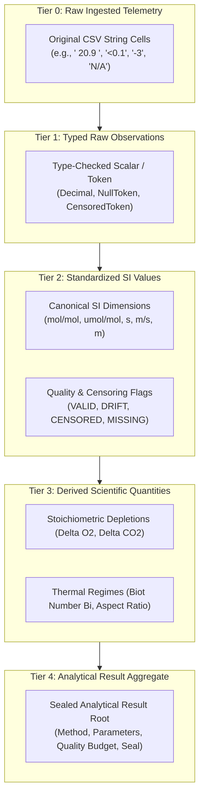
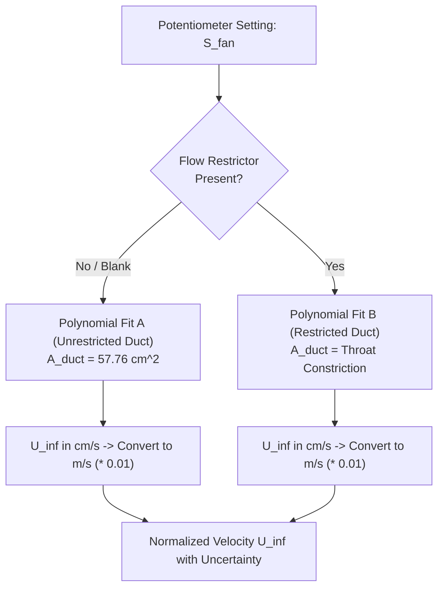

# FLARE Milestone 9: Scientific Normalization Architecture & Design

**Document Identifier:** `FLARE-NORM-M9-V1`  
**Classification:** Scientific Architecture & Design Specification (Read-Only)  
**Authors:** Senior Combustion Scientist, Scientific Data Engineer, Python Architect  
**Project:** FLARE (Scientific Intelligence Platform for Spacecraft Fire Safety)  
**Primary Dataset:** NASA PSI-25 / BASS-II (`PSI-25_Experimental table_BASS-II.csv`)  
**Target Schema:** Ephemeral PostgreSQL under Migration `0008_m6_security_remediation`  
**Date:** November 2026  
**Status:** DRAFT / APPROVED FOR SPECIFICATION  

---

## 1. Architectural Philosophy & Guiding Principles

The FLARE scientific normalization layer bridges raw experimental flight telemetry and downstream deterministic analytical protocols. In microgravity combustion research, subtle measurement nuances—such as electrochemical sensor drift, motor potentiometer non-linearities, and video frame rate ambiguities—can introduce severe systematic biases if handled naively.

To guarantee scientific defensibility, reproducibility, and mathematical auditability, the normalization layer adheres to five non-negotiable architectural principles:

1. **Epistemic Layer Separation:** Raw telemetry, normalized values, derived physical quantities, and theoretical models must occupy distinct epistemic tiers and relational entities. They must never overwrite or collide with one another.
2. **Verbatim Preservation Invariant:** The exact string representation of every raw cell from the original NASA source file must remain permanently preserved in storage (`observation.source_value_text`).
3. **Stateless, Pure-Functional Transformations:** All normalization algorithms must operate as pure functions: identical inputs must yield bit-for-bit identical outputs across operating systems and execution environments.
4. **Zero Silent Imputation:** Missing, unrecorded, or corrupted observations must remain explicitly NULL. Interpolation, mean substitution, or heuristic imputation without explicit, sealed analytical protocols is strictly prohibited.
5. **Cryptographic Lineage Sealing:** Every normalized record must maintain an unbroken chain of cryptographic provenance back to its parent CSV row number, parent document ID, and the SHA-256 hash of the original NASA archive.

---

## 2. Multi-Tiered Epistemic Architecture

The normalization pipeline is organized into five strictly bounded epistemic tiers:



### 2.1 Epistemic Tier Definitions
- **Tier 0 (Raw Telemetry):** Immutable string data captured during M8 ingestion. Stored in `observation.source_value_text` with JSONB formatting metadata.
- **Tier 1 (Typed Observations):** Cleaned, stripped, and lexically classified primitives using Python's arbitrary-precision `decimal.Decimal` and custom token types.
- **Tier 2 (Standardized SI Normalization):** Physical quantities converted to canonical SI units with attached uncertainty intervals and ISO/IEC 17025 data quality flags.
- **Tier 3 (Derived Scientific Quantities):** Thermodynamic and stoichiometric metrics calculated through explicit physical equations (e.g. molar mass loss, Biot numbers).
- **Tier 4 (Analytical Result Aggregate):** Immutable protocol results sealed under `flare_sealing.aggregate_seal`.

---

## 3. Canonical SI Unit Standardization

All quantitative variables ingested from `PSI-25_Experimental table_BASS-II.csv` must be transformed into standard SI units prior to analytical consumption:

| Raw Variable Name | Source Header | Raw Source Unit | Canonical SI Unit | Conversion Factor / Equation | Uncertainty Model |
| :--- | :--- | :--- | :--- | :--- | :--- |
| **Initial / Final Oxygen** | `Initial O2 %`, `Final O2 %` | Volumetric percent ($\%$) | Mole fraction ($\text{mol/mol}$) | $X_{O2} = \frac{\text{RawValue}}{100.0}$ | $\pm 0.001\text{ mol/mol}$ (Electrochemical sensor resolution $\pm 0.1\%$) |
| **Initial / Final Carbon Dioxide** | `Initial CO2 %`, `Final CO2 %` | Volumetric percent ($\%$) | Mole fraction ($\text{mol/mol}$) | $X_{CO2} = \frac{\text{RawValue}}{100.0}$ | $\pm 0.001\text{ mol/mol}$ (NDIR sensor resolution $\pm 0.1\%$) |
| **Initial / Final Carbon Monoxide** | `Initial CO (ppm)`, `Final CO (ppm)` | Parts per million ($\text{ppm}$) | Trace mole fraction ($\mu\text{mol/mol}$) | $X_{CO} = \text{RawValue} \times 1.0$ | $\pm 3.0\ \mu\text{mol/mol}$ (Zero-drift baseline band) |
| **Combustion Duration** | `Frame start`, `Frame stop` | Camera frame index | Time in seconds ($\text{s}$) | $\Delta t = \frac{\text{Stop} - \text{Start}}{f_{cam}}$ | Systematic: $f_{cam} = 30.0 \pm 0.03\text{ fps}$; Frame sync: $\pm 1\text{ frame}$ ($\pm 0.033\text{ s}$) |
| **Centerline Flow Speed** | `Fan display`, `Air display` | Unitless potentiometer setpoint ($0 - 99$) | Velocity ($\text{m/s}$) | Piecewise calibration polynomial: $U_\infty = P(S_{fan}) \times 10^{-2}$ | Dependent on calibration curve: $\pm 5\%$ at high flow, $\pm 25\%$ near zero flow |
| **Fuel Dimensions** | `Fuel Dimensions` | Millimeters / Inches | Length, Width, Thickness ($\text{m}$) | $\tau = \text{val}_{mm} \times 10^{-3}$ or $\text{val}_{in} \times 0.0254$ | Caliper tolerance: $\pm 0.05\text{ mm}$ ($\pm 5 \times 10^{-5}\text{ m}$) |

---

## 4. Special Token Handling & Quality Flagging Matrix

Data in experimental tables frequently contains anomalous readings, detector drift, censoring, and missing telemetry. The normalization engine implements an explicit token matrix:

```
+-------------------------------------------------------------------------------------------------------------+
| RAW PATTERN          | CLASSIFICATION       | NORMALIZED OUTPUT       | DATA QUALITY FLAG                   |
+-------------------------------------------------------------------------------------------------------------+
| Numeric (e.g. 21.0)  | Standard Numeric     | Decimal('0.210')        | VALID_NUMERIC                       |
| Negative (e.g. -3.0) | Zero-Point Drift     | Decimal('-3.0')         | SENSOR_ZERO_DRIFT_PRESERVED         |
| Range (e.g. <0.1)    | Left-Censored Token  | Interval(0.0, 0.001)    | CENSORED_BELOW_DETECTION_LIMIT      |
| Range (e.g. >50)     | Right-Censored Token | Interval(50.0, +Inf)    | CENSORED_ABOVE_DETECTION_LIMIT      |
| Empty string ""      | Missing Telemetry    | NULL                    | MISSING_TELEMETRY_UNREPORTED        |
| String "N/A", "None" | Explicit Missing     | NULL                    | EXPLICIT_NOT_APPLICABLE             |
| String "failed"      | Operational Failure  | Categorical("failed")   | OPERATIONAL_IGNITION_FAILURE        |
| String "off"         | Actuator State       | Categorical("off")      | ACTUATOR_POWER_OFF                  |
+-------------------------------------------------------------------------------------------------------------+
```

### 4.1 Detailed Handling Policies

#### 1. Negative Values (Electrochemical Drift in CO)
- **Observed Data:** Column `Initial CO (ppm)` contains negative entries down to $-3\text{ ppm}$; `Final CO (ppm)` contains $-4\text{ ppm}$.
- **Physical Reality:** Negative chemical concentrations are physical impossibilities. However, clamping these values to zero ($0.0$) creates an artificial positive statistical bias and destroys the zero-point Gaussian noise structure of the sensor.
- **Normalization Policy:**
  - Preserve the raw signed Decimal value: `Decimal('-3.0')`.
  - Assign flag: `SENSOR_ZERO_DRIFT_PRESERVED`.
  - Attach a zero-offset uncertainty model: $u_{zero} = \pm 3.0\ \mu\text{mol/mol}$.
  - In downstream stoichiometric mass balance calculations, evaluate values inside $[0, \max(0, X_{CO})]$ with expanded sensitivity intervals.

#### 2. Censored Values
- **Observed Data:** Trace readings reported with inequality bounds (e.g., `<0.1%`).
- **Normalization Policy:**
  - Map to an explicit interval data structure: `Interval(lower=0.0, upper=0.001, left_closed=True, right_closed=False)`.
  - Assign flag: `CENSORED_BELOW_DETECTION_LIMIT`.
  - Do NOT substitute with half the limit of detection ($LOD / 2$) or zero. Downstream algorithms must explicitly employ survival-analysis or interval-censored statistical methods.

#### 3. Missing Data Policy (Strict Anti-Imputation)
- **Observed Data:** Frame bounds are absent in 12 records; air display is absent in 9 records.
- **Normalization Policy:**
  - Map to Python `None` / SQL `NULL`.
  - Assign flag: `MISSING_TELEMETRY_UNREPORTED`.
  - When calculating aggregations, adjust degrees of freedom ($N_{eff}$) to reflect only valid, non-null observations.
  - Silent imputation (filling with mean, median, forward fill, or spline) is strictly prohibited at the normalization layer.

---

## 5. Flow Velocity Normalization & Calibration Curves

Potentiometer readings `Fan display` ($S_{fan} \in [0, 99]$) and `Air display` ($S_{air} \in [0, 55]$) cannot be used directly in fluid mechanical equations.

### 5.1 Centerline Velocity Calibration Architecture
NASA Glenn Research Center engineers calibrated the MSG BASS-II flow duct using laser Doppler anemometry and hot-wire anemometer traverses. The calibration curves from `Fan calibration data.xlsx` define centerline velocity $U_\infty$ ($cm/s$) as a function of potentiometer setting.

The normalization layer implements the calibrated piecewise mapping:

$$U_\infty(S_{fan}, \text{Restrictor}) = \begin{cases}
P_{\text{unrestricted}}(S_{fan}) & \text{if } \text{Flow Restrictor} = \text{False} \\
P_{\text{restricted}}(S_{fan}) & \text{if } \text{Flow Restrictor} = \text{True}
\end{cases}$$



### 5.2 Flow Duct Boundary Layer Formulation
In microgravity, forced convective flow forms a laminar boundary layer over the flat fuel sample. The effective surface velocity gradient governing oxidizer transport is:

$$\left. \frac{\partial u}{\partial y} \right|_{y=0} = 0.332 \cdot \frac{U_\infty}{x} \cdot Re_x^{1/2} = 0.332 \cdot U_\infty \sqrt{\frac{U_\infty}{\nu x}}$$

where:
- $\nu$ is the kinematic viscosity of the $O_2 / N_2$ mixture ($\nu \approx 1.55 \times 10^{-5}\text{ m}^2/\text{s}$ at $295\text{ K}$).
- $x$ is the distance from the fuel sample leading edge.

The normalization layer extracts sample length $L$ from `Fuel Dimensions` to bound the characteristic flow time:
$$\tau_{flow} = \frac{L}{U_\infty}$$

---

## 6. Derived Scientific Quantities Pipeline

Following Tier 2 standardization, Tier 3 derives intrinsic physical metrics:

### 6.1 Stoichiometric Oxygen Depletion
$$\Delta X_{O2} = X_{O2,init} - X_{O2,final} \quad [\text{mol/mol}]$$
$$\Delta X_{CO2} = X_{CO2,final} - X_{CO2,init} \quad [\text{mol/mol}]$$

### 6.2 Apparent Respiratory Quotient ($RQ_{comb}$)
$$RQ_{comb} = \frac{\Delta X_{CO2}}{\Delta X_{O2}}$$
- For pure PMMA combustion ($C_5 H_8 O_2 + 6 O_2 \to 5 CO_2 + 4 H_2 O$), theoretical complete combustion dictates:
  $$RQ_{theoretical} = \frac{5}{6} \approx 0.833$$
- Deviations from $0.833$ quantify incomplete combustion, soot formation, and elevated carbon monoxide generation.

### 6.3 Thermal Thickness Classification (Biot Number)
Using the parsed fuel thickness $\tau = 2 L_c$, the solid thermal Biot number is computed:
$$Bi = \frac{h_c \cdot \tau}{2 k_s}$$
where $k_s$ is the solid thermal conductivity ($k_{PMMA} \approx 0.19\text{ W/m}\cdot\text{K}$) and $h_c \approx \frac{k_g}{\delta_{thermal}}$ is the convective heat transfer coefficient.
- If $Bi < 0.1 \implies$ `THERMALLY_THIN`
- If $Bi > 1.0 \implies$ `THERMALLY_THICK`
- If $0.1 \le Bi \le 1.0 \implies$ `INTERMEDIATE_REGIME`

---

## 7. Lineage Preservation and Cryptographic Traceability

Every transformed record emitted by the normalization pipeline must contain an immutable lineage manifest:

```json
{
  "provenance": {
    "source_investigation": "PSI-25",
    "source_document_title": "PSI-25_Experimental table_BASS-II.csv",
    "source_file_sha256": "e43997e20ec42c16aa95b7feee8018e6c79a48972f78e47bf1b6be91e93895e6",
    "source_record_number": 42,
    "source_row_index": 40,
    "source_cell_references": {
      "initial_o2": { "col_idx": 6, "raw_text": "21.0" },
      "final_o2": { "col_idx": 7, "raw_text": "20.6" },
      "fan_display": { "col_idx": 4, "raw_text": "45" }
    },
    "normalization_schema_version": "1.0.0",
    "pipeline_timestamp": "2026-11-14T14:10:00Z"
  }
}
```

This JSONB provenance object is stored alongside normalized metrics, ensuring complete end-to-end auditability from raw NASA bytes to sealed analytical outputs.
