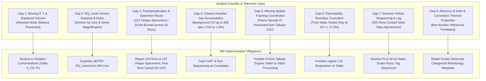

# FLARE Milestone 9: Remaining Scientific Gaps & Telemetry Limitations

**Document Identifier:** `FLARE-GAPS-M9-V2`  
**Classification:** Scientific Gap Analysis & Epistemic Limitations (Read-Only Specification)  
**Authors:** Senior Combustion Scientist, Scientific Data Engineer, Python Architect  
**Project:** FLARE (Scientific Intelligence Platform for Spacecraft Fire Safety)  
**Target Investigation:** NASA PSI-25 / BASS-II Primary Experimental Data  
**Verified Source SHA-256:** `71e792bf6b5fb5ea620c5dd70fbbac05515992e12aefcf5dff47312caa48c042`  
**Date:** November 2026  
**Status:** APPROVED (V2 FINAL CORRECTION)  

---

## 1. Executive Summary & Review Scope

This document provides the definitive, transparent accounting of remaining scientific boundaries, telemetry limitations, and deferred analytical capabilities for **FLARE Milestone 9 (M9): Deterministic Scientific Analysis Engine**.

Following rigorous, multi-turn independent audits and cross-source reconciliation against original NASA Physical Sciences Informatics (PSI-25 / BASS-II) flight archives, all previously unverified assumptions have been excised. This gap registry documents what the available BASS-II tabular flight dataset **can** and **cannot** substantiate, ensuring that M9 implementation operates within mathematically defensible and metrologically sound boundaries.

---

## 2. Detailed Inventory of Scientific Gaps & Limitations

---

### Gap 1: Environmental Telemetry Gaps (Pressure, Temperature, Displaced Volume)
- **Empirical Reality:** `PSI-25_Experimental table_BASS-II.csv` records gas volume percentages and PPM concentrations, but contains **no measurements of static chamber pressure ($P$), glovebox internal air temperature ($T$), net displaced hardware volume ($V_{net}$), or barometric venting**.
- **Physical Consequence:** Calculating absolute molar oxygen consumption via the ideal gas law:
  $$\Delta n_{O2} = \frac{P \cdot V_{net}}{R \cdot T} \cdot \frac{\Delta X_{O2}}{100}$$
  requires assuming constant atmospheric pressure ($101.325\text{ kPa}$) and room temperature ($295.15\text{ K}$). However, avionics heat dissipation and prior burns cause glovebox temperatures to drift between $20^\circ\text{C}$ and $30^\circ\text{C}$, introducing an unmeasured systematic uncertainty of $\pm 15 - 20\%$.
- **M9 Mitigation Rule:** M9 **prohibits** absolute molar consumption calculations from the deterministic core. All oxygen consumption metrics are strictly confined to **relative concentration differences** ($\Delta X_{O2}$ in vol % and mole fraction $\text{mol/mol}$, and dimensionless ratio $\Pi_{O2} = \Delta X / X_{init}$).

---

### Gap 2: Apparent Respiratory Quotient ($RQ_{comb}$) Sensor Asynchrony & Noise
- **Empirical Reality:**
  1. In **24 flight runs**, $\Delta X_{O2} = 0.0\%$, producing a division-by-zero error ($\Delta X_{CO2} / 0$).
  2. For over 60% of runs, $\Delta X_{O2} \le 0.2\%$. Because the electrochemical $O_2$ sensor has a discretization uncertainty of $\pm 0.1\%$, the relative error in the denominator is $\approx 100\%$, producing massive, unphysical oscillations in $RQ$ (ranging from $-0.50$ to $+1.40$).
  3. The $O_2$ sensor and the CDM NDIR $CO_2$ sensor are mounted at different spatial locations in the MSG duct recirculation loop and have differing pneumatic lag times.
- **M9 Mitigation Rule:** **$RQ_{comb}$ is explicitly DEFERRED from Milestone 9.** Calculating it naively would publish erratic, mathematically degenerate metrics.

---

### Gap 3: Pseudoreplication & Specimen Thermal History (Sample Reuse)
- **Empirical Reality:** An audit of `Sample #` in `m9_p4_test_regime_mapping.csv` reveals that **107 unique physical specimens were evaluated across 129 flight runs**. Exactly **20 physical specimens were burned repeatedly across 42 flight runs** (e.g. sample `144m` burned 3 times, `220m` burned 3 times, `200m` burned twice). Exactly **87 specimens were burned exactly once** (87 single-run specimens).
- **Physical Consequence:** Pre-burned specimens suffered from altered sample lengths, surface charring, and residual internal heat from prior ignitions (`BASS-II data FAQ.docx` explicitly notes preheating effects).
- **Statistical Independence Caveat:** The engine contract defines `FIRST_BURN_SUBSET` ($N = 107$ runs) and `SUBSEQUENT_REBURN_SUBSET` ($N = 22$ runs). However, **M9 does NOT claim that filtering to first burns ($N=107$) automatically establishes statistical independence**. Observations conducted on the same GMT day shared unvented glovebox air (where background $CO$ accumulated up to $950\text{ ppm}$ and $CO_2$ rose up to $1.9\%$).
- **M9 Mitigation Rule:** M9 explicitly reports run count ($N=129$) and unique specimen count ($N=107$) separately. Formal statistical models must treat `GMT` day and sequence index as potential clustering covariates.

---

### Gap 4: Chamber Combustion Byproduct Accumulation (Sequential Run Dilution)
- **Empirical Reality:** The MSG was a closed 255-liter box that was not flushed between runs on the same day. As a result:
  - `Initial CO` accumulated from near $0\text{ ppm}$ up to **950 ppm** (22 runs had initial CO $\ge 100\text{ ppm}$).
  - `Initial CO2` accumulated up to **1.9%**.
- **Physical Consequence:** Accumulated $CO_2$ and $CO$ act as radiative participating gases and thermal diluents, cooling the flame and altering soot formation in later runs of a daily sequence.
- **M9 Mitigation Rule:** Module P1 reports background byproduct accumulation trends across Julian calendar days (`GMT`), and downstream comparisons treat daily sequence index as an experimental covariate.

---

### Gap 5: Spatial Flame Spread Telemetry Gap
- **Empirical Reality:** The CSV table records camera frame counts (`Total Frames Shot`), but contains **zero spatial tracking coordinates ($x_f(t)$), pyrolyzing base positions, or optical pixel scales ($mm/\text{pixel}$)**.
- **Physical Consequence:** Estimating flame spread rate as sample length divided by frame duration ($V_f = L / \Delta t$) is scientifically invalid. Most runs were intentionally extinguished prior to total burnout, and frame counts include ignition delays and post-extinction glow.
- **M9 Mitigation Rule:** Linear flame spread velocity ($V_f$) is **strictly excluded** from the M9 tabular analysis engine. It is deferred to future computer-vision processing of video archives.

---

### Gap 6: Limiting Oxygen Index (LOI) State Space Truncation
- **Empirical Reality:** Fletcher Miller's thick PMMA slabs were tested **strictly at $O_2 \ge 17.9\%$** ($N=20$). There are zero low-oxygen extinction events for thick slabs in BASS-II ($20:0$ class balance). Low-oxygen tests ($13.6\% - 16.0\%$, $N=18$) were conducted exclusively on **clear/black cylindrical PMMA rods in forward stagnation flow** (Sandra Olson).
- **Physical Consequence:** Fitting a logistic regression model to predict LOI flammability boundaries for thick PMMA slabs encounters complete mathematical separation and cannot converge.
- **M9 Mitigation Rule:** Logistic regression LOI modeling for thick PMMA slabs is **strictly prohibited**. Flammability limit studies are restricted to descriptive reporting on Olson's stagnation rod dataset.

---

### Gap 7: Dynamic Airflow Sequencing vs. Steady Flow
- **Empirical Reality:** Exactly **100 out of 129 flight runs** (77.5%) contain multi-step fan adjustment histories and operator notes (e.g. `'10 8'`, `'5 2 slow decr to ext'`) in the airflow columns. Only **25 runs** contain single scalar flow setpoints, of which 1 run (`O2`) represents motor stall deadband ($U=0$).
- **Physical Consequence:** The duct hot-wire anemometer (`Air display`) has a response lag of $\sim 1\text{ minute}$. In dynamically adjusted runs, instantaneous display readings do not reflect steady-state fluid velocity.
- **M9 Mitigation Rule:** Module P3 confines static velocity mapping strictly to the **24 valid steady scalar runs**. All 100 complex runs are classified as `DYNAMIC_FLOW_SEQUENCE` and excluded from static flow regressions.

---

### Gap 8: Absence of Solid and Convective Thermal Properties (Biot Regimes)
- **Empirical Reality:** Primary NASA BASS-II data files contain physical sample dimensions, but **no tabulated or measured values for solid thermal conductivity ($k_s$), solid density, flame standoff distance, or convective heat transfer coefficients ($h_c$)**.
- **Physical Consequence:** Convective heat transfer in microgravity boundary-layer combustion is dynamic and coupled to fluid velocity gradients and flame standoff ($h_c(x) \propto \sqrt{U_\infty / \nu x}$). Assuming terrestrial constants (e.g. $k_s = 0.19\text{ W/m}\cdot\text{K}$, $h_c = 15\text{ W/m}^2\text{K}$) to calculate Biot numbers ($Bi = \frac{h \tau}{2 k_s}$) is scientifically ungrounded.
- **M9 Mitigation Rule:** All claims that thin films have $Bi \ll 0.1$ or thick slabs have $Bi \gg 1.0$ are **strictly expunged**. Fuel specimens are categorized **purely by observed categorical morphology and nominal dimensions** (Thin Films $100 - 400\ \mu\text{m}$, Thick Slabs $1 - 5\text{ mm}$, Cylindrical Rods, Woven Fabrics) without calculating or inferring Biot regimes.

---

## 3. Final Implementation Decision Matrix

| Proposed Analysis Capability | Original Draft Status | Final Reconciled Status | Operational Action in M9 Engine |
| :--- | :---: | :---: | :--- |
| **P1: Environmental Gas Profiling** | Supported | **APPROVED** | Implemented as specified; preserves signed negative CO drift ($N=129$). |
| **P2: Relative Oxygen Depletion** | Supported | **APPROVED** | Implemented strictly for relative metrics ($\Delta X_{O2}, \Pi_{O2}$). 93 positive, 24 zero, 5 signed drift eligible for signed distributions. 5 gross anomalies quarantined. |
| **P2: Apparent Respiratory Quotient ($RQ_{comb}$)** | Supported | **DEFERRED** | Formally deferred due to division-by-zero on 24 runs, sensor asynchrony, and noise magnification. |
| **P2: Absolute Molar Consumption ($\Delta n_{O2}$)** | Supported | **PROHIBITED** | Prohibited due to missing chamber pressure, temperature, and hardware displacement volume. |
| **P3: Calibrated Airflow Mapping** | Conditionally Supported | **APPROVED (GATED)** | Implemented using linear SPICE formula ($U = 1.0066 \times \text{Air}$) strictly on the 24 valid scalar runs ($2.0 - 15.0\text{ cm/s}$). 100 dynamic runs excluded. |
| **P4: Observed Fuel Morphology** | Supported | **APPROVED (GATED)** | Implemented across 6 PI regimes. Biot number calculations prohibited. 107 first burns and 22 re-burns partitioned. |
| **Flame Spread Rate ($V_f$)** | Not Supported | **PROHIBITED** | Strictly prohibited from tabular engine (spatial tracking coordinates absent). |
| **Logistic Regression LOI Boundary** | Supported | **PROHIBITED** | Strictly prohibited for thick slabs (zero low-oxygen runs; $20:0$ class balance). |
| **Cubic Flow Polynomial** | Conditionally Supported | **PROHIBITED** | Strictly prohibited (non-existent in NASA calibration archives). |
