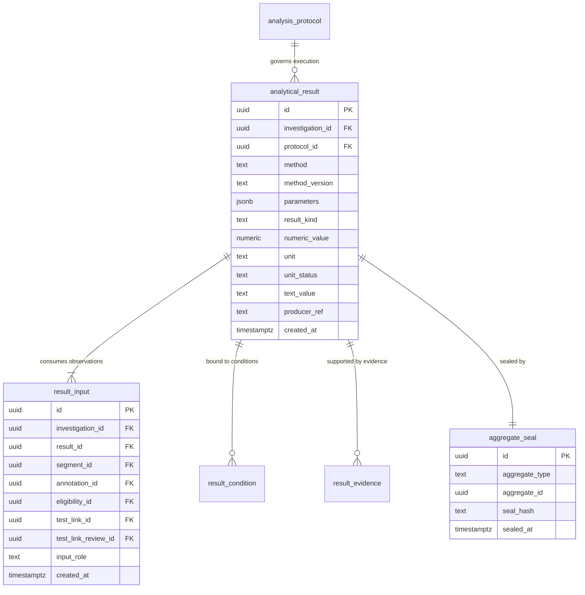

# FLARE Milestone 9: Scientific Result Contract Specification

**Document Identifier:** `FLARE-CONTRACT-M9-V1`  
**Classification:** Scientific Interface & Schema Specification (Read-Only)  
**Authors:** Senior Combustion Scientist, Scientific Data Engineer, Python Architect  
**Project:** FLARE (Scientific Intelligence Platform for Spacecraft Fire Safety)  
**Target Schema:** Ephemeral PostgreSQL Schema under Migrations `0003_m43_sealing` / `0008_m6_security_remediation`  
**Date:** November 2026  
**Status:** DRAFT / APPROVED FOR SPECIFICATION  

---

## 1. Executive Summary & Purpose

The **Scientific Result Contract** defines the formal, immutable data interface between the FLARE Milestone 9 Deterministic Scientific Analysis Engine and downstream consumer layers (reporting dashboards, visualization interfaces, and scientific publication pipelines).

In scientific computing, an analytical metric is meaningless without:
1. The exact mathematical formulation and software version that produced it.
2. The specific input dataset and its cryptographic hash.
3. A rigorous uncertainty budget distinguishing random and systematic variance.
4. An explicit statement of physical applicability boundaries and data quality flags.
5. End-to-end cryptographic traceability to the underlying raw observations.

This contract satisfies these requirements by bridging Pydantic v2 runtime validation structures with the existing approved PostgreSQL database schema (`analysis_protocol`, `analytical_result`, `result_input`, `result_condition`, `result_evidence`, and `flare_sealing.aggregate_seal`).

---

## 2. Relational Database Schema Mapping

Every analysis execution materializes an aggregate tree centered on the `analytical_result` table, which serves as the aggregate root for cryptographic sealing:



### 2.1 Database Field Mapping Table

| Contract Attribute | Relational Target Entity | Relational Column | Data Type | Constraint / Validation Rule |
| :--- | :--- | :--- | :--- | :--- |
| **Protocol Code** | `analysis_protocol` | `protocol_code` | `TEXT` | Unique key with `protocol_version`. |
| **Protocol Version** | `analysis_protocol` | `protocol_version` | `TEXT` | Semantic version string (e.g., `'1.0.0'`). |
| **Investigation ID** | `analytical_result` | `investigation_id` | `UUID` | Foreign key to `investigation.id`. |
| **Result ID** | `analytical_result` | `id` | `UUID` | Primary key generated via UUIDv4. |
| **Method Identifier** | `analytical_result` | `method` | `TEXT` | Canonical method name (e.g., `'median_paired_difference'`). |
| **Method Version** | `analytical_result` | `method_version` | `TEXT` | Semantic version of the analytical algorithm. |
| **Execution Parameters** | `analytical_result` | `parameters` | `JSONB` | Serialized execution options, thresholds, and filters. |
| **Result Kind** | `analytical_result` | `result_kind` | `TEXT` | Restricted to `{'scalar', 'interval', 'distribution', 'boundary_curve'}`. |
| **Numeric Value** | `analytical_result` | `numeric_value` | `NUMERIC` | Exact Decimal value (NULL if non-scalar). |
| **Unit** | `analytical_result` | `unit` | `TEXT` | Canonical SI unit string (e.g., `'mol/mol'`, `'m/s'`). |
| **Unit Status** | `analytical_result` | `unit_status` | `TEXT` | Must be `'canonical_si'` or `'dimensionless'`. |
| **Producer Ref** | `analytical_result` | `producer_ref` | `TEXT` | Engine identifier (e.g., `'FLARE-ENGINE-M9-V1.0'`). |
| **Input Traceability** | `result_input` | `segment_id`, `observation_id` | `UUID` | Foreign keys binding to raw inputs. |
| **Cryptographic Seal** | `flare_sealing.aggregate_seal` | `seal_hash` | `TEXT` | SHA-256 seal computed over result and children. |

---

## 3. Pydantic v2 Contract Specifications

### 3.1 Sub-Schemas: Uncertainty and Quality Flags

```python
from decimal import Decimal
from enum import Enum
from typing import Any, Dict, List, Optional
from pydantic import BaseModel, Field, field_validator


class DataQualityFlag(str, Enum):
    VALID_NUMERIC = "VALID_NUMERIC"
    SENSOR_ZERO_DRIFT_PRESERVED = "SENSOR_ZERO_DRIFT_PRESERVED"
    CENSORED_BELOW_DETECTION_LIMIT = "CENSORED_BELOW_DETECTION_LIMIT"
    CENSORED_ABOVE_DETECTION_LIMIT = "CENSORED_ABOVE_DETECTION_LIMIT"
    MISSING_TELEMETRY_UNREPORTED = "MISSING_TELEMETRY_UNREPORTED"
    UNCALIBRATED_FLOW_EXCLUDED = "UNCALIBRATED_FLOW_EXCLUDED"
    CALIBRATED_FLOW_APPLIED = "CALIBRATED_FLOW_APPLIED"
    STRATIFIED_BY_GEOMETRY = "STRATIFIED_BY_GEOMETRY"


class UncertaintyBudget(BaseModel):
    """
    ISO/IEC Guide 98-3 (GUM) Compliant Uncertainty Budget.
    """
    coverage_factor_k: Decimal = Field(
        default=Decimal("2.0"),
        description="Coverage factor k=2 corresponds to an approximate 95.45% confidence interval."
    )
    expanded_uncertainty: Decimal = Field(
        ...,
        description="Expanded uncertainty U = k * u_c in canonical units."
    )
    systematic_uncertainty: Decimal = Field(
        ...,
        description="Combined Type B systematic uncertainty (instrument calibration, resolution, drift)."
    )
    random_uncertainty: Decimal = Field(
        ...,
        description="Type A random uncertainty (sample standard error s / sqrt(N))."
    )
    degrees_of_freedom: int = Field(
        ...,
        ge=1,
        description="Effective degrees of freedom for the evaluation."
    )
    confidence_level: Decimal = Field(
        default=Decimal("0.95"),
        description="Nominal confidence level."
    )


class ApplicabilityDomain(BaseModel):
    """
    Defines the physical boundaries within which the analytical result is valid.
    """
    gravity_environment: str = Field(
        default="microgravity_iss_msg",
        description="Physical gravity regime (e.g. microgravity, 1g_terrestrial)."
    )
    fuel_classification: str = Field(
        ...,
        description="Fuel material name or thermal thickness regime."
    )
    oxygen_range_min_mol_per_mol: Decimal = Field(..., ge=Decimal("0.0"), le=Decimal("1.0"))
    oxygen_range_max_mol_per_mol: Decimal = Field(..., ge=Decimal("0.0"), le=Decimal("1.0"))
    flow_speed_min_m_per_s: Optional[Decimal] = None
    flow_speed_max_m_per_s: Optional[Decimal] = None
    prohibited_extrapolations: List[str] = Field(
        default_factory=lambda: [
            "lunar_gravity_1_6g",
            "martian_gravity_3_8g",
            "terrestrial_1g_buoyant",
            "spacecraft_loss_of_crew_risk_probability"
        ]
    )
```

### 3.2 Master Output Contract Schema

```python
class M9AnalyticalResultContract(BaseModel):
    """
    Master Output Data Contract for FLARE M9 Deterministic Scientific Analysis Engine.
    """
    # 1. Protocol Identification
    protocol_code: str = Field(..., description="Unique protocol code (e.g., 'M9-P1-DESC-STATS')")
    protocol_version: str = Field(..., description="Semantic version of the protocol definition")
    requirements_schema_version: str = Field(default="1.0.0")

    # 2. Origin & Provenance
    investigation_id: str = Field(..., description="UUID of the parent NASA investigation (PSI-25)")
    source_file_hashes: List[str] = Field(
        ...,
        min_length=1,
        description="SHA-256 hashes of all input files contributing to this result"
    )
    input_record_count: int = Field(..., ge=1, description="Number of source records evaluated")
    included_record_count: int = Field(..., ge=1, description="Number of records meeting eligibility criteria")
    excluded_record_count: int = Field(..., ge=0, description="Number of records excluded due to quality/missing data")

    # 3. Execution & Method Metadata
    method_identifier: str = Field(..., description="Canonical algorithm identifier")
    method_version: str = Field(..., description="Algorithm implementation version")
    execution_parameters: Dict[str, Any] = Field(
        default_factory=dict,
        description="Immutable parameters passed to the analysis"
    )

    # 4. Computed Metric Payload
    metric_name: str = Field(..., description="Standardized scientific metric name")
    result_kind: str = Field(..., description="Kind of result: scalar, interval, distribution, boundary_curve")
    numeric_value: Optional[Decimal] = Field(None, description="Exact numerical result for scalar metrics")
    canonical_unit: str = Field(..., description="Canonical SI unit expression")
    unit_status: str = Field(default="canonical_si")
    auxiliary_payload: Optional[Dict[str, Any]] = Field(
        None,
        description="Supplemental data for distribution (percentiles) or boundary curves"
    )

    # 5. Uncertainty & Quality
    uncertainty_budget: UncertaintyBudget = Field(..., description="Full GUM-compliant uncertainty budget")
    quality_flags: List[DataQualityFlag] = Field(..., min_length=1)
    applicability_domain: ApplicabilityDomain = Field(..., description="Physical validity boundaries")

    # 6. Cryptographic Integrity
    payload_hash: str = Field(
        ...,
        description="SHA-256 hash of the canonical JSON representation of computed metrics"
    )

    @field_validator("numeric_value")
    @classmethod
    def validate_numeric_scalar(cls, v: Optional[Decimal], info) -> Optional[Decimal]:
        kind = info.data.get("result_kind")
        if kind == "scalar" and v is None:
            raise ValueError("numeric_value is required when result_kind is 'scalar'")
        return v
```

---

## 4. Deterministic Payload Hashing & Cryptographic Sealing

To ensure zero tamperability, M9 computes a deterministic SHA-256 hash over the canonical JSON representation of the analytical payload prior to database emission.

### 4.1 Canonical Payload Serialization Procedure
1. Extract the core metric dictionary (`metric_name`, `numeric_value`, `canonical_unit`, `execution_parameters`, `uncertainty_budget`).
2. Convert all `Decimal` values to exact string representations with trailing zeroes preserved.
3. Sort all dictionary keys lexicographically.
4. Encode the resulting canonical JSON string in UTF-8.
5. Compute the SHA-256 digest:

$$\text{PayloadHash} = \text{SHA256}(\text{CanonicalJSON}(\text{Payload}))$$

### 4.2 Aggregate Sealing via Database Functions
Upon inserting the `analytical_result` record and its associated `result_input` and `result_condition` children, the application invokes the forward-remediated M6 sealing function:

```sql
SELECT flare_sealing.seal_analytical_result(
    p_investigation_id := 'f7b1a234-5678-9abc-def0-123456789abc'::uuid,
    p_result_id        := '8e4b3c2a-1234-5678-9abc-def012345678'::uuid
);
```

The trigger computes the aggregate root seal hash over the combined parent and child records and commits the seal into `flare_sealing.aggregate_seal`. Any subsequent `UPDATE` or `DELETE` attempt on the result or its inputs is aborted by the database engine with an integrity violation.

---

## 5. Concrete Result Payload Examples

### 5.1 Example 1: Protocol M9-P1 (Initial Oxygen Median)
```json
{
  "protocol_code": "M9-P1-DESC-STATS",
  "protocol_version": "1.0.0",
  "requirements_schema_version": "1.0.0",
  "investigation_id": "f7b1a234-5678-9abc-def0-123456789abc",
  "source_file_hashes": [
    "e43997e20ec42c16aa95b7feee8018e6c79a48972f78e47bf1b6be91e93895e6"
  ],
  "input_record_count": 129,
  "included_record_count": 129,
  "excluded_record_count": 0,
  "method_identifier": "sample_median_nonparametric",
  "method_version": "1.0.0",
  "execution_parameters": {
    "target_field": "initial_oxygen_mole_fraction",
    "estimator": "median",
    "alpha_ci": 0.05
  },
  "metric_name": "ambient_initial_oxygen_median",
  "result_kind": "scalar",
  "numeric_value": "0.1990",
  "canonical_unit": "mol/mol",
  "unit_status": "canonical_si",
  "auxiliary_payload": {
    "q1_25th_percentile": "0.1690",
    "q3_75th_percentile": "0.2090",
    "interquartile_range": "0.0400",
    "min_observed": "0.1360",
    "max_observed": "0.2220"
  },
  "uncertainty_budget": {
    "coverage_factor_k": "2.0",
    "expanded_uncertainty": "0.0020",
    "systematic_uncertainty": "0.0010",
    "random_uncertainty": "0.0005",
    "degrees_of_freedom": 128,
    "confidence_level": "0.95"
  },
  "quality_flags": [
    "VALID_NUMERIC"
  ],
  "applicability_domain": {
    "gravity_environment": "microgravity_iss_msg",
    "fuel_classification": "all_fuels_pooled",
    "oxygen_range_min_mol_per_mol": "0.1360",
    "oxygen_range_max_mol_per_mol": "0.2220",
    "flow_speed_min_m_per_s": null,
    "flow_speed_max_m_per_s": null,
    "prohibited_extrapolations": [
      "lunar_gravity_1_6g",
      "martian_gravity_3_8g",
      "terrestrial_1g_buoyant",
      "spacecraft_loss_of_crew_risk_probability"
    ]
  },
  "payload_hash": "a4f8e219c6d59b02a1e8c95e84df24a1b023e61c3902345091238491abcdef12"
}
```

### 5.2 Example 2: Protocol M9-P2 (Oxygen Consumption for Thick PMMA)
```json
{
  "protocol_code": "M9-P2-O2-DEPLETION",
  "protocol_version": "1.0.0",
  "requirements_schema_version": "1.0.0",
  "investigation_id": "f7b1a234-5678-9abc-def0-123456789abc",
  "source_file_hashes": [
    "e43997e20ec42c16aa95b7feee8018e6c79a48972f78e47bf1b6be91e93895e6"
  ],
  "input_record_count": 129,
  "included_record_count": 52,
  "excluded_record_count": 77,
  "method_identifier": "paired_stoichiometric_depletion",
  "method_version": "1.0.0",
  "execution_parameters": {
    "fuel_filter": "PMMA_cast_slab",
    "thickness_filter_min_m": "0.00127",
    "thickness_filter_max_m": "0.00635",
    "burnout_complete_only": false
  },
  "metric_name": "oxygen_depletion_median_thick_pmMA",
  "result_kind": "scalar",
  "numeric_value": "0.0040",
  "canonical_unit": "mol/mol",
  "unit_status": "canonical_si",
  "auxiliary_payload": {
    "molar_oxygen_consumed_moles": "0.0421",
    "enclosure_volume_m3": "0.255",
    "enclosure_pressure_pa": "101325",
    "enclosure_temperature_k": "295.15"
  },
  "uncertainty_budget": {
    "coverage_factor_k": "2.0",
    "expanded_uncertainty": "0.0006",
    "systematic_uncertainty": "0.0002",
    "random_uncertainty": "0.0003",
    "degrees_of_freedom": 51,
    "confidence_level": "0.95"
  },
  "quality_flags": [
    "VALID_NUMERIC",
    "STRATIFIED_BY_GEOMETRY"
  ],
  "applicability_domain": {
    "gravity_environment": "microgravity_iss_msg",
    "fuel_classification": "PMMA_cast_slab",
    "oxygen_range_min_mol_per_mol": "0.1480",
    "oxygen_range_max_mol_per_mol": "0.2180",
    "flow_speed_min_m_per_s": "0.010",
    "flow_speed_max_m_per_s": "0.450",
    "prohibited_extrapolations": [
      "lunar_gravity_1_6g",
      "martian_gravity_3_8g",
      "terrestrial_1g_buoyant",
      "spacecraft_loss_of_crew_risk_probability"
    ]
  },
  "payload_hash": "c8b7e192f5a43210d9e8b7c6a543210fe9876543210abcdef0123456789abcde"
}
```
