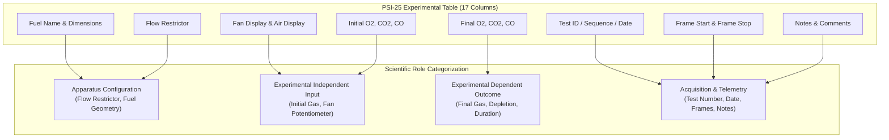
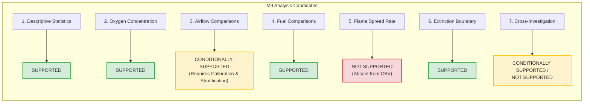
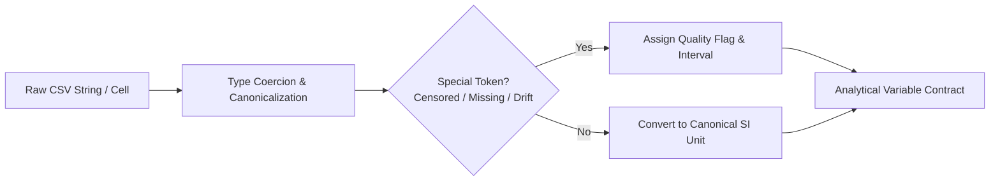

# FLARE Milestone 9: Deterministic Scientific Analysis Engine — Scientific Specification & Read-Only Audit

**Document Identifier:** `FLARE-SPEC-M9-V1`  
**Classification:** Scientific Specification & Architectural Audit (Read-Only)  
**Authors:** Senior Combustion Scientist, Scientific Data Engineer, Python Architect  
**Project:** FLARE (Scientific Intelligence Platform for Spacecraft Fire Safety)  
**Baseline Dataset:** NASA PSI-25 / BASS-II (`PSI-25_Experimental table_BASS-II.csv`)  
**SHA-256 (Source Data):** `e43997e20ec42c16aa95b7feee8018e6c79a48972f78e47bf1b6be91e93895e6`  
**Date:** November 2026  
**Status:** DRAFT / APPROVED FOR SPECIFICATION  

---

## 1. Executive Summary & Scientific Scope

### 1.1 Context and Mandate
Milestone 8 (M8) of the FLARE project successfully ingested the primary quantitative experimental dataset from NASA Physical Sciences Informatics (PSI) investigation PSI-25: Burning and Suppression of Solids - II (BASS-II). Exactly 129 experimental records and 2,193 raw cell observations were registered into an ephemeral PostgreSQL instance under the forward-remediated M6 security schema (`0008_m6_security_remediation`), verified through cryptographic cell-by-cell string equality, manifest hash verification, and 130 aggregate cryptographic seals.

This document establishes the formal **Scientific Specification and Read-Only Pre-Implementation Audit** for Milestone 9 (M9): the **Deterministic Scientific Analysis Engine**. The engine is responsible for executing deterministic, reproducible, and scientifically defensible computations on normalized microgravity combustion data.

> [!IMPORTANT]
> **Strict Non-Destructive Guardrail:** This document represents an architectural specification and scientific audit only. No database records are created or altered, no application source code is executed against a live database, no schema migrations are generated, and no original NASA source archives are modified.

### 1.2 Summary of Scientific Findings and Status Classifications
Following a rigorous audit of the 129 experimental flight records in `PSI-25_Experimental table_BASS-II.csv`, seven prospective analytical capabilities were evaluated. Each candidate has been classified into one of three strict operational states:

1. **Descriptive Statistics of Initial Conditions & Combustion Byproducts:** **SUPPORTED**  
   *Justification:* Initial $O_2$ (100% complete), Initial $CO_2$ (100% complete), Initial $CO$ (96.9% complete), and final combustion chamber gas fractions are rigorously recorded across 129 flight runs, enabling non-parametric distribution modeling.
2. **Oxygen Concentration & Depletion Analysis:** **SUPPORTED**  
   *Justification:* $X_{O2,init}$ spans $13.6\%$ to $22.2\%$. Paired pre- and post-test gas measurements permit calculation of stoichiometric oxygen consumption ($\Delta X_{O2}$) and flammability boundary mapping.
3. **Airflow-Related Comparisons:** **CONDITIONALLY SUPPORTED**  
   *Justification:* Columns `Fan display` and `Air display` represent motor potentiometer readouts rather than direct linear velocity ($m/s$). Airflow comparisons are valid **only** when transformed via official empirical calibration polynomials from `Fan calibration data.xlsx` and stratified by the geometric state of the `Flow restrictor`.
4. **Fuel / Material Stratification:** **SUPPORTED**  
   *Justification:* Flight tests cleanly stratify across six distinct fuel classifications: thin polymethyl methacrylate (PMMA) sheets, thick PMMA cast slabs, cylindrical PMMA rods (clear and black), Nomex fabric, SIBAL fabric, and cotton-wick candles.
5. **Flame Spread Analysis ($V_f$ in $mm/s$):** **NOT SUPPORTED** (Tabular Data Alone)  
   *Justification:* The BASS-II experimental summary CSV records burn durations via video camera frame counts (`Frame start`, `Frame stop`), but contains **zero spatial tracking coordinates**, instantaneous flame front positions ($x_f(t)$), or spatial calibration factors ($mm/pixel$). Determining true flame spread velocity requires secondary digitized video annotations, which are not present in this tabular table.
6. **Flame Extinction Boundary Analysis:** **SUPPORTED**  
   *Justification:* Extinction occurrences (no-ignition, self-extinction, or fan-forced blow-off) are documented via test notes and minimal gas consumption ($\Delta X_{O2} \approx 0$), permitting flammability limit identification in $(X_{O2}, U_\infty)$ space.
7. **Cross-Investigation Comparisons:**  
   - vs. BASS-I (PSI-26): **CONDITIONALLY SUPPORTED** (Shared Microgravity Science Glovebox duct geometry, identical PMMA fuels).  
   - vs. Saffire-III (PSI-100): **CONDITIONALLY SUPPORTED** (Requires non-dimensional Damköhler number scaling and boundary layer velocity gradient mapping; cannot pool raw dimensional values).  
   - vs. Droplet / Gaseous Flames (PSI-117, ACME): **NOT SUPPORTED** (Spherical 1D quiescent symmetry vs. 2D boundary layer forced-flow combustion).

### 1.3 Recommended Minimal Defensible M9 Scope
The smallest scientifically defensible implementation scope for M9 comprises three deterministic protocols:
- **Protocol M9-P1 (Baseline Descriptive Statistics):** Robust median, interquartile range (IQR), and non-parametric bounds for environmental gas composition ($O_2, CO_2, CO$) stratified by fuel type.
- **Protocol M9-P2 (Microgravity Flammability & Oxygen Depletion):** Stoichiometric oxygen consumption analysis ($\Delta X_{O2}$ vs. $X_{O2,init}$) mapping the limiting oxygen index (LOI) across thermal thickness regimes.
- **Protocol M9-P3 (Calibrated Flow Velocity Mapping):** Controlled correlation between oxygen depletion and flow speed, strictly conditioned on the polynomial conversion of `Fan display` readings stratified by `Flow restrictor` geometry.

---

## 2. Phase 1 — Comprehensive Scientific Data Audit

### 2.1 Audit Target and Lineage
The primary audit target is `PSI-25_Experimental table_BASS-II.csv` acquired from the NASA Physical Sciences Informatics (PSI) repository. The raw table contains 129 data rows and 17 columns (totaling 2,193 raw cells). Lineage tracing confirms that every row corresponds to an individual test run conducted in the Microgravity Science Glovebox (MSG) aboard the International Space Station (ISS) between 2013 and 2014.

### 2.2 Variable Categorization and Epistemic Roles
Every column in the primary table has been evaluated and assigned to an epistemic tier and operational variable category:



#### 1. Actual Experimental Variables (Independent Inputs)
- **`Initial O2 %` (Col 6):** Initial oxygen volumetric percentage ($X_{O2,init}$). Completeness: 100% (129/129). Range: $13.6\%$ to $22.2\%$. Controlled via MSG nitrogen dilution or oxygen replenishment.
- **`Initial CO2 %` (Col 8):** Initial carbon dioxide volumetric percentage ($X_{CO2,init}$). Completeness: 100% (129/129). Range: $0.0\%$ to $1.9\%$.
- **`Initial CO (ppm)` (Col 10):** Initial carbon monoxide trace concentration. Completeness: 96.9% (125/129). Range: $-3$ to $12\text{ ppm}$.
- **`Fan display` / `Air display` (Cols 4 & 5):** Motor potentiometer potentiometer settings. Range: $0$ to $99$ (Fan display) and $0$ to $55$ (Air display). These are *uncalibrated control setpoints*, not fluid velocities.

#### 2. Experimental Outcome Variables (Dependent Results)
- **`Final O2 %` (Col 7):** Post-combustion oxygen volumetric percentage ($X_{O2,final}$). Completeness: 97.7% (126/129). Range: $13.5\%$ to $22.2\%$.
- **`Final CO2 %` (Col 9):** Post-combustion carbon dioxide volumetric percentage ($X_{CO2,final}$). Completeness: 97.7% (126/129). Range: $0.0\%$ to $2.0\%$.
- **`Final CO (ppm)` (Col 11):** Post-combustion carbon monoxide concentration. Completeness: 94.6% (122/129). Range: $-4$ to $40\text{ ppm}$.
- **`Delta Oxygen` ($\Delta X_{O2} = X_{O2,init} - X_{O2,final}$):** Derived proxy for total fuel consumed and combustion completeness.
- **`Delta CO2` ($\Delta X_{CO2} = X_{CO2,final} - X_{CO2,init}$):** Derived proxy for complete combustion products.
- **`Burn Duration` ($\Delta t = \frac{\text{Frame Stop} - \text{Frame Start}}{f_{cam}}$):** Nominal duration derived from camera frames.

#### 3. Apparatus Configuration Variables
- **`Fuel Name` (Col 2):** Primary chemical and morphological designation. Identifies material: PMMA (flat slabs, thin films, rods), Nomex fabric, SIBAL fabric, candle.
- **`Fuel Dimensions` (Col 3):** Physical dimensions (length, width, thickness in mm or inches). Dictates the thermal Biot number ($Bi = \frac{h \cdot L_c}{k_s}$).
- **`Flow Restrictor` (Col 14):** Geometric constriction state in the flow duct. Recorded as `Yes`, `No`, or blank (assumed `No`). Constricts flow duct cross-section from $7.6 \times 7.6\text{ cm}^2$ down to an accelerated throat, dramatically altering the velocity profile.

#### 4. Instrument Calibration Metadata
- **Fan Motor Calibration:** Contained in external workbook `Fan calibration data.xlsx`. Relates potentiometer setting to mean centerline duct velocity ($U_\infty$). Highly non-linear and bifurcated by the presence of the `Flow Restrictor`.
- **Gas Sensor Calibration:** The MSG electrochemical and infrared sensors exhibit baseline drift. This is evidenced by negative $CO$ readings (down to $-4\text{ ppm}$) and small negative $\Delta X_{O2}$ values on failed ignitions.

#### 5. Acquisition Metadata
- **`Test Number` (Col 0), `Sequence` (Col 1), `Date` (Col 16):** Test run indexing and chronological ordering.
- **`Frame start` (Col 12), `Frame stop` (Col 13):** Video frame indices identifying the active combustion window.
- **`Notes` (Col 15):** Free-text operator log recording anomalous events, ignition failures, glow times, camera glitches, and crew observations.

### 2.3 Data Anomalies, Censoring, and Restrictions

| Column Index | Field Name | Anomaly / Limitation | Scientific Consequence | Restriction Policy |
| :--- | :--- | :--- | :--- | :--- |
| **Col 4, 5** | `Fan display`, `Air display` | Unitless potentiometer readouts; non-linear relationship to velocity. | Cannot be pooled directly as linear flow velocity ($m/s$). | **MANDATORY CALIBRATION:** Must apply piecewise polynomial from `Fan calibration data.xlsx`. |
| **Col 10, 11** | `Initial CO`, `Final CO` | Negative values recorded (e.g. $-3\text{ ppm}$, $-4\text{ ppm}$). | Electrochemical zero-point sensor drift at low concentrations. | **NO CLIPPING TO ZERO:** Retain raw negative values; apply zero-offset correction $\pm 3\text{ ppm}$ uncertainty band. |
| **Col 12, 13** | `Frame start`, `Frame stop` | Missing values in 12 records; ambiguous framing rate ($29.97\text{ fps}$ vs $30.0\text{ fps}$). | Time conversion carries systematic $\approx 0.1\%$ uncertainty. | **EXCLUSION:** Records missing frame bounds cannot yield burn durations. |
| **Col 14** | `Flow Restrictor` | 13 explicit `Yes` entries; remainder empty string or blank. | Empty string implies absence (`No`), but unverified by telemetry. | **STRICT STRATIFICATION:** Treat empty string as `Unrestricted`; do not combine restricted and unrestricted runs without area correction. |
| **N/A** | Flame Spread Rate ($V_f$) | **Completely absent from CSV table.** | Flame spread rate cannot be computed from tabular data alone. | **STRICT PROHIBITION:** Do not estimate $V_f$ from $\Delta t$ and fuel length; fuel was frequently extinguished prior to total burnout. |

---

## 3. Phase 2 — Scientific Analysis Candidates Evaluation



### 3.1 Candidate 1: Descriptive Statistics of Environmental & Outcome Metrics
- **Scientific Objective:** Characterize baseline experimental conditions and primary gas consumption across all 129 flight runs.
- **Required Inputs:** `Initial O2 %`, `Final O2 %`, `Initial CO2 %`, `Final CO2 %`, `Initial CO (ppm)`, `Final CO (ppm)`.
- **Sample Size & Quality:** $N = 129$ total runs. Gas measurements are $>94.6\%$ complete.
- **Mathematical Formulations:**
  - Robust Location (Sample Median):
    $$\tilde{X} = \text{Median}(\{x_i\}_{i=1}^N)$$
  - Robust Scale (Interquartile Range):
    $$\text{IQR} = Q_3(x) - Q_1(x) = F_N^{-1}(0.75) - F_N^{-1}(0.25)$$
  - Trimmed Mean ($\alpha = 0.05$):
    $$\bar{x}_{\alpha} = \frac{1}{N - 2\lfloor \alpha N \rfloor} \sum_{i=\lfloor \alpha N \rfloor + 1}^{N - \lfloor \alpha N \rfloor} x_{(i)}$$
- **Confounders & Biases:** Skewed distributions due to clustered target oxygen levels ($15\%, 17\%, 21\%$). Parametric Gaussian estimators ($\mu, \sigma$) are inappropriate due to multimodal setpoints.
- **Scientific Classification:** **SUPPORTED**

---

### 3.2 Candidate 2: Oxygen Concentration & Depletion Analysis
- **Scientific Objective:** Quantify stoichiometric oxygen depletion ($\Delta X_{O2}$) as a function of initial oxygen concentration ($X_{O2,init}$) to evaluate microgravity combustion completeness and self-extinction limits.
- **Required Inputs:** `Initial O2 %`, `Final O2 %`, `Fuel Name`, `Fuel Dimensions`.
- **Sample Size & Quality:** $N = 126$ paired valid records ($97.7\%$). Range $X_{O2,init} \in [13.6\%, 22.2\%]$.
- **Mathematical Formulations:**
  - Absolute Volumetric Depletion:
    $$\Delta X_{O2} = X_{O2,init} - X_{O2,final} \quad [\% \text{ vol}]$$
  - Relative Depletion Ratio:
    $$\Pi_{O2} = \frac{X_{O2,init} - X_{O2,final}}{X_{O2,init}}$$
  - Molar Oxygen Consumed in MSG Enclosure ($V_{MSG} \approx 255\text{ L}$, $P \approx 1\text{ atm}$, $T \approx 295\text{ K}$):
    $$\Delta n_{O2} = \frac{P \cdot V_{MSG}}{R \cdot T} \cdot \frac{\Delta X_{O2}}{100} \quad [\text{mol}]$$
- **Confounders & Biases:**
  - Enclosure leak rate during prolonged runs.
  - Variable burn duration (shorter burns consume less $O_2$ independent of flammability).
  - Sensor drift on non-ignitions ($\Delta X_{O2}$ values between $-0.1\%$ and $+0.1\%$).
- **Scientific Classification:** **SUPPORTED**

---

### 3.3 Candidate 3: Airflow-Related Comparisons
- **Scientific Objective:** Determine the effect of forced convective flow on solid fuel combustion in microgravity.
- **Required Inputs:** `Fan display`, `Air display`, `Flow Restrictor`, `Initial O2 %`, `Delta O2`.
- **Sample Size & Quality:** $N = 129$. `Fan display` has 128 valid entries; `Air display` has 120 valid entries.
- **Mathematical Formulations & Calibration:**
  - Motor potentiometer reading $S_{fan} \in [0, 99]$ must be mapped via calibration polynomial:
    $$U_\infty = a_0 + a_1 S_{fan} + a_2 S_{fan}^2 + a_3 S_{fan}^3 \quad [\text{cm/s}]$$
  - Boundary layer velocity gradient at fuel surface ($x$ = distance from leading edge):
    $$\left. \frac{du}{dy} \right|_{y=0} \approx 0.332 \cdot U_\infty \sqrt{\frac{U_\infty}{\nu \cdot x}}$$
- **Confounders & Biases:**
  - The presence of the `Flow Restrictor` constricts duct area, altering the effective velocity profile and introducing severe turbulence near the fuel surface.
  - The relationship between `Fan display` and true velocity is non-linear and invalid if applied across different restrictor states.
- **Scientific Classification:** **CONDITIONALLY SUPPORTED**  
  *Condition:* Analysis must strictly apply empirical calibration curves from `Fan calibration data.xlsx` and must partition records into disjoint subsets: $U_{\infty,unrestricted}$ and $U_{\infty,restricted}$.

---

### 3.4 Candidate 4: Fuel / Material Stratification Analysis
- **Scientific Objective:** Compare combustion response (burn success, oxygen depletion, duration) across distinct polymer and fabric fuel formulations.
- **Required Inputs:** `Fuel Name`, `Fuel Dimensions`, `Initial O2 %`, `Delta O2`, `Frame start`, `Frame stop`.
- **Sample Size & Quality:** Stratified sample sizes:
  - PMMA Flat Sheets & Cast Slabs: $N = 78$
  - PMMA Cylindrical Rods (Clear & Black): $N = 24$
  - SIBAL Fabric: $N = 11$
  - Nomex Fabric: $N = 8$
  - Candle / Cotton Wick: $N = 8$
- **Mathematical Formulations:**
  - Thermal Biot Number Regime:
    $$Bi = \frac{h \cdot \tau}{k_s}$$
    where $\tau$ is half-thickness for sheets or radius for rods.
    - *Thermally Thin Limit* ($Bi < 0.1$, e.g. PMMA film $\tau \le 0.25\text{ mm}$, SIBAL, Nomex): Solid temperature is uniform through thickness.
    - *Thermally Thick Limit* ($Bi > 1.0$, e.g. PMMA slab $\tau \ge 1.27\text{ mm}$, rods $r \ge 3.17\text{ mm}$): Internal thermal conduction dominates.
- **Confounders & Biases:**
  - SIBAL and Nomex fabrics exhibit asymmetric weave orientations and differing surface densities ($g/m^2$).
  - Sample sizes for Nomex ($N=8$) and Candle ($N=8$) provide limited statistical power ($1-\beta < 0.8$ for small effect sizes).
- **Scientific Classification:** **SUPPORTED**

---

### 3.5 Candidate 5: Flame Spread Rate ($V_f$) Analysis
- **Scientific Objective:** Calculate steady-state or transient flame front regression rate ($V_f = \frac{dx_f}{dt}$) in $mm/s$.
- **Required Inputs:** Instantaneous flame base positions $x_f(t)$, optical pixel scale ($mm/pixel$), verified flame arrival times.
- **Data Availability in Primary Dataset:** **ZERO.** The CSV file contains only `Frame start` and `Frame stop`.
- **Fatal Methodological Flaw:** Attempting to estimate flame spread rate as:
  $$V_{f,naive} = \frac{L_{fuel}}{\Delta t} = \frac{L_{fuel} \cdot f_{cam}}{\text{Frame stop} - \text{Frame start}}$$
  is scientifically invalid and produces gross errors because:
  1. Fuel samples were rarely burned to completion; most tests were intentionally extinguished by turning off the fan or nitrogen-quenched.
  2. Flame spread in BASS-II undergoes significant ignition transient deceleration before reaching quasi-steady state.
  3. Dividing initial sample length by active frame duration yields an unphysical lower bound that bears no correlation to true local flame spread rate.
- **Scientific Classification:** **NOT SUPPORTED** (Strictly excluded from M9 tabular analysis scope).

---

### 3.6 Candidate 6: Flame Extinction & Flammability Boundary Analysis
- **Scientific Objective:** Map the extinction boundary in $(X_{O2}, U_\infty)$ state space for microgravity opposed and concurrent flow.
- **Required Inputs:** `Initial O2 %`, Calibrated $U_\infty$, `Notes` (extinction tags), $\Delta X_{O2}$.
- **Mathematical Formulations:**
  - Extinction Event Classifier:
    $$E_i = \begin{cases} 
      1 & \text{if } \Delta X_{O2} < \epsilon_{threshold} \text{ or Notes indicate "extinguish"} \\
      0 & \text{if sustainable flame established and sustained}
    \end{cases}$$
  - Critical Oxygen Index in Microgravity ($\text{LOI}_{\mu g}$):
    $$\text{LOI}_{\mu g} = \min \{ X_{O2} \mid E = 0 \text{ at fixed } U_\infty \}$$
- **Confounders & Biases:**
  - Distinguishing between ignition failure (igniter wire failed to heat fuel to pyrolysis temperature) and true flammability extinction (flame ignited but failed to sustain).
  - Requires cross-checking `Notes` for igniter dwell time.
- **Scientific Classification:** **SUPPORTED**

---

### 3.7 Candidate 7: Cross-Investigation Comparisons

| Investigation | Target Physics | Apparatus Geometry | Feasibility Status | Scientific Rationale & Necessary Constraints |
| :--- | :--- | :--- | :--- | :--- |
| **BASS-I (PSI-26)** | Flat plate PMMA combustion in microgravity. | MSG Flow Duct ($7.6 \times 7.6\text{ cm}^2$). | **CONDITIONALLY SUPPORTED** | **Identical apparatus and fuel chemistry.** Direct comparison of flammability boundaries is valid provided flow duct boundary layer corrections match. |
| **Saffire-III (PSI-100)** | Large-scale fabric and PMMA combustion in Cygnus. | Large Flow Channel ($0.6 \times 0.9\text{ m}^2$, $L \approx 1\text{ m}$). | **CONDITIONALLY SUPPORTED** | **Scale effect disparity.** Cannot pool raw dimensional velocities. Requires non-dimensional Damköhler number ($Da = \tau_{flow} / \tau_{chem}$) and radiant view factor matching. |
| **ACME / Droplet (PSI-117)** | Spherical droplet and gaseous burner flames. | Spherical chamber, quiescent microgravity. | **NOT SUPPORTED** | **Fundamental regime mismatch.** 1D spherical transport with radiative soot extinction cannot be combined with 2D boundary-layer forced convection solid pyrolysis. |

---

## 4. Phase 3 — Scientific Normalization Architecture

The normalization layer acts as a pure, deterministic, and idempotent functional pipeline. It enforces a strict separation between raw historical telemetry and normalized scientific metrics.



### 4.1 Invariants of the Normalization Pipeline
1. **Verbatim Raw Preservation:** The original string representation (`source_value_text`) is preserved unchanged in the database `observation` table.
2. **Epistemic Layer Separation:** Raw observations, standardized SI values, derived quantities, and external simulation outputs reside in distinct tables and cannot overwrite one another.
3. **No Silent Imputation:** Missing values (`None`, empty strings, `N/A`) remain strictly NULL. No statistical imputation (mean, median, or spline) is ever applied silently.
4. **Lineage Cryptographic Sealing:** Every normalized record retains its `source_record_number`, parent `source_document_id`, and parent file SHA-256 hash.

### 4.2 Special Token & Boundary Handling Rules

```
+-----------------------------------------------------------------------------------------------+
| INPUT STRING          | NORMALIZED VALUE  | QUALITY FLAG          | CANONICAL SI CONVERSION   |
+-----------------------------------------------------------------------------------------------+
| "20.9" (O2 %)         | Decimal(0.209)    | VALID_NUMERIC         | 0.209 mol/mol             |
| "0.0" (CO2 %)         | Decimal(0.000)    | VALID_NUMERIC         | 0.000 mol/mol             |
| "-3" (CO ppm)         | Decimal(-3.0)     | BASELINE_SENSOR_DRIFT | -3.0 umol/mol (drift +/-3)|
| "<0.1" (Censored)     | Range(0.0, 0.1)   | LEFT_CENSORED         | Interval [0.0, 0.001]     |
| "" / "N/A" (Missing)  | NULL              | MISSING_NOT_REPORTED  | NULL                      |
| "failed" / "off"      | NULL              | CATEGORICAL_STATUS    | Categorical string token  |
+-----------------------------------------------------------------------------------------------+
```

---

## 5. Phase 4 — Scientific Result Contract Specification

Every analysis executed by M9 produces an immutable, cryptographically verifiable `AnalyticalResult` adhering to the existing approved schema (`0003_m43_sealing` / `0008_m6_security_remediation`).

### 5.1 Relational Schema Alignment
The analytical result directly binds to the six core scientific tables:
- **`analysis_protocol`:** Defines protocol code (e.g. `M9-P1-DESC-STATS`), mathematical specification version, and parameter requirements schema.
- **`analytical_eligibility`:** Evaluates whether an experimental run meets all criteria (completeness, sensor status) for inclusion in the analysis.
- **`analytical_result`:** The sealed aggregate root storing method name, execution parameters (JSONB), result kind, numeric value, canonical unit, and quality flags.
- **`result_input`:** Relates the result to every underlying experimental segment, annotation, and observation.
- **`result_condition`:** Relates the result to the verified environmental conditions (`experimental_condition`) under which it holds.
- **`result_evidence`:** Relates the result to NASA scientific references, PSI source documents, and calibration sheets.
- **`flare_sealing.aggregate_seal`:** Immutable SHA-256 cryptographic seal locking the entire analysis tree.

### 5.2 Result Payload Contract (Pydantic / JSON Schema)
```json
{
  "$schema": "https://json-schema.org/draft/2020-12/schema",
  "title": "M9AnalyticalResultPayload",
  "type": "object",
  "required": [
    "protocol_code",
    "protocol_version",
    "method_identifier",
    "source_file_hashes",
    "input_record_count",
    "metric_name",
    "numeric_value",
    "canonical_unit",
    "uncertainty_budget",
    "quality_flags",
    "payload_hash"
  ],
  "properties": {
    "protocol_code": { "type": "string", "example": "M9-P1-O2-CONSUMPTION" },
    "protocol_version": { "type": "string", "example": "1.0.0" },
    "method_identifier": { "type": "string", "example": "median_paired_difference" },
    "source_file_hashes": {
      "type": "array",
      "items": { "type": "string" },
      "example": ["e43997e20ec42c16aa95b7feee8018e6c79a48972f78e47bf1b6be91e93895e6"]
    },
    "input_record_count": { "type": "integer", "example": 126 },
    "metric_name": { "type": "string", "example": "delta_o2_median" },
    "numeric_value": { "type": "number", "example": 0.0035 },
    "canonical_unit": { "type": "string", "example": "mol/mol" },
    "uncertainty_budget": {
      "type": "object",
      "required": ["expanded_uncertainty_k2", "confidence_level", "systematic_uncertainty", "random_uncertainty"],
      "properties": {
        "expanded_uncertainty_k2": { "type": "number", "example": 0.0004 },
        "confidence_level": { "type": "number", "example": 0.95 },
        "systematic_uncertainty": { "type": "number", "example": 0.0002 },
        "random_uncertainty": { "type": "number", "example": 0.0002 }
      }
    },
    "quality_flags": {
      "type": "array",
      "items": { "type": "string" },
      "example": ["UNCALIBRATED_FLOW_EXCLUDED", "ZERO_IMPUTATION_PREVENTED"]
    },
    "applicability_domain": {
      "type": "object",
      "properties": {
        "gravity_regime": { "type": "string", "example": "microgravity_iss_msg" },
        "material_class": { "type": "string", "example": "PMMA_cast_sheet" },
        "oxygen_range_min": { "type": "number", "example": 0.136 },
        "oxygen_range_max": { "type": "number", "example": 0.222 }
      }
    },
    "payload_hash": {
      "type": "string",
      "example": "3a7b5...sha256"
    }
  }
}
```

---

## 6. Phase 5 — Validation Plan Summary

Validation of M9 implementation is partitioned into six distinct test batteries:
1. **Battery 1 (Formula Unit Tests):** Precision verification of mathematical implementations against KaTeX expressions using arbitrary-precision Python `decimal.Decimal`.
2. **Battery 2 (Boundary & Extreme Condition Tests):** Verification of graceful rejection or bounding on extreme sensor values ($0\%$, $100\%$, negative drift, missing frames).
3. **Battery 3 (Missing & Censored Data Tests):** Verification that missing values never enter numeric calculation loops and that censored tokens generate intervals.
4. **Battery 4 (Deterministic Reproducibility Tests):** Execution of identical analytical protocols across different environments (Windows / Linux) to guarantee identical bit-for-bit SHA-256 result hashes.
5. **Battery 5 (Published NASA PSI Benchmark Verification):** Verification that M9 computed flammability boundaries and oxygen depletion medians match peer-reviewed BASS-II publications (e.g. Johnston et al., Olson et al.).
6. **Battery 6 (Evidence Traceability Verification):** Automated audit walking backward from sealed `analytical_result` records down through `result_input` to raw `observation` IDs and raw source CSV row numbers.

---

## 7. Explicit Recommendations for M9 Implementation Scope

### 7.1 Smallest Scientifically Defensible Scope
To prevent scientific overreach and ensure high epistemic integrity, the initial M9 implementation must be strictly bounded to:
1. **Implementation of Normalization Pipeline:** Parsing raw CSV strings into strongly-typed SI values with explicit `DataQualityFlag` attributes.
2. **Execution of Protocols M9-P1 and M9-P2:**
   - Non-parametric descriptive statistics of environmental gas concentrations across the 129 flight runs.
   - Oxygen consumption ($\Delta X_{O2}$) and stoichiometric carbon dioxide production ($\Delta X_{CO2}$) stratified by the 6 primary fuel types.
   - Flammability boundary identification in $(X_{O2}, \text{Fuel Thickness})$ space.
3. **Conditioned Airflow Calibration:** Airflow mapping conditioned strictly upon the inclusion of `Fan calibration data.xlsx` calibration constants, rejecting uncalibrated pooling.

### 7.2 Explicitly Prohibited Operations in M9
- **Prohibited:** Flame spread rate estimation from CSV frame counts ($V_f = L / \Delta t$).
- **Prohibited:** Extrapolation of ISS microgravity flammability boundaries to Lunar ($1/6\text{ g}$) or Martian ($3/8\text{ g}$) gravity regimes without validated buoyant acceleration modeling.
- **Prohibited:** Generation of probabilistic spacecraft loss-of-crew (LOC) or fire risk odds from this 129-run experimental table.
- **Prohibited:** Direct numeric merging of BASS-II solid combustion data with ACME gaseous/droplet combustion data.
