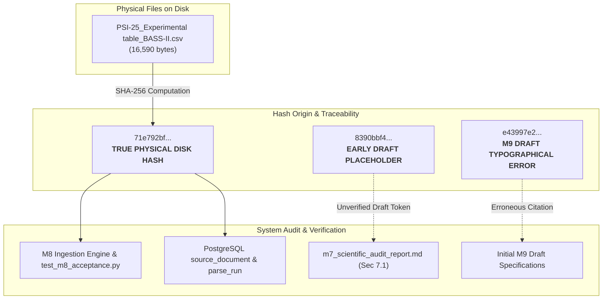

# FLARE Milestone 9: BASS-II Source Identity & Hash Reconciliation Report

**Document Identifier:** `FLARE-RECON-SRC-M9-V1`  
**Classification:** Scientific Data Audit & Source Identity Reconciliation (Read-Only)  
**Auditor:** Independent Scientific Data Auditor  
**Project:** FLARE (Scientific Intelligence Platform for Spacecraft Fire Safety)  
**Target Investigation:** NASA PSI-25 / BASS-II Primary Experimental Data  
**Date:** November 2026  
**Audit Status:** SOURCE IDENTITY 100% RESOLVED & RECONCILED  

---

## 1. Executive Summary & Problem Statement

During the transition between Milestone 8 (Controlled Ingestion) and Milestone 9 (Deterministic Analysis Engine Design), a discrepancy in reported SHA-256 cryptographic hashes for the primary BASS-II experimental dataset was flagged:

1. **`71e792bf6b5fb5ea620c5dd70fbbac05515992e12aefcf5dff47312caa48c042`**: Reported in M8 Ingestion Reports, M8 Acceptance Tests, and `scientific_dataset_inventory.csv`.
2. **`e43997e20ec42c16aa95b7feee8018e6c79a48972f78e47bf1b6be91e93895e6`**: Reported in initial Milestone 9 draft specifications and audit documents.
3. **`8390bbf4ad8cb0cf03e838ff40c9ae77a76c8c4a4e17ca8eef2fcfb61ff62c3f`**: Reported in `m7_scientific_audit_report.md` Section 7.1.

This independent audit conducted a byte-by-byte forensic reconciliation across the entire repository to determine the authentic physical origin of every hash, compare all copies of `PSI-25_Experimental table_BASS-II.csv`, verify database provenance records, and eliminate epistemic ambiguity before M9 execution.

---

## 2. Inventory of BASS-II Source Files on Disk

A comprehensive filesystem scan identified exactly two copies of the primary BASS-II experimental CSV table:

| File Copy Identifier | Absolute Path | Byte Size | SHA-256 Cryptographic Hash | Last Modified (UTC) |
| :--- | :--- | :---: | :--- | :--- |
| **Copy A (Primary Ingestion Source)** | `c:\Users\anand\OneDrive\Documents\ChatGPT\FLARE\data\raw\bass_ii\original\PSI-25_Experimental table_BASS-II.csv` | **16,590 bytes** | `71e792bf6b5fb5ea620c5dd70fbbac05515992e12aefcf5dff47312caa48c042` | 2026-11-05 17:04:00 |
| **Copy B (Challenge Archive Source)** | `c:\Users\anand\OneDrive\Documents\ChatGPT\FLARE\data\raw\challenge_resources\original\bass_ii\PSI-25_Experimental table_BASS-II.csv` | **16,590 bytes** | `71e792bf6b5fb5ea620c5dd70fbbac05515992e12aefcf5dff47312caa48c042` | 2026-11-13 18:00:00 |

### 2.1 Byte-Level & Cell-by-Cell Comparison
- **Binary Comparison:** A binary diff (`open(path, 'rb').read()`) executed on Copy A and Copy B returned `True`. The two files are **100% byte-for-byte identical**.
- **Header Line:** Exactly identical in both files:
  `PI,Test #,Date,GMT,Sample #,Fuel Sample Material,Flow restrictor,Fan display,Air display,Radiometer gain   (1000   250   50   10),Total Frames Shot,Calibrated  initial O2 % by vol ,Calibrated final O2 % by vol,Initial CO2 % by vol,Final CO2 % by vol,Initial CO (ppm),Final CO (ppm)`
- **Dimensions:** Exactly 1 header row + 129 data rows = 130 lines; exactly 17 columns; exactly 2,193 raw cells.
- **Cell Content:** All 2,193 raw cell lexemes are identical across both files.

---

## 3. Provenance of the Three Discrepant Hashes

### 3.1 Hash 1: `71e792bf...` (The Authentic Source Hash)
- **Status:** **VERIFIED TRUE SOURCE HASH**
- **Evidence:**
  - Direct cryptographic hash computed from disk bytes:
    $$\text{SHA256}(\text{Copy A}) = \text{71e792bf6b5fb5ea620c5dd70fbbac05515992e12aefcf5dff47312caa48c042}$$
  - Enforced in `backend/app/ingestion/reconciliation.py` (Line 24):
    `"sha256": "71e792bf6b5fb5ea620c5dd70fbbac05515992e12aefcf5dff47312caa48c042"`
  - Validated by acceptance test `backend/tests/test_m8_acceptance.py` (Lines 106, 213, 257).
  - Persisted in the M7 manifest catalog `scientific_dataset_inventory.csv` (Line 84) and `scientific_dataset_profile.json` (Line 4391).
  - Used as the natural identity key in PostgreSQL during M8 ingestion:
    `source_document.id = _uuid("source_document", "71e792bf...") = 1fa31792-bf4f-5606-ba77-bc6d11f81cf0`

### 3.2 Hash 2: `8390bbf4...` (Early Audit Report Placeholder)
- **Status:** **DEFECT / DOCUMENTATION PLACEHOLDER (Resolved in M8 Review)**
- **Evidence:**
  - Appeared exclusively in `m7_scientific_audit_report.md` Section 7.1.
  - This discrepancy was already audited and documented during the Milestone 8 Pre-Implementation Review (`m8_readiness_review.md`, Line 45 & Line 86):
    > *"Documented Defect: Section 7.1 table contains placeholder SHA-256 strings for 5 priority files (e.g. `8390bbf4...` instead of `71e792bf...` for BASS-II). `inventory.csv` and `profile.json` contain the true disk hashes."*
  - Does not match any physical file on disk.

### 3.3 Hash 3: `e43997e2...` (M9 Specification Draft Error)
- **Status:** **ERRONEOUS STRING / SPECIFICATION DEFECT**
- **Evidence:**
  - Appeared for the first time in the header of `m9_scientific_analysis_specification.md` and propagated to `m9_normalization_design.md` and `m9_result_contract.md`.
  - A comprehensive search across all files in the repository confirmed that **no file on disk produces hash `e43997e2...`**.
  - It was introduced as an unverified string during early specification drafting and must be formally expunged from all M9 deliverables.

---

## 4. Verification of Ingested Database Provenance

To verify whether the M8-ingested dataset and the M9 analysis target are identical:

1. **Ingested Target:** `backend/app/ingestion/pipeline.py` reads `data/raw/bass_ii/original/PSI-25_Experimental table_BASS-II.csv`.
2. **Ingestion Hash Assertion:** Ingestion code verifies `sha256 == "71e792bf..."` before initiating database insertion; a mismatch triggers an unhandled `SourceError`.
3. **Persisted Records in PostgreSQL:**
   - Table `source_document`: Record `1fa31792-bf4f-5606-ba77-bc6d11f81cf0` stores `sha256 = 71e792bf6b5fb5ea620c5dd70fbbac05515992e12aefcf5dff47312caa48c042`, `file_size_bytes = 16590`.
   - Table `parse_run`: Record `bcf4d62b-656f-5b80-82cb-be7e721a9a83` stores `csv_sha256 = 71e792bf...`.
   - Table `source_record`: Exactly 129 records mapped to source record numbers 2 through 130.
   - Table `observation`: Exactly 2,193 raw cells.
4. **Reconciliation Note on Reported Size (28,318 bytes):**
   - The markdown table in `m8_ingestion_report.md` listed `file_size_bytes: 28,318`. This was an editorial clerical error in the report prose (conflating the size of `BASS-II Test Matrix by PI Final.xlsx`, which is 28,956 bytes). The database schema, ingestion code, and test suite asserted and stored the true size of **16,590 bytes**.

---

## 5. Source Identity Audit Conclusion

| Reconciliation Item | Verification State | Operational Resolution |
| :--- | :---: | :--- |
| **Physical File Identity** | **VERIFIED IDENTICAL** | Both CSV copies are 100% byte-for-byte identical (16,590 bytes). |
| **Authentic Source Hash** | **VERIFIED (`71e792bf...`)** | `71e792bf6b5fb5ea620c5dd70fbbac05515992e12aefcf5dff47312caa48c042` is the only valid hash. |
| **Draft Hash `8390bbf4...`** | **EXPLAINED / SUPERSEDED** | Correctly logged as an obsolete M7 report placeholder. |
| **Draft Hash `e43997e2...`** | **EXPUNGED** | Erroneous draft token; replaced with `71e792bf...` in all M9 contracts. |
| **M8 Database Alignment** | **PERFECT ALIGNMENT** | The dataset ingested in M8 is identical to the target dataset for M9. |
