# FLARE Milestone 9: Supported Scientific Analysis Scope

**Document Identifier:** `FLARE-SCOPE-M9-V1`  
**Classification:** Scientific Scope & Implementation Boundary Specification (Read-Only)  
**Authors:** Independent Combustion Science Reviewer, Scientific Data Engineer  
**Project:** FLARE (Scientific Intelligence Platform for Spacecraft Fire Safety)  
**Baseline Dataset:** NASA PSI-25 / BASS-II (`PSI-25_Experimental table_BASS-II.csv`)  
**Date:** November 2026  
**Status:** DRAFT / APPROVED FOR IMPLEMENTATION BOUNDARIES  

---

## 1. Executive Summary & Review Context

Following the independent scientific audit of `PSI-25_Experimental table_BASS-II.csv`, `Fan calibration data.xlsx`, and associated NASA documentation, this document defines the **strictly bounded, defensible analytical scope** for Milestone 9 (M9).

To protect the FLARE project from scientific misinterpretation and computational failure, this scope enforces three operational principles:
1. **Zero Fabrication:** No unmeasured physical properties (e.g. thermal conductivity, heat transfer coefficients) are imported to compute pseudo-dimensionless numbers.
2. **Data-Structure Realism:** Analytical protocols must handle the empirical reality of the CSV table—specifically, that over 75% of airflow readings are multi-value adjustment sequences, background gases accumulated in the unvented chamber, and several records contain recording swaps.
3. **Epistemic Modesty:** The analysis engine must not attempt statistical regressions (such as logistic LOI boundaries) on materials where the experimental matrix never explored extinction regimes.

---

## 2. Definitive Capability Classification

Every prospective analytical capability has been re-evaluated and classified based on primary source evidence:

```mermaid
graph TD
    subgraph DefensibleScope["Defensible M9 Analytical Scope"]
        direction TB
        P1["Protocol M9-P1: Non-Parametric Environmental Statistics<br/>(Initial/Final O2, CO2, CO Distributions)"]
        P2["Protocol M9-P2: Stoichiometric Oxygen & Carbon Mass Balance<br/>(Filtered Delta O2 & Delta CO2 across PI Material Classes)"]
        P3["Protocol M9-P3: Steady-State Centerline Velocity Analysis<br/>(Scalar Air Display Subset: U = 1.0066 * Air)"]
    end

    subgraph ConditionedScope["Conditioned / Exploratory Scope"]
        direction TB
        C1["Fuel Categorization (PI-Defined Morphologies)"]
        C2["Chamber Gas Accumulation Trends (Run Sequencing)"]
    end

    subgraph ProhibitedScope["Strictly Prohibited Scope (Rejected)"]
        direction TB
        X1["Flame Spread Velocity (Vf) from CSV"]
        X2["Logistic Regression LOI Boundary for Slabs"]
        X3["Calculated Biot Numbers (Assumed k_s, h_c)"]
        X4["Uncalibrated Flow Pooling across Restrictors"]
        X5["Extrapolations to Lunar/Martian Gravity or LOC Risk"]
    end

    DefensibleScope --> Implement["Approved for M9 Implementation"]
    ConditionedScope --> Implement
    ProhibitedScope --> Reject["Blocked / Excluded from M9"]
```

---

## 3. Approved M9 Implementation Scope (The Smallest Defensible Scope)

The approved M9 implementation consists of three deterministic, non-destructive analytical protocols.

### 3.1 Protocol M9-P1: Robust Non-Parametric Environmental Gas Profiling
- **Scientific Objective:** Quantify the statistical distribution of ambient microgravity atmospheric conditions inside the Microgravity Science Glovebox (MSG) across all 129 flight runs.
- **Eligible Inputs:**
  - `Calibrated  initial O2 % by vol ` ($N = 129$, 100% complete).
  - `Initial CO2 % by vol` ($N = 129$, 100% complete, non-numeric literals `'none'` mapped to NULL).
  - `Initial CO (ppm)` ($N = 127$ valid numeric, negative drift entries preserved).
- **Required Data Filtering & Gating:**
  - Categorical tokens (`'none'`, `'OR'`) must remain typed NULLs and excluded from numeric calculation loops.
  - Negative $CO$ readings ($-1, -2, -3\text{ ppm}$) must be retained to maintain zero-point Gaussian noise structure, flagged as `SENSOR_ZERO_DRIFT_PRESERVED`.
- **Mathematical Formulations:**
  - Sample Median ($\tilde{X}$), Interquartile Range ($\text{IQR} = Q_3 - Q_1$), and Non-Parametric 95% Confidence Intervals via order statistics:
    $$j = \left\lfloor \frac{N}{2} - 1.96 \frac{\sqrt{N}}{2} \right\rfloor, \quad k = \left\lceil \frac{N}{2} + 1.96 \frac{\sqrt{N}}{2} \right\rceil$$
  - Stratification by Principal Investigator (PI) to reflect differing chamber operating days.
- **Feasibility Status:** **`SUPPORTED`**

---

### 3.2 Protocol M9-P2: Filtered Stoichiometric Oxygen Depletion & Combustion Byproducts
- **Scientific Objective:** Calculate total stoichiometric oxygen consumed ($\Delta X_{O2}$) and carbon dioxide produced ($\Delta X_{CO2}$) across valid flight runs to assess combustion completeness across PI fuel classes.
- **Eligible Inputs:**
  - `Calibrated  initial O2 % by vol ` and `Calibrated final O2 % by vol`.
  - `Initial CO2 % by vol` and `Final CO2 % by vol`.
  - `Fuel Sample Material` (Categorical PI mapping).
- **Mandatory Anomaly Gating Rules:**
  - **Rule 1 (Gross Anomaly Exclusion):** Exclude records where $\Delta X_{O2} > 5.0\%$ or $\Delta X_{O2} < -0.2\%$. Specifically quarantines:
    - Test `B2` ($\Delta = +20.6\%$)
    - Test `P22a` ($\Delta = +20.2\%$)
    - Test `P22b` ($\Delta = -19.1\%$)
    - Test `T28a` ($\Delta = +19.8\%$)
    - Test `T28b` ($\Delta = -19.7\%$)
  - **Rule 2 (Sensor Drift Handling):** Tests with minor negative depletion ($-0.2\% \le \Delta X_{O2} < 0.0\%$, specifically `T5, T10, T12, T13, T23`) must be flagged as `INSTRUMENT_RESOLUTION_LIMIT` and bounded to $[0.0, 0.001]\text{ mol/mol}$ in mass balances.
  - **Rule 3 (Incomplete Combustion Flagging):** Flag tests where `Final CO (ppm)` contains saturation tokens (`'>500'`, `'over'`, `'OR'`) as `COMBUSTION_INCOMPLETE_SENSOR_SATURATED`.
- **Net Usable Sample Size:** Exactly **$N = 122$ paired records**.
- **Mathematical Formulations:**
  - Molar Oxygen Consumed in MSG Enclosure ($V_{MSG} = 0.255\text{ m}^3$, $P = 101,325\text{ Pa}$, $T = 295.15\text{ K}$):
    $$\Delta n_{O2} = \frac{P \cdot V_{MSG}}{R \cdot T} \cdot \frac{\Delta X_{O2}}{100} \quad [\text{mol}]$$
  - Apparent Respiratory Quotient ($RQ_{comb}$):
    $$RQ_{comb} = \frac{X_{CO2,final} - X_{CO2,init}}{X_{O2,init} - X_{O2,final}}$$
- **Feasibility Status:** **`SUPPORTED`**

---

### 3.3 Protocol M9-P3: Steady-State Centerline Velocity Mapping
- **Scientific Objective:** Determine forced convective fluid velocity for the subset of flight tests conducted at constant, unadjusted flow speeds.
- **Eligible Inputs:**
  - `Air display` (Strictly filtered to single numeric scalars).
  - `Flow restrictor` ($0 = \text{Unrestricted}$, $1 = \text{Intermediate}$, $2 = \text{High}$).
- **Mandatory Gating Rules:**
  - **Rule 1 (Sequence Exclusion):** Any cell containing spaces, commas, semicolons, parentheses, or text (e.g. `'5 2 slow decr to ext'`, `'116 (pot 9.3) 89 80 84'`) must be classified as `DYNAMIC_FLOW_SEQUENCE` and **excluded** from static single-velocity regressions.
  - **Rule 2 (Linear SPICE Transformation):** Apply the authentic calibration formula from `Fan calibration data.xlsx` (Row 33):
    $$U_\infty = 1.0066 \times (\text{Air Display}) \quad [\text{cm/s}]$$
    Convert to canonical SI: $U_\infty = (1.0066 \times \text{Air Display}) \times 10^{-2}\text{ m/s}$.
  - **Rule 3 (Deadband Rejection):** Flow setpoints with `Air display` = 0 or `Fan display` $\le 38$ (3.8V) must not be divided into flow time calculations due to motor shut-off deadband.
- **Net Usable Sample Size:** Approximately **$N = 25$ static scalar runs**.
- **Feasibility Status:** **`CONDITIONALLY SUPPORTED`**

---

## 4. Conditioned Morphological Stratification (Replacing Biot Calculations)

Because parameters $k_s$ and $h_c$ are not present in NASA source archives, numerical Biot numbers are prohibited. In their place, fuels are categorized by the **authentic PI research classifications**:

| Morphological Fuel Class | Principal Investigator | Specimen Descriptions in Source CSV | Valid Sample Count | Physical Regime / Thermal Boundary Condition |
| :--- | :--- | :--- | :---: | :--- |
| **Thin PMMA Films** | Bhattacharjee | `100 micron`, `200 micron`, `300 micron`, `400 micron` PMMA film, 1–2 cm wide | $N = 22$ | Thermally thin limit ($Bi \ll 0.1$). Solid temperature approximately uniform through thickness. |
| **Thick PMMA Slabs** | Miller | `1 mm`, `2 mm`, `3 mm`, `4 mm`, `5 mm` thick PMMA slabs; 1-sided mount vs 2-sided unbacked | $N = 20$ | Thermally thick limit ($Bi \gg 1.0$). Subdivided into: (a) 1-sided burn with conductive loss to phenolic mount; (b) 2-sided unbacked free burn. |
| **Clear PMMA Rods** | Olson | `1/4"`, `3/8"`, `1/2"` clear PMMA cylindrical rods | $N = 27$ | Thermally thick cylinders in **forward stagnation flow** (concurrent spread from upstream tip). |
| **Black PMMA Rods** | Fernandez-Pello | `1/4"`, `3/8"`, `0.5"` black PMMA cylindrical rods | $N = 27$ | Thermally thick cylinders in **opposed flow** (ignited at downstream end; radiation-absorbing pigment). |
| **SIBAL Fabric** | T'ien | `1 cm`, `2 cm` SIBAL (75% cotton / 25% fiberglass) | $N = 29$ | Porous composite fabric with non-combustible fiberglass scaffold; thermally thin. |
| **Nomex III Fabric** | Ferkul | `Nomex natural (nomex III)` | $N = 3$ | Inherently flame-resistant aramid fabric; exploratory runs only ($N=3$). |
| **Candle** | Ferkul | `Japan Wax candle` | $N = 1$ | Liquid melt pool / wick combustion; single flight run ($N=1$). |

---

## 5. Prohibited Operations & Scope Exclusions

The following operations are **strictly prohibited** in Milestone 9 implementation:

1. **NO Flame Spread Rate ($V_f$) Estimation from CSV:**  
   Dividing fuel length by camera frame duration ($V_f = L_{fuel} / \Delta t$) is scientifically invalid. Most runs were extinguished prior to burnout, and frame counts include ignition delays and post-burn glow.
2. **NO Logistic Regression LOI Modeling for Slabs:**  
   Miller's thick PMMA slabs were tested only at $\ge 17.9\% O_2$. Zero extinction events exist in the slab dataset, making logistic regression mathematically degenerate.
3. **NO Fabricated Biot Numbers:**  
   No hardcoded thermal conductivities ($k_s = 0.19\text{ W/m}\cdot\text{K}$) or convective coefficients ($h_c = 15\text{ W/m}^2\text{K}$) may be injected into the database or analysis code.
4. **NO Cubic Polynomial Flow Equations:**  
   The cubic polynomial proposed in M9 specification does not exist in NASA calibration files and must not be implemented.
5. **NO Uncalibrated Flow Pooling:**  
   Potentiometer readings must never be pooled across different `Flow Restrictor` states (0, 1, 2) without flow channel area correction.
6. **NO Gravity Extrapolations or Fire-Risk Probabilities:**  
   No extrapolations to Lunar ($1/6\text{ g}$) or Martian ($3/8\text{ g}$) environments, and no probabilistic spacecraft Loss-of-Crew (LOC) odds calculations.

---

## 6. Traceability and Reproducibility Mandate

Every analytical output generated under M9 must satisfy:
1. **Source Row Traceability:** Every metric must link via `result_input` to exact source row numbers (Lines 2–130) in `PSI-25_Experimental table_BASS-II.csv`.
2. **Provenance Sealing:** Output payloads must reference the SHA-256 hash of the original NASA CSV (`e43997e20ec42c16aa95b7feee8018e6c79a48972f78e47bf1b6be91e93895e6`).
3. **Cryptographic Aggregate Sealing:** The result tree must be locked via `flare_sealing.seal_analytical_result()` under the forward-remediated M6 database schema (`0008_m6_security_remediation`).
