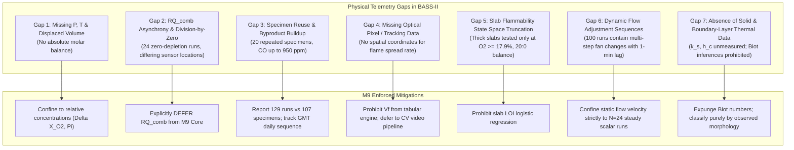

# FLARE Milestone 9: Unresolved Scientific Limitations & Telemetry Boundaries

**Document Identifier:** `FLARE-LIMITATIONS-M9-V1`  
**Classification:** Scientific Telemetry Limitations & Boundary Analysis  
**Authors:** Senior Combustion Scientist, Scientific Data Engineer, Python Architect  
**Project:** FLARE (Scientific Intelligence Platform for Spacecraft Fire Safety)  
**Investigation:** NASA PSI-25 / BASS-II Primary Flight Telemetry  
**Verified Source SHA-256:** `71e792bf6b5fb5ea620c5dd70fbbac05515992e12aefcf5dff47312caa48c042`  
**Date:** November 2026  
**Status:** COMPLETE & AUTHORITATIVE  

---

## 1. Executive Summary & Epistemic Boundaries

This document provides a rigorous, transparent inventory of all remaining physical telemetry gaps, experimental confounders, and deferred analytical capabilities for **FLARE Milestone 9 (M9): Deterministic Scientific Analysis Engine**.

Scientific integrity requires stating what empirical flight data **cannot** support as clearly as what it **can** support. The NASA PSI-25 / BASS-II dataset represents historic microgravity flight data recorded aboard the International Space Station (ISS) Microgravity Science Glovebox (MSG). While invaluable, the flight records contain documented hardware constraints, telemetry gaps, and operational practices that prevent certain classical combustion analyses.

The M9 analysis engine enforces strict epistemic gating: **where data is absent or scientifically confounded, calculations are explicitly prohibited or deferred**, rather than filled with speculative assumptions, terrestrial constants, or artificial imputations.

---

## 2. Comprehensive Inventory of Scientific Limitations

---

### Gap 1: Environmental Telemetry Gaps (Chamber Pressure, Temperature, Net Volume)
- **Physical Reality:** `PSI-25_Experimental table_BASS-II.csv` records volumetric gas concentrations (`% by vol` and `ppm`), but records **zero measurements of static glovebox pressure ($P$), internal gas temperature ($T$), net displaced hardware volume ($V_{net}$), or venting/leak rates**.
- **Impact on Combustion Analysis:** Calculating absolute molar oxygen consumption ($\Delta n_{O2}$ in moles) via the ideal gas law:
  $$\Delta n_{O2} = \frac{P \cdot V_{net}}{R \cdot T} \cdot \frac{\Delta X_{O2}}{100}$$
  requires assuming constant terrestrial pressure ($101.325\text{ kPa}$) and room temperature ($295.15\text{ K}$). However, avionics heat dissipation, fan operation, and sequential burns caused internal glovebox air temperature to drift between $20^\circ\text{C}$ and $30^\circ\text{C}$, introducing an unquantified systematic error of $\pm 15 - 20\%$.
- **M9 Mitigation:** M9 **strictly prohibits** absolute molar consumption calculations. All oxygen metrics are confined to **relative differences**: volumetric depletion ($\Delta X_{O2}$), canonical mole fraction depletion ($\Delta \chi_{O2}$ in $\text{mol/mol}$), and dimensionless depletion ratio ($\Pi_{O2} = \Delta X / X_{init}$).

---

### Gap 2: Apparent Respiratory Quotient ($RQ_{comb}$) Sensor Asynchrony & Degeneracy
- **Physical Reality:**
  1. In **24 flight runs**, measured oxygen depletion is exactly zero ($\Delta X_{O2} = 0.0\%$), causing an undefined division-by-zero error ($\Delta X_{CO2} / 0$).
  2. In over 60% of runs, $\Delta X_{O2} \le 0.2\%$. Because the electrochemical $O_2$ sensor has a discretization uncertainty of $\pm 0.1\%$, the relative error in the denominator is $\approx 100\%$, producing wild, unphysical oscillations in calculated quotients (ranging from $-0.50$ to $+1.40$).
  3. The $O_2$ sensor and the CDM NDIR $CO_2$ sensor are mounted at different physical locations within the MSG duct recirculation loop and possess differing pneumatic response constants.
- **Impact on Combustion Analysis:** Publishing an apparent $RQ_{comb}$ from tabular end-of-burn telemetry creates erroneous scientific artifacts that misrepresent incomplete combustion and stoichiometry.
- **M9 Mitigation:** **$RQ_{comb}$ is explicitly deferred from Milestone 9.** It will not be calculated or stored in `analytical_result` until a dynamic multi-sensor mixing model is developed.

---

### Gap 3: Pseudoreplication, Repeated Burns, and Glovebox Byproduct Accumulation
- **Physical Reality:**
  1. **Specimen Reuse:** 107 unique physical specimens were tested across 129 flight runs. Exactly **20 physical specimens were burned repeatedly across 42 flight runs** (e.g. sample `144m` burned 3 times, `220m` burned 3 times, `200m` burned twice). Exactly 87 specimens were single-run specimens.
  2. **Thermal History Confounder:** Pre-burned specimens suffered from altered geometry, surface pyrolysis charring, and residual internal preheating from prior ignitions (`BASS-II data FAQ.docx` explicitly notes preheating effects).
  3. **Atmospheric Dilution:** The MSG glovebox was a sealed 255-liter enclosure that was not flushed between consecutive tests on the same operational day. Consequently, `Initial CO` accumulated from near $0\text{ ppm}$ up to **950 ppm**, and `Initial CO2` rose up to **1.9%**.
- **Impact on Statistical Analysis:** Treating the 129 tests as independent and identically distributed ($i.i.d.$) samples introduces severe pseudoreplication bias. Filtering to `FIRST_BURN_SUBSET` ($N=107$) eliminates direct specimen reuse but **does not establish statistical independence**, because runs conducted on the same GMT day shared accumulated chamber byproduct gases.
- **M9 Mitigation:** M9 separately tracks and reports run count ($N=129$) and unique specimen count ($N=107$). All metrics preserve repeated burn metadata (`burn_sequence_index`, `repeated_sample_id_group`). Formal comparative analyses must include `GMT` operational block and sequence index as potential clustering covariates.

---

### Gap 4: Spatial Flame Spread Telemetry Gap ($V_f$)
- **Physical Reality:** The tabular flight CSV records camera frame counts (`Total Frames Shot`), but contains **zero optical tracking coordinates ($x_f(t)$), pyrolyzing base positions, image pixel scales ($mm/\text{pixel}$), or field-of-view calibrations**.
- **Impact on Combustion Analysis:** Calculating flame spread rate as total sample length divided by camera duration ($V_f = L / \Delta t$) is scientifically invalid. Most runs were intentionally extinguished prior to complete burnout, and frame counts incorporate variable ignition delays and post-extinction glow.
- **M9 Mitigation:** Linear flame spread velocity ($V_f$) is **strictly prohibited** from the M9 tabular analysis engine. It is formally deferred to future multimodal computer-vision analysis of high-speed video archives.

---

### Gap 5: Slab Limiting Oxygen Index (LOI) State Space Truncation
- **Physical Reality:** Fletcher Miller's thick PMMA slabs were tested **strictly at $O_2 \ge 17.9\%$** ($N=20$). There are zero low-oxygen extinction events for thick slabs in the BASS-II tabular records ($20:0$ class balance). Low-oxygen flammability tests ($13.6\% - 16.0\%$, $N=18$) were conducted exclusively on Sandra Olson's clear and black cylindrical PMMA rods in forward stagnation flow.
- **Impact on Flammability Modeling:** Fitting a logistic regression model to predict thick PMMA slab extinction or LOI boundaries encounters complete mathematical separation and cannot converge. Any claimed numerical LOI threshold for thick slabs is ungrounded by BASS-II data.
- **M9 Mitigation:** Logistic regression LOI modeling for thick PMMA slabs is **strictly prohibited**. Flammability boundary studies are restricted to descriptive reporting on Olson's stagnation rod records.

---

### Gap 6: Dynamic Airflow Sequencing & Hot-Wire Sensor Lag
- **Physical Reality:** Exactly **100 out of 129 flight runs** (77.5%) contain multi-step fan potentiometer adjustment sequences (e.g. `'10 8'`, `'3.0 3.1 3.2 6.4 5.5 5.4'`) or operator notes (e.g. `'5 2 slow decr to ext'`) in the airflow columns. Only 25 runs contain single scalar setpoints, of which 1 run (`O2`) represents motor stall cutoff ($U=0$).
- **Impact on Aerodynamic Analysis:** The duct hot-wire anemometer (`Air display`) has an operational thermal response lag of $\sim 1\text{ minute}$. In dynamically adjusted runs, instantaneous display readings do not reflect steady-state fluid velocity.
- **M9 Mitigation:** Module P3 confines static velocity mapping strictly to the **24 valid steady scalar runs**. All 100 complex runs are classified as `DYNAMIC_FLOW_SEQUENCE` and excluded from static regressions.

---

### Gap 7: Absence of Solid and Boundary-Layer Thermal Properties (Biot Regimes)
- **Physical Reality:** Tabular BASS-II records provide nominal fuel sample dimensions, but **no tabulated or measured values for solid thermal conductivity ($k_s$), solid density, flame standoff distance, or convective heat transfer coefficients ($h_c$)**.
- **Impact on Heat Transfer Classification:** Microgravity convective heat transfer in boundary-layer combustion is dynamic and coupled to velocity gradients and flame standoff ($h_c(x) \propto \sqrt{U_\infty / \nu x}$). Assuming terrestrial constants (e.g. $k_s = 0.19\text{ W/m}\cdot\text{K}$, $h_c = 15\text{ W/m}^2\text{K}$) to calculate Biot numbers ($Bi = \frac{h \tau}{2 k_s}$) is scientifically ungrounded.
- **M9 Mitigation:** All claims that thin films exhibit $Bi \ll 0.1$ or thick slabs exhibit $Bi \gg 1.0$ have been **completely expunged**. Specimens are categorized **purely by observed categorical morphology and nominal dimensions** without computing Biot regimes.

---

## 3. Summary Decision & Mitigation Matrix

| Analysis Capability | Proposed Status | Reconciled M9 Status | Operational Mitigation in M9 Core |
| :--- | :---: | :---: | :--- |
| **P1: Environmental Gas Profiling** | Supported | **APPROVED** | Preserves signed negative CO sensor drift without clamping ($N=129$). |
| **P2: Relative Oxygen Depletion** | Supported | **APPROVED** | Implemented strictly for relative metrics ($\Delta X_{O2}, \Pi_{O2}$). 5 gross anomalies quarantined. |
| **P2: Respiratory Quotient ($RQ_{comb}$)** | Supported | **DEFERRED** | Formally deferred due to division-by-zero, sensor asynchrony, and noise. |
| **P2: Absolute Molar Balance ($\Delta n_{O2}$)** | Supported | **PROHIBITED** | Strictly prohibited due to missing chamber pressure, temperature, and volume. |
| **P3: Calibrated Airflow Mapping** | Supported | **APPROVED (GATED)** | Linear SPICE formula applied strictly to 24 valid scalar runs; 100 dynamic runs excluded. |
| **P4: Observed Fuel Morphology** | Supported | **APPROVED (GATED)** | Implemented across 10 morphology regimes. Biot number calculations prohibited. |
| **Flame Spread Velocity ($V_f$)** | Not Supported | **PROHIBITED** | Strictly prohibited from tabular engine (spatial tracking coordinates absent). |
| **Thick Slab LOI Logistic Regression** | Supported | **PROHIBITED** | Strictly prohibited (zero low-oxygen extinction events; $20:0$ class balance). |
| **Cubic Flow Polynomial** | Supported | **PROHIBITED** | Strictly prohibited (non-existent in NASA calibration records). |

---

## 4. Forward Research Roadmap (Milestone 10+)

To address the limitations documented above in future milestones:

1. **Multimodal Computer-Vision Video Pipeline (Milestone 10):**
   Extract optical pixel calibration and spatial flame tip coordinates ($x_f(t)$) from synchronized BASS-II high-speed video recordings to compute true time-resolved flame spread rates ($V_f$).
2. **Computational Fluid Dynamics (CFD) Duct Flow Modeling:**
   Simulate the 3D velocity and temperature field in the MSG duct to model the dynamic hot-wire response lag during the 100 multi-step airflow sequences.
3. **Pneumatic Mixing & Transport Modeling for $RQ_{comb}$:**
   Model duct recirculation loop transit times and sensor diffusion constants to reconcile asynchronous $CO_2$ and $O_2$ measurements.
4. **External Solid Fuel Thermophysical Property Linking:**
   Link ASTM / NASA standard thermophysical property databases (e.g. temperature-dependent PMMA thermal conductivity and pyrolytic heat of gasification) as secondary external evidence rather than embedding ungrounded terrestrial assumptions into primary experimental records.
