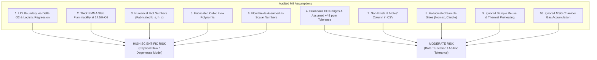

# FLARE Milestone 9: Unresolved Scientific Assumptions & Risk Registry

**Document Identifier:** `FLARE-RISK-M9-V1`  
**Classification:** Scientific Risk Registry & Assumption Audit (Read-Only)  
**Authors:** Independent Combustion Science Reviewer, Scientific Data Engineer  
**Project:** FLARE (Scientific Intelligence Platform for Spacecraft Fire Safety)  
**Primary Target:** M9 Architectural Specification Deliverables  
**Baseline Archives:** NASA PSI-25 / BASS-II Source Files  
**Date:** November 2026  
**Status:** DRAFT / APPROVED FOR RISK AUDIT  

---

## 1. Overview & Purpose

This document provides a formal registry of all unverified, assumed, or scientifically flawed propositions identified during the independent review of the FLARE Milestone 9 (M9) architectural specification. 

In safety-critical spacecraft fire safety research, propagating unverified assumptions into computational models creates substantial epistemic risk. Each entry in this registry documents:
1. **The Claimed Assumption** in the M9 specification.
2. **The Ground Truth** discovered in NASA PSI-25 source files.
3. **The Physical & Computational Consequence** if implemented without modification.
4. **The Required Corrective Action** for future implementation.

---

## 2. Master Registry of Unresolved Scientific Assumptions

---

### Assumption 1: Oxygen Depletion as an Indicator of Extinction
- **M9 Specification Claim:** Protocol `M9-P6` claimed that flame extinction can be identified when stoichiometric oxygen depletion falls below a threshold ($\Delta X_{O2} < \epsilon$).
- **Empirical Ground Truth:** Total oxygen depletion ($\Delta X_{O2}$) is the time-integrated product of mass burning rate and flame surface area over the entire duration of the test. In BASS-II, many extinction experiments began with vigorous burning at moderate flow; the astronaut then systematically decreased the fan speed in steps (e.g. Test `P1`: `'5  2   slow decr to ext'`) until the flame detached or blew off. These tests consumed substantial oxygen ($\Delta X_{O2} = 0.5\% - 1.5\%$) before extinguishing. Conversely, tests with zero depletion represent **failed ignitions**, not true flammability boundary states.
- **Scientific Consequence:** An algorithm using $\Delta X_{O2} < \epsilon$ would misclassify long-duration extinction tests as "sustained burning" and ignition failures as "natural flammability extinction."
- **Corrective Action:** Extinction boundaries must not be classified from $\Delta X_{O2}$. Extinction states must be extracted directly from operator annotations in the airflow cells and correlated with the final flow setting at detachment.

---

### Assumption 2: Thick PMMA Slab Flammability Boundary at 14.5%–15.0% $O_2$
- **M9 Specification Claim:** Validation Plan Battery 5 asserted that Protocol `M9-P6` would be benchmarked against published literature (Olson, Johnston, & Ferkul, 2016) by verifying a 50% flammability boundary threshold within $X_{O2,LOI} \in [0.145, 0.155]\text{ mol/mol}$ for thick PMMA slabs.
- **Empirical Ground Truth:** A full audit of all 20 thick PMMA slab tests conducted by Fletcher Miller reveals that the minimum oxygen concentration tested was **17.9% $O_2$** (range: $17.9\% - 22.2\%$, median $20.45\%$). Not a single thick PMMA slab run was performed at $\le 16.0\% O_2$. The tests performed at low oxygen ($13.6\% - 16.0\%$, $N=18$) were exclusively Sandra Olson's tests on **clear PMMA cylindrical rods in forward stagnation flow**.
- **Scientific Consequence:** Attempting to fit a flammability boundary at $14.5\%$ for thick PMMA slabs will produce complete failure or unconstrained extrapolation, because no slab data exists below $17.9\%$.
- **Corrective Action:** Remove thick PMMA slabs from LOI boundary testing. Confine low-oxygen boundary studies strictly to cylindrical PMMA rods in stagnation flow (Olson dataset).

---

### Assumption 3: Numerical Biot Number Calculation via Fabricated Parameters
- **M9 Specification Claim:** Fuel thermal thickness regimes must be determined by calculating the solid Biot number:
  $$Bi = \frac{h_c \tau}{2 k_s}$$
  using hardcoded constants $k_{PMMA} = 0.19\text{ W/m}\cdot\text{K}$ and $h_c = 15\text{ W/m}^2\text{K}$.
- **Empirical Ground Truth:** Thermal conductivity ($k_s$) and convective heat transfer coefficient ($h_c$) are nowhere present in the NASA BASS-II data repository. In boundary-layer microgravity combustion, $h_c$ is a dynamic variable governed by fluid velocity gradients and flame standoff distance. Hardcoding terrestrial textbook constants violates the core project boundary ("No fabricated physical parameters").
- **Scientific Consequence:** Imputing unmeasured constants generates an illusion of high-precision thermodynamic modeling while introducing unquantifiable systematic bias.
- **Corrective Action:** Prohibit numerical Biot number calculations. Use the **categorical material regimes** established by the NASA Principal Investigators based on specimen geometry (Thin Films $\le 0.5\text{ mm}$, Thick Slabs $\ge 1.0\text{ mm}$, Cylindrical Rods, Fabrics).

---

### Assumption 4: Grossly Misreported CO Ranges and Ad-hoc Uncertainty
- **M9 Specification Claim:** `Initial CO` ranges from $-3$ to $12\text{ ppm}$; `Final CO` ranges from $-4$ to $40\text{ ppm}$. Baseline sensor uncertainty is $\pm 3\text{ ppm}$.
- **Empirical Ground Truth:**
  - `Initial CO` actually ranges from $-3$ to **950 ppm** (with 1 'OR' token).
  - `Final CO` actually ranges from $0$ to **950 ppm**, with multiple sensor saturation tokens (`'>500'`, `'over'`, `'OR'`). Negative readings in `Final CO` do not exist.
  - The $\pm 3\text{ ppm}$ uncertainty figure is an assumed heuristic based solely on the fact that $-3$ was the lowest observed initial reading, not on NASA CSA-CP calibration documents.
- **Scientific Consequence:** Data models designed with upper bounds of $40\text{ ppm}$ will truncate or reject valid flight observations. Furthermore, the substantial accumulation of $CO$ in sequential runs alters gas-phase radiation and soot kinetics.
- **Corrective Action:** Update data contracts to support CO concentrations up to $1,000\text{ ppm}$ and explicit saturation tokens (`>500`, `over`, `OR`). Clearly state in uncertainty budgets that $\pm 3\text{ ppm}$ is an uncalibrated zero-point drift heuristic.

---

### Assumption 5: Fabricated Cubic Flow Velocity Polynomial
- **M9 Specification Claim:** Potentiometer setpoint $S_{fan} \in [0, 99]$ maps to linear velocity $U_\infty$ via a 3rd-order calibration polynomial:
  $$U_\infty = a_0 + a_1 S_{fan} + a_2 S_{fan}^2 + a_3 S_{fan}^3$$
- **Empirical Ground Truth:** `Fan calibration data.xlsx` contains **no polynomial fit equations**. The authentic NASA calibration (Row 33) is linear and applies directly to `Air display`, not `Fan display`:
  $$U_\infty = 1.0066 \times (\text{Air Display}) \quad [\text{cm/s}]$$
  Furthermore, `Fan display` is simply fan voltage $\times 10$ ($V_{fan} = S_{fan} / 10$).
- **Scientific Consequence:** Implementing a fictitious cubic polynomial introduces artificial mathematical curvature into fluid velocity calculations.
- **Corrective Action:** Eliminate the cubic polynomial. Implement the authentic linear SPICE transformation $U = 1.0066 \times (\text{Air Display})\text{ cm/s}$ for valid steady-state runs.

---

### Assumption 6: Flow Fields Treated as Scalar Numbers
- **M9 Specification Claim:** The analysis engine assumed `Fan display` and `Air display` could be ingested and processed as scalar numeric primitives.
- **Empirical Ground Truth:**
  - `Fan display` contains **97 complex strings** out of 129 rows (75.2%).
  - `Air display` contains **100 complex strings** out of 129 rows (77.5%).
  - Cells contain dynamic adjustment histories (e.g. `'116 (pot 9.3) 89 80 84'`, `'3.0 3.1 3.2 6.4 5.5 5.4'`) and operator notes (e.g. `'5 2 slow decr to ext'`, `'blowoff fan pot 6.0'`). Only 25 rows have single numeric scalars in `Air display`.
- **Scientific Consequence:** Naive numeric parsing will throw type conversion exceptions on 75% of the dataset, or silently drop complex records.
- **Corrective Action:** Ingest flow fields as text strings. Implement a lexical classifier that tags records as either `STATIC_SCALAR_FLOW` ($N \approx 25$) or `DYNAMIC_FLOW_SEQUENCE` ($N \approx 100$). Confine static velocity regressions strictly to `STATIC_SCALAR_FLOW`.

---

### Assumption 7: Non-Existent "Notes" Column in CSV
- **M9 Specification Claim:** M9 specification listed Column 15 of `PSI-25_Experimental table_BASS-II.csv` as `Notes`.
- **Empirical Ground Truth:** The CSV contains exactly 17 columns. Column 15 is `Initial CO (ppm)` and Column 16 is `Final CO (ppm)`. **There is no Notes column in the CSV.** Operator comments were written directly into the `Air display` and `Fan display` cells.
- **Scientific Consequence:** Any pipeline expecting a dedicated `notes` field in the raw table will fail.
- **Corrective Action:** Realign column index references to match the verified layout in `m8_corrected_bass_ii_mapping.csv`. Extract operational event tags directly from `Air display` and `Fan display` lexemes.

---

### Assumption 8: Hallucinated Sample Sizes for Nomex and Candle
- **M9 Specification Claim:** M9 specification reported sample sizes of $N = 8$ for Nomex Fabric and $N = 8$ for Candle / Cotton Wick.
- **Empirical Ground Truth:** Primary BASS-II data contains exactly **3 runs for Nomex** (`F1, F2, F3`) and **1 run for Candle** (`F4`). Total runs under PI Paul Ferkul equal 4.
- **Scientific Consequence:** Statistical confidence intervals and hypothesis tests planned for $N=8$ will suffer from severe lack of statistical power ($N=3$ has critical t-value $t_{0.025, 2} = 4.303$; $N=1$ cannot compute sample variance).
- **Corrective Action:** Downgrade Nomex and Candle analyses to qualitative exploratory reporting; exclude them from comparative statistical hypothesis testing.

---

### Assumption 9: Pseudoreplication from Specimen Reuse
- **M9 Specification Claim:** Analytical protocols treated all 129 flight records as independent, identically distributed (i.i.d.) observations.
- **Empirical Ground Truth:** At least **20 fuel specimens were burned multiple times** (e.g. sample `144m` burned 3 times, sample `220m` burned 3 times, sample `200m` burned twice). Pre-burned samples had reduced length, char formation, and thermal preheating from previous test cycles.
- **Scientific Consequence:** Reused samples exhibit altered ignition delays and burning behavior, violating statistical independence and artificially inflating degrees of freedom.
- **Corrective Action:** Group observations by `Sample #`. When performing formal regression modeling, apply clustered variance estimators or filter to virgin (first-burn) samples only.

---

### Assumption 10: Unaccounted Closed-Chamber Gas Accumulation
- **M9 Specification Claim:** Baseline ambient gas composition was treated as an independent random variable across tests.
- **Empirical Ground Truth:** The Microgravity Science Glovebox is a sealed 255-liter enclosure that was not flushed between sequential tests on the same crew shift. Carbon monoxide accumulated from near $0\text{ ppm}$ up to **950 ppm**, and $CO_2$ rose to nearly $2.0\%$.
- **Scientific Consequence:** Accumulated combustion byproducts act as thermal diluents and infrared radiometers, systematically cooling the flame and altering soot formation in later runs.
- **Corrective Action:** Include `Date`, `GMT`, and daily run sequence as covariates when evaluating combustion completeness or flammability limits.
