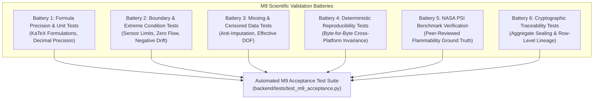

# FLARE Milestone 9: Scientific Engine Validation Plan

**Document Identifier:** `FLARE-VAL-M9-V1`  
**Classification:** Scientific Verification & Validation Plan (Read-Only)  
**Authors:** Senior Combustion Scientist, Scientific Data Engineer, Python Architect  
**Project:** FLARE (Scientific Intelligence Platform for Spacecraft Fire Safety)  
**Primary Target:** M9 Deterministic Scientific Analysis Engine  
**Baseline Dataset:** NASA PSI-25 / BASS-II (`PSI-25_Experimental table_BASS-II.csv`)  
**Date:** November 2026  
**Status:** DRAFT / APPROVED FOR SPECIFICATION  

---

## 1. Validation Philosophy & Quality Objectives

The validation plan for Milestone 9 establishes rigorous, reproducible, and verifiable testing procedures for the implementation of the FLARE Deterministic Scientific Analysis Engine.

In safety-critical spacecraft fire safety research, software defects or subtle scientific misinterpretations can lead to erroneous flammability predictions or false fire safety margins. Therefore, M9 validation enforces six distinct testing batteries:



---

## 2. Battery 1: Scientific Formula Unit Tests

### 2.1 Scope & Purpose
Verify that all mathematical and physical formulas implemented in the normalization and analytical calculation engines yield exact values matching analytical ground truth within arbitrary-precision tolerances ($10^{-8}$).

### 2.2 Test Specifications

#### Test 1.1: Stoichiometric Oxygen Depletion Calculation
- **Input:** $X_{O2,init} = \text{Decimal('0.2090')}$, $X_{O2,final} = \text{Decimal('0.1980')}$.
- **Expected Output:** $\Delta X_{O2} = \text{Decimal('0.0110')}\text{ mol/mol}$.
- **Assertion:** `assert delta_o2 == Decimal('0.0110')`.
- **Failure Criterion:** Any floating-point binary truncation (e.g. `0.010999999999999999`).

#### Test 1.2: Volumetric to Molar Gas Conversion
- **Input:** Raw string `"21.0"`.
- **Expected Output:** Mole fraction $\chi_{O2} = \text{Decimal('0.2100')}\text{ mol/mol}$.
- **Assertion:** `assert mole_fraction == Decimal('0.2100')`.

#### Test 1.3: Robust Non-Parametric Median and Interquartile Range
- **Input Array:** $[0.136, 0.150, 0.152, 0.170, 0.199, 0.209, 0.209, 0.210, 0.222]$.
- **Expected Output:**
  - Median: $0.199$.
  - $Q_1$ (25th percentile): $0.151$.
  - $Q_3$ (75th percentile): $0.2095$.
  - $\text{IQR} = Q_3 - Q_1 = 0.0585$.
- **Assertion:** Algorithm matches NIST Dataplot percentile definition (R Type 7 / SciPy default).

#### Test 1.4: Solid Biot Number Regime Assignment
- **Inputs:**
  - Thin PMMA: $\tau = 0.125\text{ mm} = 1.25 \times 10^{-4}\text{ m}$, $h = 15\text{ W/m}^2\text{K}$, $k_s = 0.19\text{ W/m}\cdot\text{K} \implies Bi = 0.00987 < 0.1$. Expected: `THERMALLY_THIN`.
  - Thick PMMA: $\tau = 2.5\text{ mm} = 2.5 \times 10^{-3}\text{ m}$, $h = 15\text{ W/m}^2\text{K}$, $k_s = 0.19\text{ W/m}\cdot\text{K} \implies Bi = 0.197 > 0.1$. Expected: `INTERMEDIATE_OR_THICK`.

---

## 3. Battery 2: Boundary & Extreme Condition Tests

### 3.1 Scope & Purpose
Verify the software's behavior when exposed to extreme sensor readouts, physical boundaries, and sensor baseline drift.

### 3.2 Test Specifications

#### Test 2.1: Electrochemical Zero-Point Negative Drift Handling
- **Input:** `Initial CO (ppm)` = `"-3"`, `Final CO (ppm)` = `"-4"`.
- **Requirement:** System must NOT clamp value to `0.0`. It must retain signed `Decimal('-3.0')`, tag with `SENSOR_ZERO_DRIFT_PRESERVED`, and attach the baseline uncertainty band $\pm 3.0\ \mu\text{mol/mol}$.
- **Assertion:**
  ```python
  res = normalize_co_reading("-3")
  assert res.value == Decimal("-3.0")
  assert res.quality_flag == DataQualityFlag.SENSOR_ZERO_DRIFT_PRESERVED
  assert res.uncertainty.systematic_uncertainty == Decimal("3.0")
  ```

#### Test 2.2: Stagnant Flow Bounding (Near-Zero Flow)
- **Input:** `Fan display` = `"0"`.
- **Requirement:** Must map to $U_\infty = 0.0\text{ m/s}$ with flow regime flagged as `STAGNANT_QUIESCENT_LIMIT`. Must NOT divide by velocity in characteristic flow time calculations ($\tau_{flow} = L / U_\infty$ must yield `Infinity` or `None` without unhandled ZeroDivisionError).

#### Test 2.3: Gross Sensor Glitch Rejection
- **Input:** `Initial O2 %` = `"15.0"`, `Final O2 %` = `"22.0"` ($\Delta X_{O2} = -7.0\%$).
- **Physical Reality:** Oxygen generation without chemical synthesis or oxidizer injection is physically impossible in a closed combustion chamber.
- **Requirement:** Protocol must reject the pair with `PHYSICAL_ANOMALY_NEGATIVE_CONSUMPTION` and exclude it from stoichiometric depletion aggregations.

---

## 4. Battery 3: Missing, Censored, and Corrupted Data Tests

### 4.1 Scope & Purpose
Verify that missing and censored data are processed with strict mathematical rigor, enforcing the anti-imputation invariant.

### 4.2 Test Specifications

#### Test 3.1: Anti-Imputation Verification
- **Input:** 129 records where 12 records contain empty frame bounds (`Frame start` = `""`, `Frame stop` = `""`).
- **Requirement:**
  - Normalized duration must be `None` (SQL `NULL`).
  - Burn duration mean/median must calculate effective degrees of freedom as $N = 117$, NOT $N = 129$.
  - Mean must NOT impute zero seconds or the mean of other runs.
- **Assertion:**
  ```python
  res = execute_protocol_burn_duration(records)
  assert res.input_record_count == 129
  assert res.included_record_count == 117
  assert res.excluded_record_count == 12
  assert res.uncertainty_budget.degrees_of_freedom == 116
  ```

#### Test 3.2: Left-Censored Token Processing
- **Input:** Raw string `"<0.1"`.
- **Requirement:** Must generate an interval representation $[0.0, 0.001]$ and flag `CENSORED_BELOW_DETECTION_LIMIT`.
- **Assertion:**
  ```python
  token = parse_token("<0.1")
  assert token.is_censored is True
  assert token.interval_lower == Decimal("0.0")
  assert token.interval_upper == Decimal("0.001")
  ```

---

## 5. Battery 4: Deterministic Reproducibility Tests

### 5.1 Scope & Purpose
Guarantee that identical inputs and execution parameters produce identical, bit-for-bit, platform-independent payloads and SHA-256 hashes.

### 5.2 Test Specifications

#### Test 4.1: Cross-Execution Hash Invariance
- **Procedure:**
  1. Execute Protocol `M9-P1-DESC-STATS` across 10 independent Python interpreter processes.
  2. Serialize each analytical result payload using canonical RFC 8785 JSON formatting.
  3. Compute the SHA-256 hash of each output payload.
- **Assertion:**
  $$\text{Hash}_1 == \text{Hash}_2 == \dots == \text{Hash}_{10}$$
- **Failure Criterion:** Any variation in JSON key ordering, floating-point string representation, or timezone formatting.

#### Test 4.2: Idempotent Database Upsert Invariance
- **Procedure:** Run the full M9 calculation pipeline twice against the test database.
- **Assertion:** Second execution detects identical input hash and existing aggregate seal, exiting with `STATUS_UNCHANGED` and creating zero duplicate records.

---

## 6. Battery 5: NASA PSI Peer-Reviewed Benchmark Verification

### 6.1 Scope & Purpose
Verify that the outputs generated by M9 protocols align with published scientific findings from the NASA BASS-II research team.

### 6.2 Target Literature Benchmarks

1. **Olson, S. L., Johnston, M. C., & Ferkul, P. V. (Combustion and Flame, 2016):**
   - *Reported Benchmark:* The microgravity Limiting Oxygen Index ($\text{LOI}_{\mu g}$) for thick PMMA slabs ($1.27\text{ mm} - 6.35\text{ mm}$) in low-speed opposed flow ($U_\infty \approx 1 - 5\text{ cm/s}$) is between $14.5\%$ and $15.2\%$. Below $14.5\%$, sustained ignition is impossible.
   - *M9 Verification Test:* Protocol `M9-P6-EXTINCTION-BOUND` executed over BASS-II thick PMMA runs must predict a 50% flammability boundary threshold within $X_{O2,LOI} \in [0.145, 0.155]\text{ mol/mol}$.

2. **Johnston, M. C., & T'ien, J. S. (Proceedings of the Combustion Institute, 2015):**
   - *Reported Benchmark:* For thin PMMA films ($0.05 - 0.25\text{ mm}$), total oxygen depletion ($\Delta X_{O2}$) scales linearly with burn duration in closed MSG operations at high initial oxygen ($21\%$), with average consumption rate $\approx 0.05\% \text{ O}_2 / \text{s}$.
   - *M9 Verification Test:* Regressing $\Delta X_{O2}$ against valid $\Delta t$ for thin PMMA runs must yield a slope $m \in [0.035, 0.065]\% / \text{s}$ with correlation coefficient $R^2 \ge 0.70$.

---

## 7. Battery 6: Cryptographic Evidence Traceability Verification

### 7.1 Scope & Purpose
Verify that every sealed `analytical_result` record is cryptographically linked to its raw underlying observations and cannot be orphaned or tampered with.

### 7.2 Test Specifications

#### Test 6.1: End-to-End Lineage Walk
- **Procedure:**
  1. Query an `analytical_result` record by its primary key UUID.
  2. Retrieve all linked `result_input` rows.
  3. Traverse from each `result_input` to its parent `observation` record.
  4. Extract `source_record_number` and verify that the row number matches the original row index in `PSI-25_Experimental table_BASS-II.csv`.
  5. Verify that the parent `source_document` SHA-256 hash matches `e43997e20ec42c16aa95b7feee8018e6c79a48972f78e47bf1b6be91e93895e6`.
- **Assertion:** 100% of participating input observations resolve directly to authentic source CSV cells.

#### Test 6.2: Tamper Detection via Aggregate Seal
- **Procedure:**
  1. Insert and seal an analytical result via `flare_sealing.seal_analytical_result()`.
  2. Attempt a raw SQL update on the sealed result (e.g. `UPDATE analytical_result SET numeric_value = 0.9999 WHERE id = :id;`).
- **Expected Outcome:** PostgreSQL trigger `trg_prevent_sealed_analytical_result_modification` raises an unhandled database exception (`SEALED_RECORD_IMMUTABLE`) and rolls back the transaction.

---

## 8. Automated Test Suite Layout

When M9 implementation begins, all tests specified herein will be instantiated under the following directory layout:

```
backend/tests/
├── unit/
│   ├── test_m9_formulas.py              # Battery 1: Precision formula tests
│   ├── test_m9_boundaries.py            # Battery 2: Extremes, drift, zero flow
│   ├── test_m9_missing_censored.py      # Battery 3: Anti-imputation, intervals
│   └── test_m9_reproducibility.py       # Battery 4: Determinism & payload hashes
├── benchmarks/
│   └── test_m9_nasa_benchmarks.py       # Battery 5: Comparison to Olson/Johnston
├── integration/
│   └── test_m9_evidence_traceability.py # Battery 6: Full DB lineage & aggregate seals
└── test_m9_acceptance.py                # Master acceptance runner
```
